<p align="center">
  
  
  
  
  
</p>

# 💻 LyShell

This checkout supports a shared official Harness backend with the controlled PetLink plugin. The official workbench stays usable for input, new sessions and history; Pet detail reuses one main-area tab. See the [usage, permission and compatibility guide (Chinese)](docs/petlink-shared-harness.md).

> 🔌 **Your terminal, now AI's terminal too.** LyShell is a Windows terminal with a built-in MCP server — letting Claude Code and other AI clients drive your SSH / Telnet / serial / local PTY sessions directly. Plus a `Ctrl+Shift+P` command palette, AI Harness workspaces with git-worktree isolation (TUI + embedded Web UI), document tabs, in-app web tabs, AI Agent launcher, plugin system, and Python scripting.

**English** | [简体中文](README.zh.md)

[v2.0.2 Changelog / 中英文更新日志](CHANGELOG.md)

**New in 2.0:** plugin views and interactive dialogs, persistent web tabs across tab switches and split-pane moves, scroll-style settings and terminal search, and four scroll materials.

[✨ Highlights](#-highlights) · [⌨️ Command Palette](#-command-palette--document-tabs) · [🐋 AI Harness](#-ai-harness) · [🌐 Web Tabs](#-web-tabs) · [🔗 MCP](#-mcp-integration) · [🤖 AI Agents](#-ai-agents) · [🧩 Plugins](#-plugin-system--python-scripting) · [🚀 Quick Start](#-quick-start) · [❓ FAQ](#-faq)

---

## ✨ Highlights

| | |
|---|---|
| 🔗 **MCP Server** — Expose your terminals to Claude Code and other AI clients, with per-session authorization and audit log | 🤖 **Agent Launcher** — Run Claude Code, Aider, Copilot CLI, or any custom CLI in a clean transient terminal |
| ⌨️ **Command Palette** — `Ctrl+Shift+P` fuzzy-search everything: sessions, agents, workspaces, panels, docs | 📄 **Document Tabs** — Read-only markdown preview with outline rail, plus built-in manual & inventory docs |
| 🧩 **Plugin System** — Python / Node.js automation, custom sidebar views and interactive dialogs, with granular permissions | 🐍 **Python Engine** — Script terminal automation through a built-in `LyShell` API |
| 🐋 **AI Harness** — DeepSeek / Codex / Claude workspaces with model, environment and permission settings | 🔐 **Embedded Web UI** — Run `dsh web` in an in-app `<webview>` tab, loopback-locked and URL-validated |
| 🌳 **Worktree isolation** — Launch each Harness workspace in its own git worktree, so multiple agents on one repo never stomp each other | 🌐 **Web tabs** — Open any URL as an in-app tab, with recent-access history and autocomplete |

---

<p align="center">
  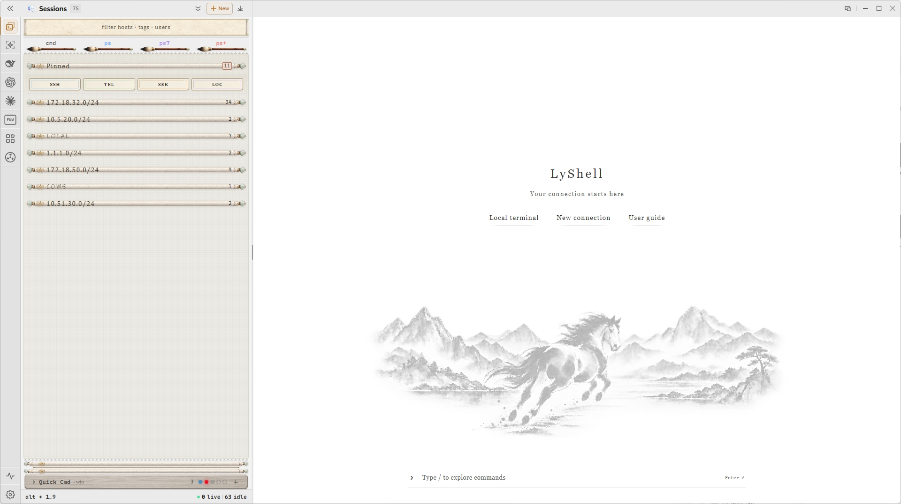
</p>

---

## 📥 Install

Download the installer or portable build from [Releases](https://github.com/liangyou09/lyshell/releases). The portable build runs without installation.

| Platform | Format | Architecture | Requirements |
|----------|--------|--------------|--------------|
| 🪟 Windows | Installer (`-setup.exe`) | x64 | Windows 10 / 11, 64-bit |
| 🪟 Windows | Portable (`-portable.exe`) | x64 | Windows 10 / 11, 64-bit |

> 🚧 Currently **Windows only** — macOS and Linux builds are not yet available.

### Open a terminal from File Explorer

Run the updated `-setup.exe` to register these entry points:

- Right-click a folder, drive, or folder background and choose **Open in LyShell** (under **Show more options** on Windows 11).
- Type `lyshell` in File Explorer's address bar to open a terminal in the current folder.
- To specify a folder, use `lyshell --open-directory "D:\My Project"`.

These terminals prefer PowerShell 7 (`pwsh.exe`) and fall back to Windows PowerShell. An existing LyShell window receives a new temporary terminal tab. PowerShell starts with `-NoProfile` to preserve the requested directory. Address-bar launches read the foreground Explorer window's active tab; other launches without arguments use the process startup working directory.

Portable builds do not register Explorer entries; launch the executable by its full path with `--open-directory`. Uninstalling removes the installed entries.

---

## ⌨️ Command Palette & Document Tabs

### Command palette

`Ctrl+Shift+P` opens a full-screen command palette — **one place to reach everything**. Fuzzy-search across saved and running sessions, agents, dsh / codex / claude workspaces, variable groups, plugins, web and settings tabs. Slash commands work here too:

- `/new` — new connection dialog · `/local` — instant local terminal
- `/help` — open the built-in user manual · `/ls` — open an inventory doc

ESC dismisses; the tab strip has a palette entry too.

### Document tabs & built-in docs

Read-only document preview as regular tabs — open several, split them, drag them. Four ways in: double-click in the file tree, drop a file onto the window, `Ctrl+Shift+O` for the system file dialog, or **Ctrl+click** a path right in the terminal. Markdown renders through the full doc pipeline — outline rail, zoom, theme — and links resolve across panes (including relative paths over SSH).

- **Built-in manual** — `/help` (or `/help chinese` / `/help english`) opens the user manual as a document tab.
- **Inventory docs** — `/ls` snapshots sessions / agents / variable groups / harness workspaces / plugins into a document tab; `lyshell-action://` links inside jump straight to each object, and `/ls <section>` (e.g. `/ls env`) scopes to one section. Re-run or hit the tab's refresh button to re-inventory.

<p align="center">
  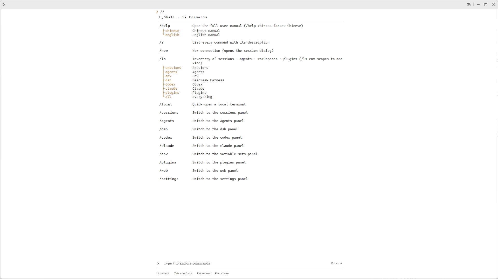
</p>

<p align="center">
  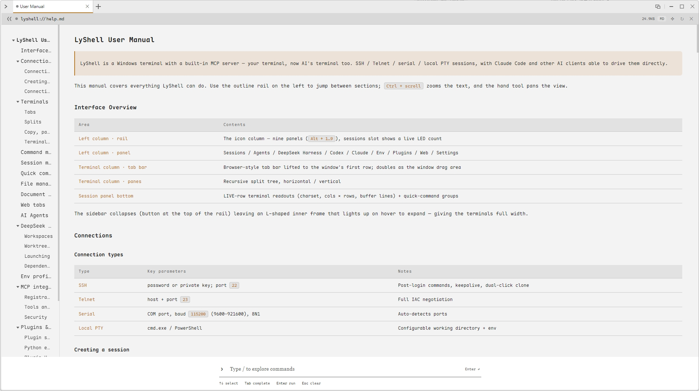
</p>

---

## 🔗 MCP Integration

**This is what makes LyShell different.** It serves as an MCP server, letting external AI clients like Claude Code control terminals via the MCP protocol — listing sessions, sending commands, reading output, transferring files, and managing connections.

> 📖 **Configuration** — see [MCP Configuration](docs/mcp-config.md). In most cases you don't configure anything by hand: launch an agent from the **Agent Launcher** and ask it to configure LyShell as its MCP server itself. Registration configs are emitted in **JSON / CLI / TOML** to fit different clients.

### Tools

Current tool names use the `lyshell_` prefix. The list available to each client depends on its granted capabilities.

| Tool | Capability | Description |
|------|-----------|-------------|
| `lyshell_list_sessions` | `read` | List sidebar sessions |
| `lyshell_send_input` | `interactiveWrite` | Send text, autoNewline support |
| `lyshell_send_and_wait` | `interactiveWrite` | Send and capture response, strips echo + ANSI |
| `lyshell_execute_command` | `execute` / `localExecute` | Run separately from the interactive terminal (SSH or local PTY; hidden from tool discovery) |
| `lyshell_run_on_sessions` | `execute` / `localExecute` | Broadcast command, max 50 sessions, concurrency 10 |
| `lyshell_read_output` | `read` | Read N lines of terminal output |
| `lyshell_terminal_screenshot` | `read` | Capture a visible, unobscured terminal viewport as PNG |
| `lyshell_upload_file` / `lyshell_download_file` | `fileWrite` | SFTP file transfer |
| `lyshell_read_file` / `lyshell_stat_file` / `lyshell_list_files` | `read` | Remote file inspection, recursive + glob |
| `lyshell_create_session` | `sessionControl` | Create/reuse saved session, auto-dedup by target |
| `lyshell_reconnect_session` | `sessionControl` | Reconnect dropped connection |
| `lyshell_close_session` | `sessionControl` | Disconnect without deleting the saved session |
| `lyshell_open_connection_dialog` | `sessionControl` | Open the new-connection dialog for user input |
| `lyshell_read_session_notes` | `read` | Read session summary, notes, tags |
| `lyshell_write_session_notes` | `sessionMetadataWrite` | Update summary, notes, tags |
| `lyshell_wait_for_prompt` | `read` | Wait for shell prompt or regex |
| `lyshell_tail_until` | `read` | Poll output until pattern matches |

### Security

- 🔑 **Per-session authorization** — each terminal gets its own scoped permission
- 🚪 **Capability gates** — enforced server-side on every endpoint
- 🛡️ **Destructive-command check** — scans for `rm -rf`, `dd if=`, fork bombs
- 🔒 **Shared PTY locking** — coordinate MCP writes and human input
- 📊 **Audit panel** — calendar + filter + pagination, accessible from the title bar

> Full-screen TUI apps (vim, htop, less) cannot be represented reliably by text output alone. Use `lyshell_terminal_screenshot` to inspect their visible layout and `lyshell_send_input` to send input. Screenshots require the target terminal to be visible and unobscured; the tool does not switch tabs or capture the desktop.

<p align="center">
  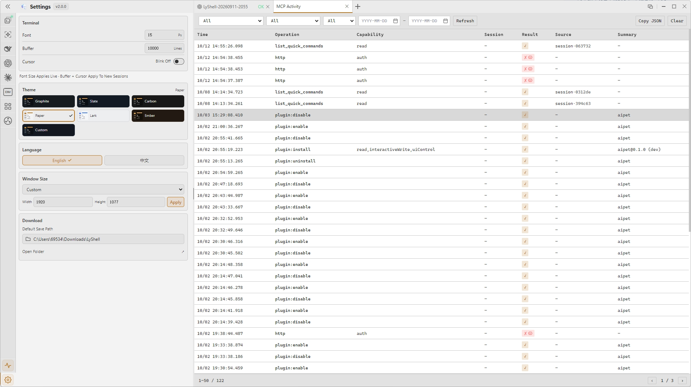
</p>

---

## 🤖 AI Agents

Agent-agnostic terminal — no lock-in to any AI tool. Launch any CLI agent and it runs in a regular terminal with full scrollback, split panes, and IME support.

| Agent | Command |
|-------|---------|
| 🧠 Claude Code | `claude` |
| 🛠️ OpenAI Codex | `codex` |
| 🤝 Aider | `aider` |
| 🔧 Custom CLI | Your configured command |

**Harness agents** — `dsh`, `codex` and `claude` each have a dedicated workspace panel with dependency detection, model and environment settings, launch permissions (Codex / Claude), and optional **worktree isolation**. See [AI Harness](#-ai-harness) for details.

**Custom agents**: Any CLI tool can be registered — name, command, icon, working directory, env vars. Sessions are transient: close the tab, it's gone.

<p align="center">
  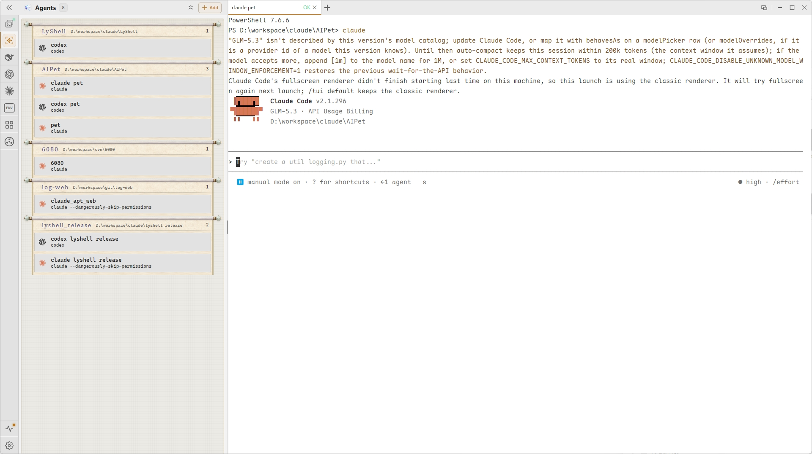
</p>

---

<a id="-deepseek-harness"></a>

## 🐋 AI Harness

Manage **DeepSeek Harness, OpenAI Codex and Claude Code** workspaces in dedicated panels. Each workspace stores its working directory, model and environment group; Codex and Claude also offer launch permission settings. All three launch in terminal tabs. DeepSeek Harness additionally supports an **embedded Web UI**, which can run alongside its TUI in split panes.

| | |
|---|---|
| 🗂️ **Workspace panel** — create, edit, delete | 🔧 **Variable groups** — structured Base URL + API Key, one global switch |
| 🎛️ **Model presets** — save & switch models per workspace | 🖥️ **Terminal launch** — `dsh-tui`, `codex` or `claude` in a native terminal tab |
| 🌳 **Worktree isolation** — dedicated git worktree per workspace | 🏷️ **Brand badge** — session tabs show which harness launched them |

### Launch permissions

Claude offers `default`, `acceptEdits`, `plan` and `bypassPermissions`; the last adds `--dangerously-skip-permissions`. Codex offers `:read-only`, `:workspace` and `:danger-full-access`, passed as `-c default_permissions=<tier>`; full access also adds `-c approval_policy=never`. Fully-open modes show a red warning in the form and on the workspace card, with the launch arguments visible before launch.

<p align="center">
  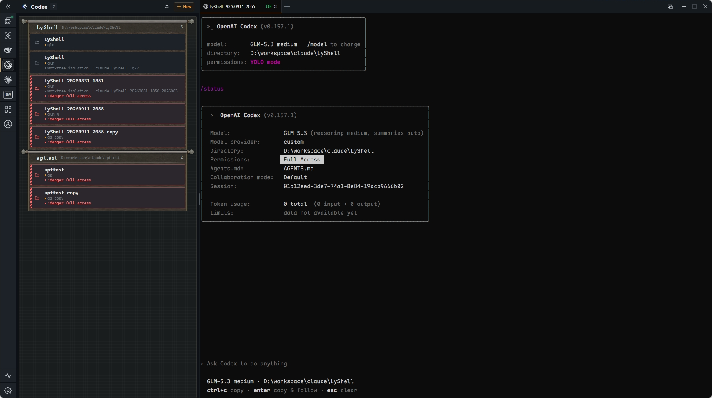
</p>

### Dependency detection & install

CLI dependencies — `dsh` + `dsh-tui` for DeepSeek Harness, `codex` / `claude` for the others — are detected by scanning PATH **once at app startup** (all three agents in parallel) and cached: opening a Harness tab reads the cached result instantly, no repeated scans. When something is missing, the panel shows which dependency is absent, its one-line install command, and the source-repo link — it never installs anything for you. A **Re-detect** button forces a fresh scan, and PATH is read live from the registry, so a freshly installed CLI is picked up without restarting LyShell.

### Shared environment groups

Variable groups live in the left-rail **Environment** panel, shared by dsh / codex / claude and the embedded dsh Web UI. At most one group is **live** at a time — the card itself is the switch: click it to power it on app-wide, click again to fall back to the system environment.

Credentials are structured as **Base URL + API Key** and injected per consumer (dsh → `DEEPSEEK_*`, codex → `OPENAI_*`, claude → `ANTHROPIC_*`); the rest of the group passes through as extra variables, and generic agents can bind a group explicitly (bound group → inline env → system environment). Each workspace picks a specific group or follows the enabled one — enter secrets once, switch environments without touching each workspace.

Secret-looking values (`*_KEY`, `*_TOKEN`, `*_SECRET`, `*_PASSWORD`, …) are **masked by default**, with an eye toggle to reveal them. Before launching Codex, LyShell also writes the selected group’s Base URL into the active provider in `config.toml` under `CODEX_HOME` (or the default `~/.codex/` directory). The original file is backed up once as `.bak`.

### Worktree isolation

Point multiple agents at the same repository without them stomping each other. Flip a workspace to **worktree** isolation and it launches inside a dedicated git worktree at `<repo>/.lyshell-worktrees/<key>` on branch `lyshell/<key>` — created on first launch, reused ever after, so **uncommitted changes survive restarts**. Deleting the workspace never deletes its worktree.

- **Private (default)** — a readable key is auto-generated (`claude-myapp-20260708-160745`, the trailing stamp is the creation time, second-precise); each workspace gets its own checkout.
- **Shared** — set the key explicitly, and every workspace that fills in the same key shares one checkout *and* one branch, even across dsh / codex / claude — they see each other's edits live.
- The form **previews the exact worktree path** before you save; invalid keys (path separators, ref-hostile characters) are rejected up front.

### Launch: TUI or Web UI

DeepSeek Harness workspaces open in two ways; Codex and Claude workspaces launch in terminal tabs:

- **Terminal TUI** — `dsh-tui` runs as a standard terminal tab with full scrollback, split panes, and IME support.
- **Embedded Web UI** — spawned as `dsh web --port 0`; LyShell parses the real port from stdout and renders the app in an in-app `<webview>` tab. No browser, no manual port juggling.

### TUI + Web UI, side by side

Drag the Web UI tab to a pane edge to split it into its own pane — the TUI and the embedded Web UI run **in the same frame, side by side**. Drag it back onto a pane's center to remount it as a regular tab.

### Web UI acts like a terminal tab

- **✕ close** — only ✕ tears the tab down and terminates the subprocess.
- **Switch away** — switching to another tab hides the Web UI but keeps the page state and the `dsh web` subprocess alive; switching back resumes instantly.

### Security

- 🔒 **Loopback-locked** — navigation and popups are pinned to the workspace's loopback origin.
- ✅ **Validated URL** — the echoed URL is checked (loopback + explicit port, no embedded credentials) *before* the `<webview>` ever loads it.

<p align="center">
  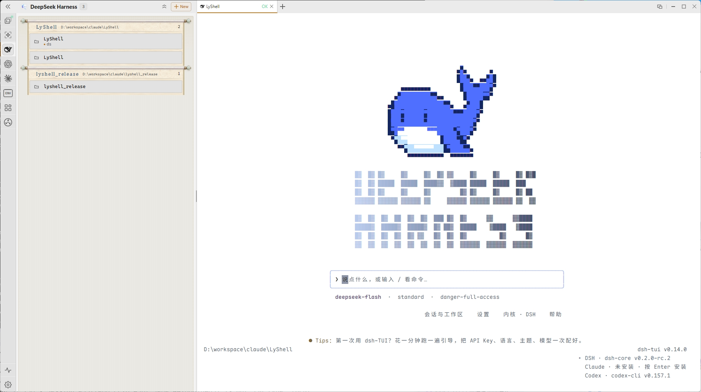
</p>

<p align="center">
  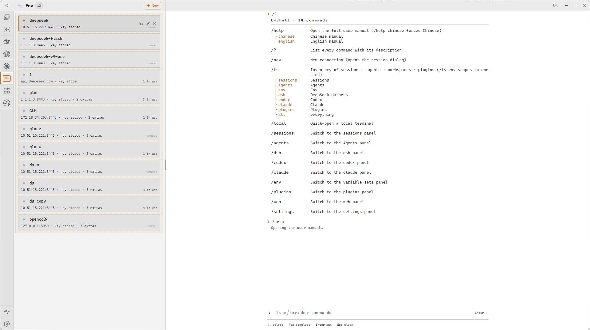
</p>

<p align="center">
  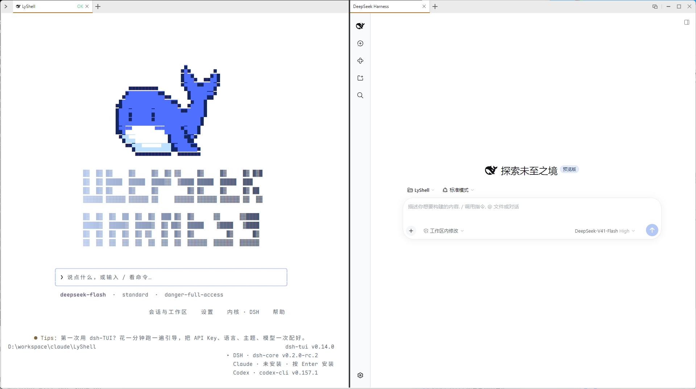
</p>

<p align="center">
  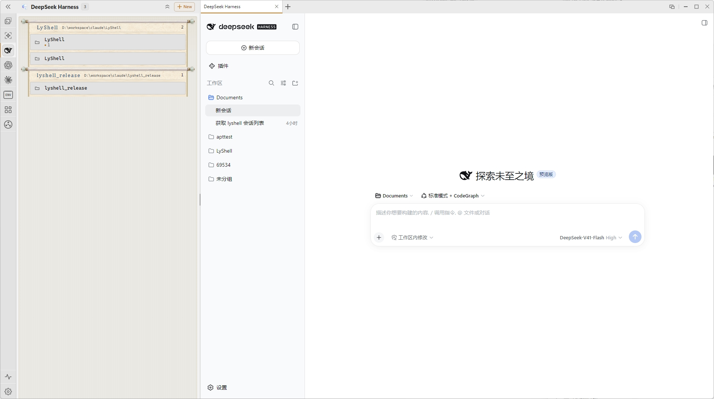
</p>

---

## 🌐 Web Tabs

The left-rail **Web** panel gives LyShell a light built-in browser for dashboards and docs. Type a URL (no scheme → `https://` is prepended), press Enter, and it opens as a regular tab in the active split pane — same drag-to-split and tab semantics as the embedded `dsh web` UI, so a dashboard can sit right next to the terminal that feeds it.

- **Open-tabs list** — click to jump to the hosting pane and activate the tab, ✕ to close.
- **Recent history** — successfully loaded URLs are remembered (30 most recent, deduplicated, persisted locally) and offered as native autocomplete in the input; click to reopen, ✕ to delete a single entry, or clear all.
- **Safety** — only `http`/`https` URLs pass validation; webview navigation and popups route through a dedicated partition in the main process.

---

## 🧩 Plugin System & Python Scripting

### Plugins

Permission-gated host for **Python** (one-shot / persistent) and **Node.js** (persistent) plugins. Install from local directory, ZIP, or remote URL. Each plugin runs with its own scoped authorization — granular permissions (read / write / execute / file / session control) with path safety, destructive-command confirmation, and shared-PTY locking.

Plugins can add **HTML sidebar views and interactive dialogs**, either declaratively or through runtime registration by persistent plugins. Views retain their state when switching panels and receive theme changes. With the required permissions, they can open terminals, web tabs and documents, call LyShell APIs, and return dialog results. Disabling or uninstalling a plugin releases its views, tabs, dialogs and controlled processes.

- [Declarative view example](examples/my-view-plugin/)
- [Runtime view example](examples/my-view-runtime-plugin/)

> Startup activation (`onStartup` / `*`) is supported. Activation through `onCommand` / `onConnectionType` events and declarative command contributions to the command palette are not yet connected.

**2.0 compatibility:** older plugins declaring only `engines.lyshell: "^1.0"` show a compatibility warning, which currently does not block installation. Plugins using the new view APIs should declare `"^2.0"`.

<p align="center">
  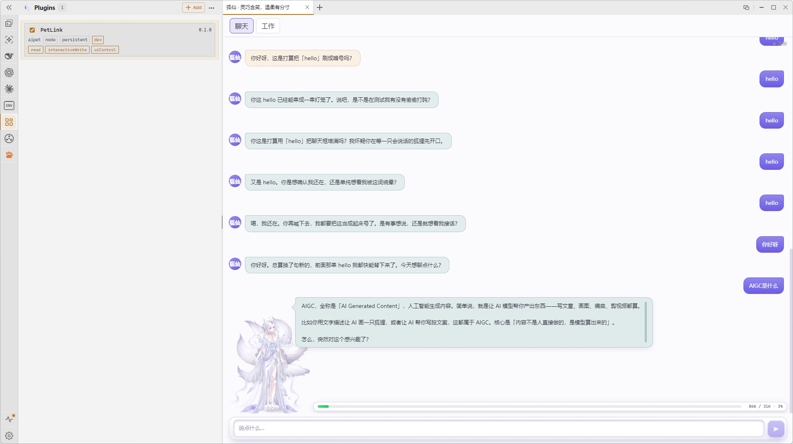
</p>

📦 Ready-to-run examples in [`examples/`](examples/).

### Python Engine

Embedded Python with `LyShell` API for terminal automation:

```python
session = LyShell.get_current_session()
LyShell.execute("ls -la")
LyShell.send("hello\n")
LyShell.wait_for("prompt$")
```

Environment variables: `LYSHELL_SESSION_ID` · `LYSHELL_SESSION_TYPE` · `LYSHELL_HOST` · `LYSHELL_PORT`.

Python path auto-detected from system PATH, configurable in settings.

> 💡 For long-running or scheduled tasks, consider **Node.js plugins** via the [Plugin System](#-plugin-system--python-scripting) — they're a better fit.

---

## 🚀 Quick Start

### Local terminal

Open the command palette with `Ctrl+Shift+P`, enter `/local`, and press Enter to start a local terminal. Enter `/help` to read the built-in manual.

### First Connection

1. Click **+** at the top of the session list → **SSH**
2. Fill in host, port, username, password/private key
3. Click **Connect** — tab turns 🟢 green

> 💡 For network devices needing `shell` → `enable`, add those in **Shell Enter Commands** — LyShell sends them sequentially.

### Multi-Server Monitoring
Click a session → `Ctrl+Shift+V` to split vertically → click another session. Layout auto-saves.

### File Transfer
- **Upload** — drag from desktop to File Panel
- **Download** — double-click remote file or right-click → Download
- **Progress** — real-time speed + ETA, auto MD5 on completion
- **History** — file, size, path, MD5 recorded; supports re-download
- **Security** — independent SSH connection (never blocks terminal), SFTP-only built-in transfers with explicit errors when SFTP is unavailable. Optional EXEC/Python/Base64 transfers are provided by the separately installed [legacy-transfer plugin](examples/legacy-transfer/README.md), with no automatic fallback in the file manager.
- **Download directory** — default `~/Downloads/LyShell/`, optional auto-create server subdirectory for archiving

### Quick Commands
Quick commands live at the bottom of the session panel — right-click → **Edit Group** → add commands like `tail -f /var/log/syslog`. `Ctrl+F1`–`F12` fires them from anywhere, even with the sidebar collapsed. Up to 12 commands × 5 groups.

### Session Management
- 📌 Pin — hover card → click 📌
- 📋 Clone session — double-click tab left half
- ⚡ Clone channel (no re-auth) — double-click tab right half (SSH only)
- 🔍 Search — type name/host/tag in search box

### Terminal Tips
- Select text → auto-copy · Right-click → paste · Middle-click → search bar
- `Ctrl+F` → draggable scroll-style search (regex, case-sensitive, whole-word, current or all tabs, with invalid-regex feedback)
- **Ctrl+click** in the terminal — URLs open in a web tab, paths open in document preview
- **Encoding** — click the encoding readout in the sidebar LIVE row to switch UTF-8 / GBK / GB2312 at runtime (kept across reconnects; close-and-reopen falls back to the saved value; local terminals stay UTF-8)
- Edge-style shrinking tab bar with hover detail cards sits on the first row; the sidebar collapses when you need full width
- In the sidebar LIVE row, click `cols × rows` → clear screen; click the buffer count → scroll to bottom, double-click → clear scrollback

<p align="center">
  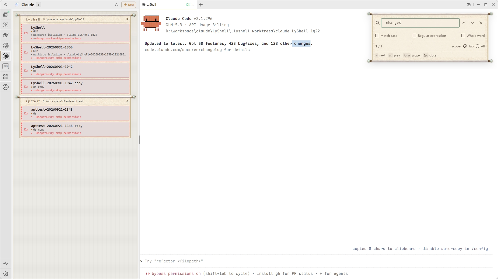
</p>

---

## 🔌 Connection Types & Terminal

| Type | Key params | Notes |
|------|-----------|-------|
| 🖥️ **SSH** | password or private key; port `22` | Post-login commands, keepalive; dual-click clone |
| 📟 **Telnet** | host + port `23` | Full IAC negotiation |
| 🔌 **Serial** | COM port, baud `115200` (9600–921600), 8N1 | Auto-detects ports |
| 💻 **Local PTY** | cmd.exe / PowerShell | Configurable working directory + env |

**Terminal**: GPU-accelerated rendering, full ANSI + 256 colors. Scrollback up to 100,000 lines. Split panes (horizontal/vertical), drag-to-split. Edge-style shrinking tab bar (hover detail cards) on the first row, collapsible sidebar. Runtime encoding switching from the sidebar (UTF-8 / GBK / GB2312). Global quick commands `Ctrl+F1–F12`. Tab status: 🟢 Connected · 🔴 Error · ⚪ Disconnected · 🔵 New output — plus a harness brand mark (🐋 dsh · 🛠️ codex · 🧠 claude) on tabs launched from a Harness workspace.

---

## 🎨 Themes

6 presets + custom. Instant switch, no restart.

| Theme | Style | Mode |
|-------|-------|------|
| **Graphite** | Deep graphite + tungsten amber (default) | Dark |
| **Slate** | Blue-tinted slate, amber accent | Dark |
| **Carbon** | Neutral charcoal, no blue cast | Dark |
| **Ember** | Warm walnut brown + warm amber | Dark |
| **Paper** | Natural warm paper, graphite ink | Light |
| **Lark** | Feishu-style light: cool-gray chrome + white canvas + brand blue | Light |

**Custom**: pick a background and accent color, LyShell auto-builds a complete harmonious theme.

**Scroll materials**: choose walnut, jade, lacquer or porcelain in settings. Materials are saved independently of the color theme and apply to scroll rods and terminal search. Light themes also adjust terminal ANSI colors and compensate for low-contrast colored output.

<p align="center">
  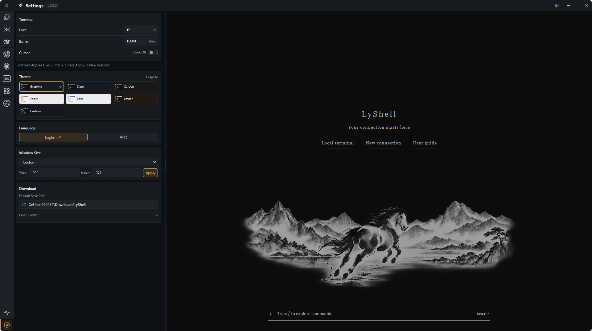
</p>

---

## ⌨️ Keyboard Shortcuts

| Shortcut | Action |
|----------|--------|
| `Ctrl + Shift + P` | Command palette |
| `Ctrl + F` | Terminal search |
| `Ctrl + Shift + O` | Open document (system file dialog) |
| `Ctrl + F1` ~ `F12` | Quick command 1–12 |
| `Ctrl + Shift + H` | Horizontal split |
| `Ctrl + Shift + V` | Vertical split |
| Right-click | Paste |
| Middle-click | Search bar |

---

## ⚙️ Configuration

Installed and portable builds store user data in `%APPDATA%\lyshell\`:

| Location | Contents |
|----------|----------|
| `config/` | `sessions.json`, `preferences.json`, `quickCommands.json`, `agents.json`, `env-profiles.json`, `dsh-workspaces.json`, `codex-workspaces.json`, `claude-workspaces.json`, `mcp-audit-settings.json` |
| `data/` | `download-history.json`, `download-config.json` |
| User-data root | `mcp-server.json` (runtime connection information) |

Development instances use a separate `%APPDATA%\lyshell-dev\` directory.

Windows application logs are saved to `logs/main.log` in the installation directory. Portable builds use the directory containing the original portable EXE, and unpacked builds use the directory containing `LyShell.exe`. If that location is not writable, logging falls back to the default user-data log directory. Development and non-Windows builds retain their default log location. Existing `main.log` files are not moved.

MCP Activity records are saved alongside application logs as `mcp-audit.json`. When no file exists in the log directory, records from the old user-data location are migrated automatically; the old file is removed only after the new file is successfully saved.

The bottom pager of the MCP Activity panel has a **Keep records** dropdown with four options: 1,000 / 5,000 / 10,000 / 20,000 (default 5,000). A selection is saved immediately to `config/mcp-audit-settings.json` in the user-data directory. The new limit applies at once: lowering it deletes the oldest records so that only the newest N remain, and newly added records are trimmed to the same limit. If saving fails, both the limit and the existing records stay unchanged.

AES-256-CBC encrypted export/import for sessions and quick commands.

---

## ❓ FAQ

<details>
<summary><b>SSH garbled Chinese characters?</b></summary>
Click the encoding readout in the sidebar LIVE row and switch UTF-8 / GBK / GB2312 at runtime — no need to edit the session.
</details>

<details>
<summary><b>Serial port no output?</b></summary>
Verify port + baud rate → check no other program uses it → some devices need Enter to activate.
</details>

<details>
<summary><b>File manager not showing?</b></summary>
SSH sessions only. Ensure the active tab is an SSH connection.
</details>

<details>
<summary><b>How to reset saved configuration?</b></summary>
Exit LyShell, back up `%APPDATA%\lyshell\`, then rename its `config` folder and restart. This resets saved sessions, preferences, agents and workspaces. To reset download history and download settings too, rename `data` as well. Theme and web-page state are stored separately and are not reset by these steps.
</details>

<details>
<summary><b>Where are downloaded files?</b></summary>
Default `~/Downloads/LyShell/`. Change in settings.
</details>

---

## 📄 License

LyShell is open-source software released under the [MIT License](LICENSE). You are free to use, modify, and redistribute it, provided the original copyright and license notices are preserved.

© 2026 liangyou

---

<p align="center">
  <a href="https://github.com/liangyou09/lyshell">GitHub</a> ·
  <a href="https://github.com/liangyou09/lyshell/issues">Issues</a> ·
  <a href="https://github.com/liangyou09/lyshell/releases">Releases</a> ·
  <a href="CHANGELOG.md">Changelog</a> ·
  <a href="CONTRIBUTING.md">Contributing</a>
</p>
