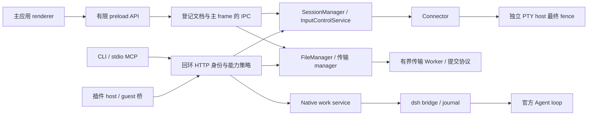

# LyShell 最终架构设计独立评审

## 2026-10-30 全部未提交改动的独立复审、F05–F08 修复与交付验收（最新记录）

**Codex 已独立复审本工作树相对基础 HEAD 的全部未提交改动及非忽略新文件；新确认的 F05–F08 已修复并逐项复审。** 本阶段覆盖既有架构改动、先前 F01–F04 修复及新增回归，没有只检查本轮四项补丁。下方所有先前评审、失败和验收结论原样保留，按各自阶段理解。

### 对象、冻结与责任

唯一工作区为 `C:/Users/69534/.codex/worktrees/architecture-optimization/LyShell`，分支 `codex/architecture-optimization`，基础 HEAD `32d6e2c611aa614d9ad3320fa68581115d809e91`。开始时逐项重算上一阶段 `fix-f01-f04-final-snapshot.json` 的 1355 个路径的真实字节及 SHA-256，全部匹配，聚合为 `0c49a6ef673c7d158f696134079aa3b5f2d7553bc6cd25d9ffdeaf5c183d95d2`；没有用 D: 登记目录替代源码。

人工评审范围包括 main/preload/renderer/shared 的权限和身份、控制租约与 PTY fence、输出预算和消费者回执、SSH 主机密钥信任、命令和传输派发、SFTP 提交、JSON 原子持久化与秘密迁移、导入导出、Harness 状态及恢复、子进程环境、诊断、构建入口、全部改动测试与架构文档。逐项哈希覆盖完整文件集合，人工判断围绕所有待提交差异和真实调用闭环；不宣称逐行阅读全部未改动文件或证明全产品无缺陷。代码评审、问题判断、交付检查和最终验收全部由 Codex 本人承担，没有委派任何代码评审。

本阶段相对上一清单修改 11 个既有路径（另更新本报告），新增两个回归文件，无删除：`CLAUDE.md`、`docs/architecture-implementation.md`、`transfer-commit.ts` 及其 SFTP 测试、`ipc/handlers.ts`、`mcp/http-server.ts` 及 terminal-control-authorization 测试、四个秘密存储实现文件；新增 `ipc/session-export.secrets.test.ts`、`storage/secret-ref-precedence.test.ts`。文档同时纠正实际七个 main/七个 preload 构建入口、持久化事实及恢复 helper 名称。

源文件停止修改后，冻结集合为 1356 项（排除本报告），排序条目的 `SHA256(JSON.stringify(files))` 为 `7d21a5514b95ae95a886442cfa3f91244280e698c9862bc55b9bb77df1a3a163`，见 `tmp/architecture/independent-final-snapshot.json`。相对基础 HEAD 待交付集合为 100 个已跟踪修改及 69 个非忽略新文件。最终检查后再次逐项核对冻结清单一致；本报告是验证期间唯一允许补写的交付文件。

### 确认的问题、实现与本人复审

| 问题 | 根因与最终行为 | 实际回归证据 |
| --- | --- | --- |
| F05 / P1：终端接管在异步清理/安装 fence 后沿用旧确认 | 原 handler 确认后等待 invalidate/acquire，期间连接、Session、Connector、类型或权限变化，可能返回未经确认的新上下文租约。现在确认前固定原 Session、Connector、类型及 connectionInstanceId；两次等待后重新检查原对象、当前授权与租约代际；失败仅尝试撤销本次取得的租约，清理失败仍拒绝返回句柄 | 真实 handler AST + 实际 InputControlService；clear/install 两阶段覆盖目标、同对象字段、凭据、资源变化，另测清理失败及正常成功。首轮 red 8 失败/7 通过，探针实际得到可用新连接句柄；Codex 复审发现首版未固定类型等字段，再用 red 6 失败/15 通过证实并修正；最终 21/21、相关 61、MCP 269、terminal 267 全过 |
| F06 / P1：同键 plaintext 与 secretRef 并存时未清理旧明文 | 检测跳过已有 ref 的键，且三类仓储检测未传实际 refs，custom key 不被视为秘密。现在已有 refs 也参与秘密分类及迁移；合法 ref 优先，验证可解析后删除多余明文；解析失败不回落明文并拒绝持久化其他记录 | 四类真实仓储 + 实际 vault：red 9 失败/1 通过，green 10/10、storage 280。Codex 发现两条 unavailable 夹具实际落入 not_found，要求先写真实 vault 条目再用不可用 cipher 打开同一文件，并断言 reason=unavailable；修正后 10/10、280 全过，未以错分支冒充覆盖 |
| F07 / P2：下载忽略远端读取句柄的真实 mtime | 初次 fstat 的 mtime 被路径 stat 覆盖，传输结束只验路径；同大小替换并还原路径可提交错误源版本。现在保留初次 fstat 真实元数据，与路径快照比对，并在提交前再次 fstat 同一读取句柄，发现变化即拒绝并清理本 attempt 临时文件 | 实际 commitDownload + 可控 SFTP/真实本地句柄：两个 red 均错误完成，修复后两个拒绝且旧目标不变/临时文件清理；transfer 40/40、文件相关 216 通过/3 跳过 |
| F08 / P1：加密导出泄漏仅由 ref 标记的自定义环境变量 | hydration 移除 refs，encryptSession 只按名字和显式 secretEnvKeys 加密，custom key 可能明文写入 encrypted=true 文件并在导入预览泄漏。现在从 main 持有的 previous 记录合并 refs/显式键分类，在加密前写入导出 secretEnvKeys，导出仍不携带 vault refs；不信任传入的外部 refs | 真实导出/导入 handler + AES-GCM + hydration/staging；saved/runtime、标准秘密、SSH、普通值、非法/缺失 ref、明文剔除、文件无真实值/placeholder/refs及 roundtrip。实际 red 是 3 失败/3 通过（原实施简报该处笔误不采信）；green 6/6，相关 249/249 |

F05 初版和 F06 初版夹具均由 Codex 检查实际交付后退回同一原会话修正，并非凭报告接受。F07 实施报告第 5 节所称远端 dev/ino 证据不成立：当前 `snapshotFromSftp` 只投影 type/size/mtime/mode，没有读取远端 dev/ino；dev/ino 只适用于本地快照。SFTP 同 size、mtime 等元数据的替换仍可能无法发现，也不具备内容 hash/CAS 保证；以此处本人源码核对为准。

### 最终稳定快照验证

| 检查 | 结果 | tmp/architecture 证据 |
| --- | --- | --- |
| 完整 Vitest，minWorkers=1/maxWorkers=2/testTimeout=15000 | exit 0；398 文件通过/1 跳过，5129 项通过/8 跳过，0 失败；207.89 秒 | `independent-final-vitest.stdout.log`、`.stderr.log`、`.exitcode.txt`、`.timing.txt`、报告 |
| 完整 typecheck | exit 0，两份 TypeScript 配置均通过 | `independent-final-typecheck.log` |
| 当前源完整 build | exit 0 | `independent-final-build.log` |
| 全部 154 个改动/新增 src 文件 ESLint | exit 0，0 错误、126 警告；未把警告清零作为验收事实 | `independent-final-eslint.log`、`-result.json` |
| 当前 dist 的 Electron 隔离集成 | exit 0、fresh=true、9/9；真实秘密 DTO、masked update、vault、child env、PTY/fence、未登记窗口拒绝；3.654 秒 | `independent-final-electron-result.json`、`.log` |
| 冻结复核、git diff --check | 集合与真实字节一致、exit 0；仅既有 CRLF 规范化提示 | 冻结清单及 Codex 直接检查 |

本阶段原始失败均保留：F05 cold MCP 首轮 confirmation-window 的动态 import 5 秒超时（随后隔离与完整 MCP 通过但未证明根因）；F06 初版 typecheck 的两个 unused helper 错误（删除未用 helper 后通过）；F07 首轮 Windows 测试夹具 EPERM/超时（修正仅测试自有临时文件恢复方法后取得真实 red）；F08 red 的真实泄漏。F07 在其他源码仍并行修改时额外执行的全量通过只是中间证据，本次稳定快照验收采用上表最后一次完整测试。上一阶段 worktree Git 子进程 10 秒 ETIMEDOUT 原因仍未确定，先前隔离/全量复验成功不抹去该失败。没有放宽源码断言、增加 skip 或隐藏失败日志。

### Native 委派及终态

使用原生 HTTP work API，backend 始终为 `96aa4f27-20e6-40c8-b908-7bcc0c6893a5` / epoch `1793277312883`。独立责任边界明确，只有实施/测试委派，评审由 Codex 完成。每个任务核对同 backend/session/task/attempt 的官方 completed 和实际交付，未在不确定状态换通道重发。

| 任务 | sessionId | taskId / attemptId |
| --- | --- | --- |
| F05 实施 | `session-ef8d6c95-e3b3-4753-a065-63e8325e8bf0` | `f3d8d1bc-fb22-45ed-b5b1-ffe6c2c860c1` / `fdbce334-167e-466b-8d13-5464bf836375` |
| F05 原会话修正 | 同上 | `2d912cdb-432a-4c4a-a2d9-67da24f00e30` / `2c31247c-56e5-43e9-919d-761a5701ec23` |
| F06 实施 | `session-48b64f36-4910-4ce9-99ef-c70f08702ff5` | `2e878af5-a6aa-45dd-b977-2ebf9e1bcf46` / `0ba1fd3c-d103-40a9-afea-7e044720786d` |
| F06 原会话夹具修正 | 同上 | `07c79596-62b9-4a7f-91da-438fe9dbbb4b` / `4dc69db3-9402-40cc-92b7-097de8277ac4` |
| F07 实施 | `session-d3421a88-37df-4410-bc2a-22d2d96e9180` | `62190909-bc8f-451c-9860-883b058a60d0` / `f29de4e5-1975-42f6-8ac3-4b5172f89433` |
| F08 实施 | `session-6ba771e7-05c6-4a83-8a47-89d3100a944a` | `705a0fef-31fc-48ee-9974-03846b6d7777` / `181420f3-fcff-40af-96ce-d4e799c07e77` |
| 最终完整测试 | `session-6f037e1b-7c3c-43be-92f0-9415fb75c23c` | `f3b74e6d-ce40-4fc6-90f5-781273bb0e5f` / `9712b68c-d273-410b-822f-e1303e0f0934` |

最终全量任务官方 completed，实际退出码 0；所有 owned activeTaskIds 和 approvals 均为空后执行 disconnect 并核对成功回执。任务终态与 disconnect 原始回执保存在 `tmp/architecture/independent-native-*.json`。没有批准 pending 操作、换通道重发或改动共享 backend。

### 交付范围和保留限制

本轮代码验收通过，无已确认而未修复的可操作问题；架构方向接受。提交交付包含此前完整架构实现及本轮四项修复、回归和文档。交付使用当前分支的正常提交及对 `origin` 同名分支的正常推送，不 rebase/amend/reset/force，不合并或发布。

没有重建 app.asar/安装器，旧 package-real 验收不能代表当前 dist；正式发布仍需 Windows 安装/升级和已安装 lyshell.exe、macOS/Linux、物理串口、真实远端大文件/断网及长时混合负载验证。JSON/vault 跨文件非整体事务、SFTP 元数据非内容验证、ANSI 历史非完整屏幕、Node/Python 属 OS 用户信任域等既有界限保留。共享 node_modules junction 未安装、未 rebuild；失败 package 目录未删除；未改共享 backend 权限/模式、未自动批准操作。

---

## 2026-10-30 F01–F04 修复验收（最新记录）

**F01–F04 已修复并经 Codex 本人复审，修复代码验收通过。** 针对性组合 64 项、最终全量 5095 项及当前源构建 Electron 9/9 均通过。下方原独立评审中的“需修改”结论及 F01–F04 缺陷描述保留为历史发现，不代表修复后仍存在相同行为。架构选型接受；正式发布验收继续单独保留。

### 对象、范围与原改动保留

本阶段仍只使用 `C:/Users/69534/.codex/worktrees/architecture-optimization/LyShell`，分支 `codex/architecture-optimization`，HEAD `32d6e2c611aa614d9ad3320fa68581115d809e91`。修复前的 1352 项冻结核对结果和本报告先存正文均保留；原清单文件没有改写。没有使用 D: 登记目录的源码代替评审版本。

相对原冻结清单，本轮修改了以下 5 个已有路径，新增 2 个测试文件，并更新本报告；其他冻结文件的真实字节均未改变，没有删除文件：

- `src/main/mcp/http-server.ts`
- `src/main/file/ssh-command-executor.ts`
- `src/main/file/ssh-command-shell.ts`
- `src/main/storage/atomic-json.ts`
- `src/main/storage/atomic-json.test.ts`
- 新增 `src/main/mcp/command-dispatch-authorization.test.ts`
- 新增 `src/main/file/ssh-command-authorization.test.ts`

2026-10-30 09:15:38（Asia/Shanghai）登记的验证集合为原 1352 项加 2 个新测试文件，共 1354 项，不包含本报告；排序条目的 `SHA256(JSON.stringify(files))` 为 `6d27ccb05b434b777b8bb46c2b4e7dd56a09d358e7d32af1b1e3be3b7336aab9`。首轮全量之后再次核对一致，复验期间没有修改源码或测试。最终文件清单和验收记录见 `tmp/architecture/fix-f01-f04-final-snapshot.json`。

### 修复与 Codex 复审结论

| 问题 | 最终实现与真实调用链 | 验收判断 |
| --- | --- | --- |
| F01 / P1 | [commandDispatchGuard](C:/Users/69534/.codex/worktrees/architecture-optimization/LyShell/src/main/mcp/http-server.ts:1092) 在确认前固定 Session、Connector、connectionInstanceId 和连接类型，检查当前凭据、能力、资源范围及 CONNECTED 状态。单条/流式/批量将 main 构造的同步断言传到 executor/shell；批量在破坏性确认之前固定原目标。executor 在 getClient 前及其 await 后、实际 client.exec 前断言；shell 在握手前后、迟到 channel-open 回调、每条初始化命令及排队命令 write 前断言 | 已修复。覆盖 connector 等待中的撤权/能力关闭/MCP 关闭/外部访问关闭/资源拒绝/Session、Connector、连接实例和类型替换/断开，以及 getClient、channel-open、缓存 shell 排队和确认后换代。拒绝后没有备用执行路径或自动重放 |
| F02 / P2 | [批量 SSH](C:/Users/69534/.codex/worktrees/architecture-optimization/LyShell/src/main/mcp/http-server.ts:3238) 使用 execStream 的结构化 output/exitCode，不再以 execRaw 字符串构造固定 0；单条、流式及批量共享实际 executor/shell 结果 | 已修复。真实 executor 夹具的 0/7/无 exit 分别返回 0/7/-1，持久 shell 与 LOCAL 的 0/7 同样保留；HTTP success 表示接口完成，不代替命令成功 |
| F03 / P2 | [dryRun](C:/Users/69534/.codex/worktrees/architecture-optimization/LyShell/src/main/mcp/http-server.ts:3175) 先执行 read 与资源可见性授权，等全部异步授权结束后再同步复核当前凭据、权限及对象，最后投影元信息；不可见/不存在目标均仅返回相同的不可用结果。wouldExecute 还检查相应执行能力；保存 ID 与执行入口统一解析 | 已修复。无 capability 插件、其他 LOCAL 的 session token、黑名单、外部关闭、read 关闭、无目标、凭据撤销均不返回目标详情；多目标等待期间撤权也会过滤早期结果。预览不建立 connector、不执行命令、不触发执行确认 |
| F04 / P2 | [恢复前提](C:/Users/69534/.codex/worktrees/architecture-optimization/LyShell/src/main/storage/atomic-json.ts:333) 要求 preserveCorruptFile 成功，否则立即 failed；显式恢复 helper 返回 false，不再用备份覆盖 primary | 已修复。EACCES、ENOSPC、100 次排他命名冲突耗尽均保留原始字节及备份；无效备份、rename 失败及正常恢复均有回归。默认损坏只读行为保留，没有新增强制恢复入口 |

F01 的实际执行边界见 [executor](C:/Users/69534/.codex/worktrees/architecture-optimization/LyShell/src/main/file/ssh-command-executor.ts:46) 和 [shell](C:/Users/69534/.codex/worktrees/architecture-optimization/LyShell/src/main/file/ssh-command-shell.ts:87)。断言是 main 的函数闭包，不接受请求体自报授权；它阻止尚未派发的操作，不能撤回已派发的 exec 或远端副作用。若 shell 初始化至少已有一次 write 派发后撤权，停止后续写入并返回 OUTCOME_UNKNOWN / reconcile-first，要求先核对副作用。交互 PTY 的租约与最终 fence 保持原机制。

Codex 逐项阅读了本轮所有实现和测试修改，包括 native 交付的 F04；没有委派代码复审。复审过程中额外复现并关闭了两种交错：批量确认后才取得目标快照、多目标预览在各行异步等待后直接复用早期元信息。最终分别改为确认前固定目标、所有等待结束后同步过滤；没有通过改断言或跳过测试掩盖问题。

### 针对性回归与已有保证

本轮新增 33 项测试：SSH 最终授权 7 项、HTTP 执行/预览 19 项、恢复保全 7 项。HTTP 测试提取当前真实 handler/授权函数并连接实际 SSHCommandExecutor / SSHCommandShell，以受控依赖驱动交错及退出事件；底层测试直接调用实际类。它们验证明确的本地执行边界，没有冒充真实远端 SSH 验收。

| 检查 | 结果 | 当前阶段证据 |
| --- | --- | --- |
| F01–F03 修复前行为回归 | exit 1；21 失败、3 通过；包括过期授权仍 exec、批量 exit 7/未知被报 0、dryRun 泄漏 | `fix-f01-f03-red.log` |
| Codex 二次复审的两项交错 | 修复前 exit 1，2 失败、17 通过；收口后通过 | `fix-f01-f03-review-red.log` |
| F04 修复前/后 | red exit 1：3 失败、20 通过；green exit 0：23 通过 | `fix-f04-red.log`、`fix-f04-green.log` |
| 最终针对性组合及原 SSH 生命周期 | exit 0；4 文件、64 项通过 | `fix-f01-f04-targeted.log` |
| F04 相关仓储回归 | exit 0；16 文件、270 项通过 | `fix-f04-storage-suite.log` |
| 最终完整 typecheck / build | 均 exit 0，使用当前现有依赖 | `fix-f01-f04-typecheck-final.log`、`fix-f01-f04-build-final.log` |
| 本轮 7 个 src 文件 ESLint | exit 0，0 错误、38 个原有 http-server no-explicit-any 警告；其他本轮文件无警告 | `fix-f01-f04-eslint-final.log` |
| 当前源构建 Electron 隔离检查 | exit 0，fresh=true，9/9，7.570 秒；真实 preload/IPC、秘密 DTO/vault、PTY/fence、未登记窗口拒绝 | `review-electron-fix-f01-f04-result.json`、`fix-f01-f04-electron.log` |
| git diff --check | exit 0，仅既有 CRLF 规范化提示 | Codex 直接执行；交付时再次核对 |
| 全量首轮（4 workers） | exit 1；395 文件通过、1 失败、1 跳过；5094 项通过、1 失败、8 跳过；176.10 秒 | `fix-f01-f04-full-tests.log`、`fix-f01-f04-full-tests.exit` |
| worktree 失败项隔离复验（1 worker） | exit 0；1 文件、24 项通过，17.86 秒；没有修改断言或超时 | `fix-f01-f04-worktree-rerun.log`、`.exit` |
| 最终全量复验（2 workers） | exit 0；396 文件通过、1 跳过；5095 项通过、8 跳过，5103 总数；201.54 秒，无失败/Unhandled Errors | `fix-f01-f04-full-tests-rerun.log`、`.exit`、`fix-f01-f04-rerun-report.md` |

以上文件位于本 worktree 的 `tmp/architecture/`。首轮全量唯一失败是未修改的 `harness/worktree.test.ts:121`：测试脚手架 `execFileSync git branch --list` 在 10 秒限制处抛 ETIMEDOUT；序列化记录同时有 status 0 和符合期望的分支输出。源码未因该失败而改动，也未放宽进程超时或断言。该次失败完整保留；后续成功不能证明这次超时的底层根因已解决。

### 委派归属、验收边界

native 通道在提交前已检查权威状态；backend 始终为 `96aa4f27-20e6-40c8-b908-7bcc0c6893a5` / epoch `1793277312883`。F04 使用 fresh session `session-aa3ab432-17d1-4588-8307-85d1dabb2c9b`，task `d213c99e-690a-4a08-ae02-e3f134da76e6`，attempt `d3b9d77d-4842-401d-ba70-b45784210bb7`，已核对官方 completed 与实际交付后 disconnect。只委派其实施与测试执行，评审由 Codex 完成。

全量执行使用 fresh session `session-ebe5fdb1-1314-4888-8630-a1d8ae82ba4f`；首轮 task `3fa58e4e-94d5-4c93-b9f9-4b8105eea58e` / attempt `8ec8ae87-eca4-43df-996e-5ba2370810fa` 已 completed，表示测试执行及报告完成，不表示测试通过。确认其终态后，在同 session 显式提交复验 task `09431fe3-1c3d-4cce-9611-f599c3395501` / attempt `0e79d150-3fad-44f4-b072-a49ef8800a9d`；已核对同一 backend/session/task/attempt 的官方 completed、真实退出码 0 及完整日志，再执行 disconnect，回执 activeTaskIds/approvals 均为空。身份、终态与收尾证据为 `fix-f04-native-task.json`、`fix-f01-f04-native-first-full-{task,state}.json`、`fix-f01-f04-native-rerun-{task,state}.json`、`fix-f01-f04-native-disconnect.json`。没有在原执行未知时换通道重发，没有批准 pending 操作，没有改变权限/模式或重启共享 backend。

本轮没有重建候选 app.asar；旧 package-real 的 87 文件匹配、30 依赖加载和候选集成属于修复前历史证据，不能作为本次新 dist 的候选包验收。正式发布前仍需重新打包并验收安装器/升级、已安装 lyshell.exe、macOS/Linux、真实串口、远端大文件/断网及长时混合负载。

原报告列出的 JSON/vault 跨文件非整体事务、SFTP 元数据非哈希/CAS、ANSI 历史非完整屏幕、Node/Python 属 OS 用户信任域及后续性能/诊断建议继续有效。本轮没有扩大为架构重写，也没有提交、推送、合并、安装或发布。共享 node_modules 未安装、未 rebuild，失败 package 目录保持原样。

最终接受判断：F01–F04 没有遗留已确认未修复项；Codex 对本轮全部修改的最终复审未发现新的可操作缺陷，代码修复验收通过。首轮 Git 进程超时的根因仍未确定，后续通过不抹去该限制；平台及候选包发布验收仍按上文保留。

---

## 2026-10-30 本会话独立复核与交付结论

**架构方向接受；冻结实现需修改后再验收。** Codex 本人重新沿真实执行链审阅，确认下文 F01–F04 仍成立：1 项 P1、3 项 P2。F01–F03 影响已开放入口，应在代码验收前修复；F04 影响尚未接入产品入口的显式恢复 helper，修复前应保持未暴露。当前证据支持保留进程布局、JSON 仓储和保守恢复策略，没有要求整体架构重写。

### 本会话的对象与冻结核对

唯一评审目录为 `C:/Users/69534/.codex/worktrees/architecture-optimization/LyShell`；所有目录相关命令明确使用该绝对 workdir。分支 `codex/architecture-optimization`，HEAD `32d6e2c611aa614d9ad3320fa68581115d809e91`，均匹配。登记目录 D: 没有作为源码替代版本。

| 冻结项目 | 本会话结果 |
| --- | --- |
| 清单自身 SHA-256 | `2ec0ccd6fe6da47433d31bc9f7448c5e07e466f1e5eaad830a9fd233b8dfacb5`，匹配 |
| 冻结内容 | 1352 项，逐项读取真实字节，大小和 SHA-256 全部匹配，无缺失 |
| 聚合算法 | `SHA256(JSON.stringify(files))`，使用清单已排序条目 |
| 聚合 digest | `ccd6996c6285b123b6054fd6ba38ad40fce63fbdc8be789faaa1ff16f1b6ceca`，匹配 |
| 实际 Git 文件集合 | `git ls-files --cached --others --exclude-standard -z` 去重排序后 1353 项；唯一额外项是进入本会话时已存在的本报告 |
| 既存报告 | 读取时 mtime 为 2026-10-30 00:06:38（Asia/Shanghai），SHA-256 为 `daa27b108e430e9760a0a5a8152c483e3ab7ca4352d96a064f31e9521bb45e77`。时间戳不能证明作者身份 |
| 写报告前复核 | 2026-10-30 08:50:31（Asia/Shanghai），1352 项仍全部匹配，分支和 HEAD 未变 |
| 依赖 Junction | node_modules 实际指向 `D:/workspace/claude/LyShell/node_modules`，没有安装或 rebuild |

评审对象确定为原冻结源码及文档；额外报告作为先存线索核实。未发现冻结源码并发变化。为保留已有 untracked 内容，本节加入原报告前，原正文完整保留。下方既存正文中的“本次”“本阶段”及 Harness task 身份仅指其原先记载的执行，**本会话不认领这些历史执行记录**。

已读取本 worktree 的 AGENTS.md、CLAUDE.md、架构优化方案、实施记录、循环复审记录、native Harness 合约及 MCP 配置。评审与最终判断全部由 Codex 本人完成，没有委派任何评审。直接源码和匹配的既存隔离证据足以确认本次问题，无需额外测试执行，因此没有建立 Harness/PetLink 会话、请求审批或操作共享 backend。逐项哈希覆盖完整集合；人工实质审阅聚焦以下执行闭环，未宣称逐行阅读全部 1352 个文件或证明全产品无缺陷。

初始受限 PowerShell/Git 入口发生文件系统初始化/目录访问失败，随后通过自动审批允许的只读 Git 命令及绝对路径字节读取取得结果。未调整权限设置或模式；该工具访问限制不计为产品缺陷。

### 本人重新核对的架构保证与边界

| 主题 | 实际源码位置与调用链 | 判断 |
| --- | --- | --- |
| 职责、依赖与身份 | application-caller.ts:14,57 → application-ipc.ts:9 → SessionManager/文件服务；HTTP :457,607,2751；operation-policy.ts:5 | main 持有真实资源和安全裁决；renderer 是展示投影，preload 为有限接口。GUI 身份来自登记对象、当前文档与主 frame；session/global/plugin 授权来源有意不同。大型 handler 仍承担业务编排，F01/F03 说明公共授权尚未覆盖完整闭环 |
| 连接代际与输入 | session-manager.ts:498,564,811；input-control.ts:202,343,370 | Session/Connector 对象、连接 UUID 和控制 epoch 分别检查。输入单会话排队、全局限额、逐块复核；部分确认后失败返回 OUTCOME_UNKNOWN，不允许重放 |
| 最终 fence | local-host-worker.ts:374,495,521；local-host-protocol.ts:42 | local PTY 实际 write 前检查活动连接与 fence；安装 ACK 后才发租约，断线清空 fence。SSH/Telnet/串口依靠 main 输入检查，独立 SSH exec 另有 F01 |
| Harness 事实与恢复 | dsh-bridge/index.mjs:1022,1078,1141,1273,1330,1341；work-state.mjs:11,29；dsh/work.ts:159 | request/键/别名、task、attempt、backend 分开；派发前日志登记，未知保留占位。所属官方 turn/end 才结算；恢复冷读/冷 fork，不复活审批 promise、不重放 prompt。没有端到端外部副作用 exactly-once 保证 |
| 秘密与迁移 | session-secrets.ts:123,210；secret-store.ts:290,365,489,604；session-import.ts:11,29 | 公开 DTO 掩码、同记录回填、SSH 改目标拒绝沿用；vault 回读后提交引用；导入票据限时且一次消费。basic_text 拒绝新秘密，未识别 env 和同用户恶意程序不在保护承诺内 |
| 仓储与回滚 | atomic-json.ts:121,183,319；repository.ts:611；download-history.ts:246,261 | 单文件替换、primary 成功后更新 revision，失败回滚；异步配置在队列内读最新值。跨文件/vault/批量导入无整体事务，revision 未强制贯通所有编辑器。默认损坏只读成立，显式恢复有 F04 |
| 传输提交与取消 | transfer-commit.ts:1086,1386；download-worker-manager.ts:205,343；upload-worker-manager.ts:184,308 | 真实派发前复权和解析主机信任；task+attempt 过滤旧消息。临时文件校验后 rename，派发与确认分开；取消不撤回提交；真实 Worker exit 才释放额度。元数据检查不提供内容哈希/CAS |
| 输出消费和预算 | output-dispatcher.ts:104,142,161,319；output-budget.ts:133,233；renderer terminal-output.ts:17 | xterm write 回调后 ACK，旧订阅 ACK 无效；无 GUI 不建 GUI 积压，慢消费者超时退订。历史和 GUI 队列分别有全局预算；码元预算不等于 RSS 上限，有限 ANSI 重放不等于完整屏幕 |
| 生命周期、共享后台与协议 | index.ts:1155；plugin/host-mgr.ts:181；dsh/web.ts:918,970,1294,1321 | 退出先阻断输入，插件 deactivate 自有 7.5 秒预算，其后进入总清理预算。功能 release 与后台销毁分开，恢复只认退出证据，Windows 旧树未核实不启动重叠实例。v1 host 明确拒绝；新读旧 journal 不代表旧桥可安全读新数据 |

上述为实际实现，不把方案中的建议类名、未勾选工作包或历史测试数字视为已经实现的保证。SQLite、进一步拆进程、WebContentsView、完整 checkpoint 应分别由事务/查询、故障隔离、嵌入维护或完整 TUI 需求触发。

### 确认问题及验收条件

缺陷优先级沿用代码复审口径：P1 是执行授权边界，P2 是结果正确性、资源元信息隔离或恢复保全；与架构方案工作包的实施优先级分别理解。

1. **F01 / P1：独立 SSH 等待后使用过期授权。** [单条入口](C:/Users/69534/.codex/worktrees/architecture-optimization/LyShell/src/main/mcp/http-server.ts:1137)、流式 :1223、批量 :3183 在 await connector 后直接执行；[executor](C:/Users/69534/.codex/worktrees/architecture-optimization/LyShell/src/main/file/ssh-command-executor.ts:44) 等待 getClient 后只检查 settled；[持久 shell](C:/Users/69534/.codex/worktrees/architecture-optimization/LyShell/src/main/file/ssh-command-shell.ts:67) 握手/排队后直接 write，初始化命令 :107 也直接发送。完整链为 token → authorizeMcpOperation → 可选确认 → getCommandConnector → getClient/openChannel/队列 → exec/write。FileManager generation 保护连接对象，不能复核当前凭据、能力及资源授权。应将 main guard 传到最终 exec、初始化命令及排队 write，绑定 Session/Connector/connectionInstance。验收覆盖三个入口，在握手/队列等待时撤销 token、关闭执行能力、拒绝资源、替换连接，确认尚未派发的 exec/write 为零。

2. **F02 / P2：批量 SSH 非零退出报告为 0。** [批量返回](C:/Users/69534/.codex/worktrees/architecture-optimization/LyShell/src/main/mcp/http-server.ts:3187) 调用仅返回字符串的 execRaw，再固定 exitCode:0；executor :19 确实丢弃退出状态。单条 :1143 使用 execStream，两入口结果不一致。应统一保留真实退出状态的结构化结果，验证 exec、持久 shell、LOCAL 的 0、非零及无 exit，未知状态不能映射为 0。

3. **F03 / P2：dryRun 未授权便返回会话元信息。** [预览分支](C:/Users/69534/.codex/worktrees/architecture-optimization/LyShell/src/main/mcp/http-server.ts:3144) 直接返回 name/type/status/wouldExecute，授权要到 :3178 才执行。普通 POST :607 仅复查 token，:695 直达 handler；直接 HTTP 不受 tools/list 门控。合法但无 capability 或资源被拒绝的调用仍可读取已知 ID 的元信息。应先检查可见性及预览权限，再计算执行资格，不泄漏不可见目标存在性，不触发执行确认。没有秘密或终端正文泄漏的证据。

4. **F04 / P2：原件保全失败仍恢复覆盖。** [恢复分支](C:/Users/69534/.codex/worktrees/architecture-optimization/LyShell/src/main/storage/atomic-json.ts:331) 未检查 preserveCorruptFile 返回 undefined，:350 仍用合法备份替换 primary，:366 因而返回 true。copy 失败而 rename 可用时可丢失原件中的可恢复新数据。应以保全成功为前提，失败保持原字节；验证 EACCES/ENOSPC、命名冲突耗尽、无效备份和 rename 失败。全 src 检索显示生产代码未调用该 helper 或 backup:true，默认加载不会因此覆盖原件。

F01–F03 是仍被当前实现调用的既有执行链遗漏；F04 是本轮新增的低层能力缺陷。以上源码判断与下方既存隔离结果一致，应以修复后的行为回归关闭，不能由全量测试数量推导缺少断言的路径也正确。

### 本会话验证、剩余风险与接受判断

本会话核对了已有日志、探针脚本及结果：完整 Vitest 汇总 394 文件通过、1 跳过，5062 项通过、8 跳过；ESLint 0 错误、115 警告；源构建与候选 asar 隔离 Electron 各 9/9、exit 0；完整性记录 87 文件一致，运行时记录 30 依赖可加载。它们是既存执行证据，本会话没有重新运行全量测试、构建或 Electron。新增只读 `git diff --check` 返回 0，仅既有 CRLF 规范化提示。

既存 probes 结果对应 http-server.ts 的 SHA-256 `ab37605d9a4d2cd6cfe3374259621214a21c3a17c07d5df4ca2b9c80a5d392a3`；recovery 结果对应 atomic-json.ts 的 `bf4cae2a56bba9c6315229621845853014979edc137ecef345549bef9e722f71`，均与当前字节匹配。探针提取真实 handler、加载实际 executor 并以受控依赖/故障注入执行；能支持这些边界问题，不能代替真实 SSH 或完整 HTTP/恢复集成。探针 exit 0 代表缺陷复现断言成立。

- **代码接受条件：** 关闭 F01–F03；F04 修复前继续保持未暴露。运行对应行为回归和受影响检查，再按源码变化决定完整复验。保持未知副作用不重放契约。
- **发布门槛：** 已安装 lyshell.exe、安装器/升级、macOS/Linux、真实串口、远端大文件/断网及长时混合负载尚未由本次复核验收。开发 Electron 加载 asar 不替代安装体验。127 中断及 PowerShell Electron 停留的历史根因仍未知。
- **短期建议：** 批量命令聚合结果需要独立全局预算；终端历史预算不覆盖最多 50 个结果及并发 handler。诊断白名单缺少 task/attempt 与完整清理原因，尚未达到方案的完整生命周期追踪。同步 JSON/vault/journal 的阻塞应以真实负载测量，再决定合并提交或迁移。
- **数据与兼容：** 配置/vault/备份恢复应配套；旧桥回退不能丢弃新别名后继续提交。CLAUDE Storage 段仍有直写旧描述，AGENTS 的 Electron 28 已过时，后续修正文档事实。API capability、环境过滤和 guest sandbox 不作为 Node/Python OS 沙箱承诺。

本会话唯一工作树写入是本报告的复核说明。未修源码、测试或既有设计文档，未提交、推送、合并、安装、发布、重启共享 backend、调整权限/模式，未处理失败 package 目录。全部原有未提交/untracked 内容和冻结清单保留。**接受架构选型，当前代码需修改；发布验收继续单独保留。**

---

## 既存评审正文（原文保留）

评审日期：2026-10-29 至 2026-10-30（Asia/Shanghai）。评审者：Codex，独立 fresh 会话。

## 结论

**架构方向可接受，当前实现需修改后再验收。** 保留 Electron main / preload / renderer、独立 PTY host、文件传输 Worker、插件进程与官方 dsh agent loop 的分工是合理的。本轮加强了输入控制、提交事实、秘密边界和单文件持久化，没有证据要求整体重写或立即引入 SQLite、更多进程、WebContentsView、完整终端检查点。

本次独立评审确认 **1 项 P1、3 项 P2**。其中 F01–F03 已存在于基础 HEAD，仍存在于当前最终版本；F04 位于本轮新增的恢复 helper，目前未接入产品恢复入口。前一阶段的 12 组修复和完整测试通过不覆盖这些遗漏，不能据此接受“全部异步执行入口已收口”的结论。

- F01 / P1：独立 SSH 命令在异步等待后缺少执行前授权复核。
- F02 / P2：批量 SSH 命令把真实非零退出码报告为 0。
- F03 / P2：批量命令 dryRun 跳过能力与资源可见性检查，返回受保护会话元信息。
- F04 / P2：显式 JSON 备份恢复在损坏原件保存失败时仍覆盖原件并报告成功。

本阶段只评审、运行隔离证据脚本并新增本报告；未修改产品源码、测试或既有文档，未提交、推送、合并、安装、发布或重启共享后台。

## 1. 评审对象与冻结核对

所有目录相关操作均显式使用：

`C:/Users/69534/.codex/worktrees/architecture-optimization/LyShell`

没有使用登记项目目录 `D:/workspace/claude/LyShell` 的源码代替评审版本。`node_modules` 确认为指向该 D: 目录依赖的共享 Junction；本阶段没有 rebuild、安装或修改依赖。失败试验产物 `tmp/architecture/package/` 保持原状，没有绕过先前的删除审批拒绝。

| 项目 | 核对结果 |
| --- | --- |
| 分支 | `codex/architecture-optimization` |
| 基础 HEAD | `32d6e2c611aa614d9ad3320fa68581115d809e91` |
| 冻结清单 | `tmp/architecture/review-final-snapshot.json` |
| 清单自身 SHA-256 | `2ec0ccd6fe6da47433d31bc9f7448c5e07e466f1e5eaad830a9fd233b8dfacb5` |
| 文件条目数 | 1352，tracked 与非 ignored untracked 文件的集合 |
| 聚合算法 | `SHA256(JSON.stringify(manifest.files))`，使用清单已排序的条目 |
| 聚合 SHA-256 | `ccd6996c6285b123b6054fd6ba38ad40fce63fbdc8be789faaa1ff16f1b6ceca` |
| 逐项内容与大小 | 全部匹配，无缺失、无额外文件、无内容变化 |
| 写报告前再次核对 | 2026-10-30 00:01:32（UTC 2026-10-29 16:01:32），仍全部匹配 |

核对同时比对 `git ls-files --cached --others --exclude-standard -z` 的去重排序集合，并对每项读取真实文件字节计算 SHA-256。既有修改和新增文件均保留；本报告是冻结后的授权新增文档，不属于原 1352 项。证据为 `tmp/architecture/final-review-freeze-verification.json`。

已读取适用 `AGENTS.md`、`CLAUDE.md`、架构方案、实施记录、前阶段代码复审记录、native Harness 合约及 MCP 配置说明。判断以当前源码为准：方案中的建议接口、未勾选清单和历史测试数字均不视为现有保证。

本次逐项哈希覆盖完整文件集；人工实质评审聚焦未提交实现及相关执行依赖，包括基础版本中仍被调用的 SSH 命令层、文件管理器、插件边界和后台生命周期。哈希核对不等于逐行人工阅读 1352 个文件，也不构成全产品无缺陷证明。

## 2. 证据与验证方法

### 2.1 前阶段证据的独立核验

本次核对了最终测试日志汇总、源构建与候选包 Electron 结果文件，以及候选包运行时结果。它们支持对应的已有回归结论，属于前阶段运行证据，本次没有将其冒充为新会话重新执行。

| 证据 | 可接受的结论 | 不能据此推导 |
| --- | --- | --- |
| `review-final-tests.log` | 394 文件通过、1 跳过；5062 项通过、8 跳过，117.69 秒 | 本次发现的缺少断言的路径也正确 |
| `review-typecheck-final.log`、`review-build-final.log`、`review-lint-final.log` | 前阶段记录 typecheck/build 通过；148 个修改/新增 src 的 ESLint 0 错误、115 警告 | 安全策略、退出码、恢复保全语义已经完备 |
| `review-electron-final-result.json` | 源构建 9/9，退出码 0，结果新鲜；含真实 preload/IPC、DPAPI、PTY/fence 与未登记窗口拒绝 | 所有交互路径或所有平台已人工验收 |
| `review-electron-packaged-result.json` | 同版本仓库 Electron 加载候选 app.asar 后 9/9、退出码 0 | 已安装 lyshell.exe、安装器和升级迁移已验收 |
| `review-package-integrity.json`、`review-package-runtime-result.json` | 记录的 87 个 dist/bridge 文件一致，30 个依赖可加载，包内 PTY 可退出 | Junction 工作区可直接成为标准发布流程 |

未重新执行全量构建/测试，因为冻结源码没有变化；本次增加了直接覆盖新发现的隔离探针。前阶段的一次 127 中断和一次 PowerShell Electron 检查停留仍是原因未确定的历史异常，后续正常重跑不解释其根因，本报告没有将其升级为已确认的产品缺陷。

### 2.2 本次新增的可重复证据

`tmp/architecture/final-review-probes.cjs` 用 TypeScript AST 从当前 `http-server.ts` 提取实际 handler 和授权函数，用受控依赖运行；退出码场景还加载实际 `SSHCommandExecutor`。没有真实 SSH 连接、真实命令执行或正式用户配置访问。它验证当前缺陷存在，**退出码 0 表示复现断言成立，不表示产品通过验收**。

结果 `tmp/architecture/final-review-probes-result.json` 包含：

- 3 个 handler × 凭据撤销、execute 禁用、资源拒绝，共 9 个等待后仍派发场景。
- 同一实际 SSH executor 在 fixture 收到 exit 7：单条接口返回 7，批量接口返回 0。
- 无 capability 的插件 binding，在资源被拒绝时 dryRun 仍返回会话名、类型、状态和 wouldExecute。
- 实际 executor 等待 `getClient()` 后仍调用 `client.exec()` 的低层窗口。

HTTP 源文件 SHA-256：`ab37605d9a4d2cd6cfe3374259621214a21c3a17c07d5df4ca2b9c80a5d392a3`；结果 SHA-256：`a507a834a7cf81cce7cbd58897cd7678efa2a6187d3d7d74ba2c9484d85b26ea`。

按适用指令，先检查 native 通道和权威状态，再创建独立 session，仅委派上述脚本的执行。脚本、断言、源码审查和问题判断均由 Codex 完成。最终核对：

| 关联项 | 值 |
| --- | --- |
| backend | `96aa4f27-20e6-40c8-b908-7bcc0c6893a5` / epoch `1793277312883` |
| session | `session-b3b7c147-1e9d-4bdf-ba25-109e26fceae0`，workspace 与目标绝对目录一致 |
| task | `90e562f9-e1af-478c-99de-d239824b9e0a` |
| attempt | `f8f1df6f-41f2-4fb1-bfe8-6e6116303d2b` |
| 官方终态 | `completed`；脚本退出码 0，结果文件实际存在且经 Codex 检查 |
| 收尾 | approvals 为空、activeTaskIds 为空，disconnect 返回成功 |

首轮执行因 Codex 编写的探针括号错误而退出 1，未产生结果；Codex 修正探针并通过语法检查后在同一 session 显式提交复验。首轮不计入产品缺陷或通过证据。原始回执、终态和最终审计保存在 `final-review-native-*.json`、`final-review-execution-audit.json`。未批准任何 pending 操作、未改变模式/权限、未切换 PetLink。

F04 使用 Codex 本地直接运行的短脚本 `tmp/architecture/final-review-recovery-probe.cjs`：加载实际 `atomic-json.ts`，只对 `copyFileSync` 注入 EACCES，其他文件操作发生在全新隔离 fixture 目录。结果 `final-review-recovery-result.json` 显示 preservationCalls=1、recovered=true、原件已被备份替换、`.corrupt-*` 数量为 0。该短探针首次因 CommonJS 中局部变量名冲突未运行，改名后退出 0；未改产品实现。fixture 留作证据，无正式数据副作用。

## 3. 实际职责划分与依赖方向

该图是当前关键链路，不表示所有业务已有单一中央授权服务。尤其独立 SSH exec 的最后执行边界仍有 F01；不是图中经过 HTTP 就自然解决异步撤权。

| 状态 / 资源 | 实际拥有者与证据 | 评审判断 |
| --- | --- | --- |
| GUI 调用身份 | `security/application-caller.ts:14,57`；`ipc/application-ipc.ts:9`；`index.ts:467` 注册文档 | 精确 WebContents 对象、当前 URL、顶层 frame 和导航/崩溃失效，优于仅凭 window 类型信任 |
| HTTP / 插件 / CLI 授权 | `mcp/http-server.ts:457,2740,2751`；`mcp/operation-policy.ts`；stdio 转发至同一 HTTP | 共享效果分类有效，但 handler 仍各自负责异步边界及资源过滤，F01/F03 证明收口尚不完整 |
| 真实终端与连接代际 | `terminal/session-manager.ts:498,564` | Session 对象、connector 对象、generation、connectionInstanceId 各有作用；旧事件不会仅靠相同 sessionId 更新新连接 |
| 输入所有权 | `terminal/input-control.ts:202,286,343,370` | main 仲裁控制租约，变更串行、失效先更新内存，再清宿主 fence；UI 是句柄投影 |
| PTY | `terminal/local-host-worker.ts:374,495,521` | host 持有 PTY 与活动认证连接，在真正 write 前检查 fence；main 不持有可在重启后随意复用的 PTY 句柄 |
| Harness 事实 | `resources/dsh-bridge/index.mjs:944`；`work-state.mjs:11,29` | bridge 拥有 owner/session/request/task/attempt 与官方 turn 关联；main/UI 快照不是第二套执行真相源 |
| 文件传输 | `file/download-worker-manager.ts:205,343`；`upload-worker-manager.ts`；`transfer-commit.ts` | manager 拥有调度与 attempt，Worker 拥有数据和 rename；退出证据与业务结果分开 |
| 持久配置与秘密 | `storage/atomic-json.ts`、各 repository、`secret-store.ts` | 普通配置只含引用/密文；运行时解析与公开 DTO 分离。只承诺具体单文件边界 |
| 共享后台 | `dsh/web.ts:880,918,976,1294,1321` | 已就绪后台由宿主持有，功能租约释放与后台销毁分开；退出走拥有的树回收 |

`shared/terminal-control.ts`、`shared/terminal-output.ts`、`shared/harness-work.ts` 的纯契约可供多 bundle 使用；SSH 指纹纯逻辑也与 main 的信任仓储分离，Worker 不依赖 Electron 决策首次信任。这些是有价值的依赖方向。

main 内仍有较大 `handlers.ts` / `http-server.ts`，仓储存在 `repository ↔ secret-store` 的懒加载依赖，部分纯 helper 为避开依赖重复了形状与常量。当前没有循环初始化失败证据，不能据此判不合格；后续应按业务闭环抽取小服务，优先移动授权复核和提交结果规则，避免只改目录结构。

## 4. 关键保证与实际边界

### 4.1 授权一致性和异步撤权

GUI、session token、global token、插件 host/UI 有不同且明确的授予来源；“一致”应指同一主体产生相同效果时使用一致规则，而不是所有身份共用同一 allow 开关。`authorizeMcpOperation` 明确将 session token 视为 LyShell 孵化信任，限制其访问其他 LOCAL/重连断开的其他会话；插件使用获授能力；global 使用外部接入与 allow* 设置。不能把 session 分支的有意信任政策误报为 global 能力绕过。

`operationCapabilities` 对 LOCAL 输入要求 interactiveWrite+localExecute，对 SSH/Telnet 要求 interactiveWrite+execute；串口保留设备交互语义。终端 handoff 走实际用户确认，自动化不能 takeover 另一个控制者（`http-server.ts:1281`）。传输队列收到服务端闭包，实际创建 Worker 前再检查凭据、资源、Session/Connector/connectionInstance，重新解析主机信任（`:2417,2521`，manager `:236,254`）。这两条链具备所需闭环。

HTTP 的 Host、Origin、token、请求/执行/连接、body/JSON 深度限制分别有执行点（`:457,494,605,3329`；`local-request.ts`）。普通执行槽在底层 handler 结束时才释放，响应断开不代表操作已终止。native 与 exclusive 路径使用自身语义。以上不能替代每个 handler 的授权，独立 exec 和 dryRun 的缺口见 F01/F03。

### 4.2 终端控制与宿主最终 fence

`SessionManager.writeToSession` 用单会话顺序队列和全局输入预算，32 Ki chars 分块，每块检查租约、当前凭据、Session/Connector/connectionInstance，并保护代理对（`:811–858`）。已确认部分写入再失败，或宿主 ACK 丢失，返回 OUTCOME_UNKNOWN，不能自动重放。

租约只有在宿主安装 fence ACK 后发出；安装失败不授予，清理失败标记 dirty，后续发放前严格清理。local-host v2 强制 `input-fence-v1`，拒绝 v1。host 在 `pty.write` 前检查当前认证连接、controllerInstanceId、connectionInstanceId、epoch、leaseId 与到期时间；断线清空 fence，保留代际下限（`local-host-worker.ts:374,495,521`；`shared/terminal-control.ts:checkInputFence/checkFenceInstall`）。实施文档所称 mainInstanceId 在代码中的实际字段为 controllerInstanceId。

这些保证只能阻止尚未落地的输入，不能撤回 PTY 已收到的字节，也不能证明交接时处于空命令行。SSH/Telnet/串口没有独立宿主最终 fence，依靠 main 写入前复核；当前输入调用点经 SessionManager，没有发现这一差别被静默伪装为远端 ACK。它与独立 SSH exec 是不同链路，后者不能借用本节结论。

### 4.3 Harness 请求、任务、attempt 与恢复

`index.mjs:1330` 在首个异步提交之前占用 row.pending，`requests/submissions/aliases/retired` 分别处理在途、完整请求、重试关联和退役摘要。requestId 冲突先于显式键命中；正文、会话、workspace、提交/resume 目标参与摘要，同键同参的别名在派发前持久登记（`:1022,1027,1273`）。未知请求不能因释放名额或淘汰而重新执行。

`submit:1141` 建立逻辑 taskId 和新 attemptId，写 journal 后才 prompt；submissionState、observationState、lastConfirmedState 与 cancelRequestedAt 分开。官方 turn/start 确立回合，所属 turn/end 才能结束；普通迟到事件不能回退终态（`:1078`）。审批为随机 ID、绑定所属记录，一次消费；取消回执不替代真实 turn/end（`:1113,1349`）。

恢复读取 journal 只认被证明归属的会话，未完记录转 unconfirmed/recoveryRequired，不恢复审批 promise 或 prompt。`reconcile:1036` 使用官方冷读的精确 turn/end；resume 先冷 fork，再以新 attempt 执行用户核对后的剩余工作。main 的离线视图保留最后事实、标 stale/offline，不制造新完成证据（`dsh/work.ts:114`）。这是一套保守且合适的恢复语义，**不提供任意外部工具副作用的 exactly-once 或事务回滚**。

可选键没有覆盖实际环境值：摘要固定的是 API 会话 workspace，而运行环境由后台启动实例固定；当前没有每次 submit 自报配置的参数。因此不据此推断同键可悄悄换配置执行。但跨 backend 必须检查 executionIdentity/attemptId，不能只比较同一逻辑 taskId。

10000 摘要/别名、256 完整请求和 64 会话等保留限制达到后拒绝新关联，保障安全优先于可用性。需要今后的显式归档/容量处理流程；不能通过自动删 journal 恢复接单。

### 4.4 秘密 DTO、vault、迁移与仓储事务

`publicSessionConfig` 与 `hydrateSessionSecrets` 分别承担公开掩码和同记录回填；SSH host/port/user 变化不能沿用旧秘密，外部引用不能复制成另一记录的解密权（`storage/session-secrets.ts:123,210`）。Session、Agent、变量组和工作区的执行读取在 main 解析，preload/UI 接收公开 DTO；导入明文留在 main 的限时、一次性、绑定主体票据中（`session-import.ts:stage/take`）。

vault 的 put 先验证强后端、加解密回读，再提交；Linux basic_text 拒绝新秘密写入。迁移先 vault 后配置，保存失败恢复内存并清理本次引用；SSH 旧密文解密失败时保留原密文，启动前拒绝缺失引用/占位符（`secret-store.ts:290,386,604`；`repository.ts:342,611`）。不能将未显式声明且未被命名规则识别的任意 env 都称为“已识别秘密”。

同步 JSON 提交使用同目录唯一 wx 临时文件、写/fsync/close/rename，primary 成功后才提交 revision；backup 失败不谎报 primary 失败。getter 克隆防止外部绕过提交改状态。异步下载配置在串行链中读取最新值、检查版本再保存（`download-history.ts:mutateConfig`）。下载历史新增是 250ms 合并保存，`flush()` 是持久化屏障，不能把 addRecord 返回当作已耐久提交。

**原子性只覆盖一个文件。** vault/config、跨仓储解除引用、批量导入及 manifest/archive 没有数据库整体事务；孤儿条目、旧备份、部分批次提交需要单独核对。revision 为进程内可选机制，未全量贯通所有 GUI 编辑器，不是所有旧快照覆盖都已被强制拒绝。单应用 userData 锁也不保护任意外部程序并写。

损坏只读保护在默认加载路径成立；显式恢复 helper 的“先保全原件”却存在 F04，不能把两者合并宣称已经安全恢复。异步 atomicWriteFile 没有同步版本的目录 fsync 尝试；同步目录 fsync 本身也只是尽力。应按平台和函数的实际承诺说明耐久性。

### 4.5 文件传输提交、取消与未知结果

Worker 固定 taskId+attemptId 和可信主机指纹，数据写入随机同目录 0600 临时文件。`transfer-commit.ts:922,1216` 区分 data/verifying/committing/completed，检查源/目标元数据与字节数，已有远端目标要求 posix-rename 扩展；不会先删最终目标。

`commitDispatched` 与 `committed` 分开，rename 已派发但无可靠回执返回 outcome-unknown；取消在派发前检查，派发后等回执，不能声称撤回已提交内容。manager 在实际 Worker exit 才结算 Promise 和释放调度/同目标链；terminate 超时不等于线程已经停止（`download-worker-manager.ts:343,604`；`transfer-attempt.ts:classifyExitWithoutResult`）。这是比“100%即成功、取消即释放”可靠的模型。

元数据不等于内容哈希，也不是服务器 CAS。mtime 粒度、同大小修改、路径别名、外部程序在最后 stat 与 rename 之间竞争都在保证之外；新目标普通 rename 还依赖服务器语义。远端文件句柄不提供可持久复用的内容版本，本次没有断点续传承诺。HTTP 可选 MD5 只是附加校验，不是提交协议的条件锁或端到端内容证明。

### 4.6 输出、资源预算与生命周期

xterm write callback 后 ACK；main ACK 按 window/session/subscription/sequence 验证，不接受客户端自报扣减长度（`output-dispatcher.ts:161`；renderer `terminal-output.ts:deliver`）。单消费者与全局 GUI 队列、ACK 超时、历史单 buffer 与全局预算分别实现；无 GUI 消费者不建 GUI 积压，慢消费者退订后解除其暂停。旧订阅 ACK 不能扣新订阅预算。

OutputBuffer 提供 UTF-16 游标、epoch、historyGap 与 responseTruncated；GUI 缺口后 RIS 加有限重放，不能还原完整 TUI 屏幕。32 Mi chars 历史预算约束的是保留码元，不包含全部派生缓存、对象、renderer 或各 host ring 的内存，因此不等于全应用 RSS 上限（`output-budget.ts`；`output-buffer.ts:295`）。

退出先阻断输入，等待受管终端、Worker、插件、dsh 和历史 flush；插件 deactivate 自有 7.5s 等待，之后还有总 cleanup 预算（`index.ts:1165,1212`；`plugin/host-mgr.ts:181`）。预算到期并不证明远端命令或外部工具已回滚。共享 dsh 的功能租约释放不会停止宿主保留的后台；只对确证进程退出做有限恢复，Windows 旧树未核实则不启动重叠实例（`dsh/web.ts:918,970`）。

Node/Python 插件属于当前 OS 用户信任域，API capability、guest sandbox、env allowlist 不约束其直接系统调用。`childEnvironment` 仅减少非必要继承，显式任务 env 仍可注入，且用户 shell/CLI 可能从自己的配置再加载凭据。该边界应持续保留在产品说明中。

## 5. 已确认问题与修复验收条件

优先级使用当前代码复审语义：P1 为授权/执行安全边界，P2 为结果正确性、资源信息隔离或恢复数据保全。以下均为 Codex 的判断；未委派任何评审。

### F01 / P1：独立 SSH 命令在等待后仍可用过期授权派发

**位置：** `src/main/mcp/http-server.ts:1137,1223,3183`；`src/main/file/ssh-command-executor.ts:44–46`；`src/main/file/ssh-command-shell.ts:67–72,107`。

调用链为 HTTP/stdio/插件 → `authorizeMcpOperation` → 可选确认 → `await fileManager.getCommandConnector()` → `execStream/execRaw` → `await SSHFileClient.getClient()` 或持久 shell 队列/openChannel → `client.exec` / `channel.write`。`FileManager:129` 的 generation 检查能防连接回收后的旧对象，不能代替凭据、allowExecute 或会话可见性复核。

在取得连接或等待队列期间撤销凭据、关闭执行能力、拒绝该会话，操作尚未发到 SSH 执行边界；等待恢复后当前代码仍发送命令。上层在 getCommandConnector 返回后没有 current 闭包，下层 executor/shell 也没有相应入口。设置变化只撤销交互输入 fence，不能阻止这条独立执行链。

隔离探针 9/9 场景记录了授权已 false 时执行一次；实际 executor 的 `getClient()` 场景同样执行。该证据证明函数边界缺失，不依赖真实服务器时序，也不声称已派发命令可回滚。

**建议修复：** 为独立命令传递由 main 构造的执行授权 guard，绑定凭据、资源、Session/Connector/connectionInstance；在真实 client.exec、shell 初始化命令和每个排队命令 write 前同步复核。仅在 HTTP 最后一个 await 后补一次检查仍无法覆盖下层握手/排队。三个入口共用该规则，拒绝后不要改接口或重放。

**验收：** 三入口 × 撤权/能力关闭/资源拒绝，覆盖缓存 connector、首次握手、持久 shell 排队；最终 exec/write 次数均为 0。另验证正常调用、连接替换和已经派发后的未知结果语义。该项应在接受当前实现前修复。

### F02 / P2：批量 SSH 命令把非零退出码伪报为 0

**位置：** `src/main/mcp/http-server.ts:3187–3188`；`src/main/file/ssh-command-executor.ts:18–24`。

`handleRunOnSessions` 调用只返回字符串的 execRaw，随后固定 `exitCode: 0`。单条 execute 已改为真实 execStream 结果，批量路径没有同步修改。同样命令在不同入口返回相反的成功信号，自动化可能据此继续依赖失败操作的后续步骤。

实际 executor fixture 收到 SSH exit 7，单条返回 `{exitCode:7}`，批量返回 `{exitCode:0}`；源码和结果文件均保留。此问题是原有批量路径遗漏，不能算本轮新引入。

**建议修复与验收：** 使用保留真实 exitCode 的共用命令结果接口；分别验证 SSH exec、shellEnterCommands、LOCAL 的 0/非零/无 exit 状态，未知不能映射为成功 0。保留每目标结果以及受限输出，不以 HTTP success 代替命令成功。

### F03 / P2：dryRun 未授权便返回目标会话元信息

**位置：** `src/main/mcp/http-server.ts:3144–3159`，路由直达点 `:695`；后续授权要到 `:3178` 才执行。

dryRun 在授权之前直接读取 sessionIds 并返回 sessionName、sessionType、status 和 wouldExecute。合法 token 在普通 POST 路由只完成身份检查，工具列表的 capability 门控不能保护直接 HTTP 请求；无 read/execute 的插件、被禁止会话或 session token 指定的其他 LOCAL 都不应靠猜测 ID 获得这些元信息。返回值的 wouldExecute 也没有包含该主体是否可执行的事实。

探针用 capabilities=[] 的插件 binding、资源检查恒 false，仍得到 HTTP 200 和受保护 LOCAL 的私有名称；授权审计调用为 0。该证据限于元信息泄漏，没有泄漏密码或终端正文的证据。

**建议修复与验收：** 预览也先执行只读身份/资源可见性规则，再计算执行资格；不触发执行确认，不回传不可见目标的存在性或详情。覆盖无 capability 插件、session token 的其他 LOCAL、黑白名单、外部访问关闭和合法可见目标；dryRun 永远不产生执行副作用。

### F04 / P2：显式恢复可在未保全原件时覆盖损坏文件

**位置：** `src/main/storage/atomic-json.ts:295,331,350,366`。

`preserveCorruptFile()` 在 copy 失败时返回 undefined；`loadJsonFileSync(...,{backup:true})` 不检查这个结果，继续将合法 `.bak` 原子替换 primary 并返回 recovered；`recoverJsonFileFromBackupSync` 因而返回 true。与函数“损坏原件先另存”的承诺不一致，损坏文件中的仍可恢复新数据和调查证据会丢失。

故障注入仅令原件副本 copy 抛 EACCES，备份可读和 primary rename 可写：结果为 recovered=true、primary 变成旧备份、无 `.corrupt-*`。真实权限、单文件限制或保全副本空间不足可以使复制失败而小备份替换仍成功，因此不能以 rename 成功证明原件已保存。

**影响边界：** 当前生产源码没有调用 backup:true 或此显式恢复函数，只有测试使用；默认加载只读保护仍成立。这是新增低层能力的已确认缺陷，不宣称正常启动正在覆盖损坏配置。

**建议修复与验收：** 保全失败必须停止恢复并返回明确失败，primary 原字节保持不变；需要不保全的强制恢复时另设明确授权语义。覆盖 copy EACCES/ENOSPC、命名冲突耗尽、backup 无效、rename 失败和正常恢复；未满足前不得把此 helper 接入产品恢复入口。

## 6. 风险与设计建议（与确认缺陷分开）

| 优先顺序 | 风险 / 取舍与源码依据 | 建议与可验证触发条件 |
| --- | --- | --- |
| 发布前 | Windows 候选由开发 Electron 加载；macOS/Linux、安装器/升级、真实串口、大文件/断网、长时混合负载尚未实机验收 | 使用完整非 Junction 依赖安装的正式候选，在实际发布平台执行关键链；保留进程退出、文件结果和迁移原件证据，不把开发 smoke 计为已安装应用验收 |
| 发布前 | local-host v2 是安全必需变化；journal schema 1 增加了去重别名等具有正确性意义的字段 | 明确兼容方向：新读旧不等于旧读新。桥整目录更新；回退旧桥可能丢弃新别名，不能在同一 journal 上直接降级继续提交。用独立档案和配套数据备份演练回退 |
| 发布前文档 | `CLAUDE.md:118` 仍描述偏好/会话/历史直写、插件/audit rename 失败回落直写，与当前源码相反；AGENTS 的 Electron 28 也已过时。实施矩阵的普遍“统一授权”需结合 F01/F03 收窄 | 更新运行事实与链接，不要求重写原历史方案；修复后用实际闭环验收替代完成项的概括性陈述 |
| 短期 | 诊断 ring 仅保存 at/requestId/operation/source/outcome/duration/status（`diagnostics/events.ts`）；main 的 requestId 可用于 PTY RPC ID，但导出不含 task/attempt、fence 变化、提交/清理原因 | 当前可安全导出请求概况，尚不足以从一个 ID 追完整生命周期。按白名单增加必要关联和固定错误分类，演示一次失败从入口定位到执行与清理；不要为了完整性收集命令、env 或终端全文 |
| 短期 | JSON 和 vault 的同步加解密、全量序列化/fsync，在 main 或共享 dsh 进程内执行；合成 benchmark 不含真实 xterm/网络/官方长回合 | 测真实混合负载的 EL p95/p99、输入显示延迟、各进程 RSS 与 fsync 次数；确认热点后合并持久写/迁移相应数据，不凭文件名直接迁数据库 |
| 短期 | 单命令输出上限 1 Mi chars；批量最多 50 个结果，普通执行池全局最多 16 个 handler（`command-output.ts:2`、`http-server.ts:95,3131,3202`） | 局部限额存在，但结果聚合理论上可达单调用约 50 Mi chars、多调用约 800 Mi chars，尚不含临时副本。这是上界估算而非实测泄漏；增加批量/全局结果预算并测峰值，不把终端历史预算当作命令结果预算 |
| 后续能力前 | JSON/vault、manifest/archive 没有整体事务；迁移时 primary 成功、backup 刷新失败可能保留旧明文备份，清理失败会留孤儿；revision 只在部分入口使用 | 在隔离旧档案中注入各提交点故障，扫描主文件、bak、legacy 和 corrupt 副本；显示迁移/备份健康与显式修复步骤。只有实际跨记录事务或查询需求成立时再评估 SQLite |
| 后续能力前 | 受信任插件共用 host，OS 用户权限不可撤销；SSH 信任删除约束新建连接/新派发，不是已认证连接的全量会话封禁 | 产品说明维持准确边界。如需不同插件互不信任或忘记主机立即中断所有已有连接，应分别设计并验收，不把现有能力名称扩张成这些承诺 |
| 按需求 | ANSI 有限历史、元数据传输校验、无确认任务不重放，均牺牲部分便利以保留可解释行为 | 保持这些边界；确需完整 TUI、内容版本提交或无人工恢复时，单独定义 checkpoint/CAS/执行去重协议与支持矩阵 |

这些建议不是当前缺陷数量的一部分，也不自动要求扩大本次实施范围。SQLite 不能修复远端 exactly-once；增加进程不能替代授权；更换 webview 不能替代 guest 身份；完整终端 checkpoint 也不能使旧输入安全重放。

## 7. 接受条件与后续边界

架构选型无需推翻。当前实现的验收应先关闭 F01–F03，F04 在低层修复并验证后才能作为恢复能力交付；若本阶段只保留默认只读保护，必须继续保持其未暴露状态并如实记录。

修复以具体调用闭环为单位：独立命令最终执行 guard、共享结构化命令结果、只读预览授权、保全成功才恢复。补充对应行为回归，重新运行受影响检查，再按源码变化决定完整检查；不需要因这份评审扩大成架构重写。

发布验收与代码验收分开。即便上述缺陷全部关闭，仍应完成目标平台/安装升级等已列出的门槛。当前证据支持保留已有分层和保守恢复策略，**不支持直接认定冻结版本可以发布**。

本报告交付后保留全部既有未提交/untracked 改动、原冻结清单和本次隔离证据。评审发现只在此报告中说明，没有自动修复或修改先前评审结论。
