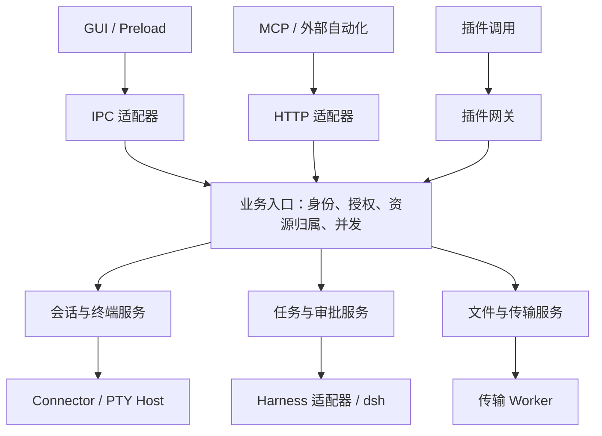

# LyShell 系统架构优化与强化方案（含详细实施步骤）

> 版本：1.0
>
> 编制日期：2026-10-28
>
> 文档性质：架构评审后的实施方案，供开发、代码评审与验收使用。
>
> 依据：用户提供的《LyShell 系统架构》（`system-architecture.md`，整理日期 2026-10-28）及文末列出的一手技术文档。
>
> 证据范围：本次未获得项目源码、`package.json`、锁文件和 `native-harness-work.md`，没有执行项目测试或修改项目代码。本文中的新模块名、接口、状态和错误码均为建议契约；实施时应与现有实现合并。

## 使用说明

2026-10-29 的源码实施、运行证据和未覆盖发布项见 [架构实施与验收记录](architecture-implementation.md)。本方案保留原评审语境，下文建议与复选清单不能替代该实施记录中的实际验收结果。

本文将信息分为三类：

- **文档已明确**：原架构文档直接说明的设计，可以作为本轮评审基线，但仍需源码和运行验证证明实现。
- **待核查**：原文没有提供足够细节，不能据此断言存在缺陷。先找到代码证据，再决定是否改造。
- **建议目标**：希望系统能够保证的行为，可通过现有代码补强、抽取公共逻辑或新增小型模块实现。

优先级定义：

| 优先级 | 含义 | 完成要求 |
|---|---|---|
| P0 | 可能影响权限、资源归属、操作是否重复或是否误执行，优先核查 | 若缺失，先补齐；已有实现则补证据与有针对性的验收 |
| P1 | 影响持续运行、数据完整性、异常恢复和故障定位 | 在扩大自动化使用规模前形成稳定保证 |
| P2 | 兼容性演进、维护成本和测量后才能确定收益的优化 | 按实际发布范围、性能证据和产品计划推进 |

实施时采用“核查现状 → 固化契约 → 完成一个业务闭环 → 验收”的顺序。优先复用现有能力；模块抽取和目录调整随实际改动进行。

## 目录

1. [结论与优化目标](#1-结论与优化目标)
2. [目标逻辑架构与模块职责](#2-目标逻辑架构与模块职责)
3. [统一调用契约与授权模型](#3-统一调用契约与授权模型)
4. [会话控制权与 Connector 契约](#4-会话控制权与-connector-契约)
5. [Harness 任务一致性与恢复](#5-harness-任务一致性与恢复)
6. [终端输出与机器执行结果](#6-终端输出与机器执行结果)
7. [资源生命周期与退出策略](#7-资源生命周期与退出策略)
8. [安全与信任边界强化](#8-安全与信任边界强化)
9. [持久化、配置迁移与数据恢复](#9-持久化配置迁移与数据恢复)
10. [SFTP 传输完整性与调度](#10-sftp-传输完整性与调度)
11. [性能、可观测性与发布兼容](#11-性能可观测性与发布兼容)
12. [验收矩阵与验证方法](#12-验收矩阵与验证方法)
13. [分阶段实施与回退策略](#13-分阶段实施与回退策略)
14. [优化实施详细步骤](#14-优化实施详细步骤)
15. [源码核查入口与实施交付要求](#15-源码核查入口与实施交付要求)
16. [参考资料与证据说明](#16-参考资料与证据说明)

## 1. 结论与优化目标

### 1.1 总体结论

LyShell 当前的 Electron 多进程架构适合多协议终端、文件管理、AI 自动化和插件共存的桌面工作台。建议沿用现有进程布局，重点强化跨入口、跨进程和异常情况下的行为一致性。

优先投入的方向是：统一授权、交互终端控制权、任务提交与恢复、无界面时的输出消费、配置和文件传输完整性，以及跨进程故障诊断。进一步拆分进程或迁移数据库，应由隔离需求、事务需求和实际测量触发。

### 1.2 已有设计基线

| 原文已明确的设计 | 保留理由 | 后续要验证的保证 |
|---|---|---|
| renderer 管理界面状态，main 管理连接与资源 | 资源生命周期能够独立于界面组件 | 关闭、收纳、重新附着不会误释放或重复创建资源 |
| GUI 与 MCP / HTTP 复用业务服务 | 可以统一人工与自动化行为 | 权限、归属、并发与取消规则也在共用层落实 |
| SessionManager 与 Connector 统一连接接口 | 多协议可共用生命周期管理 | 不支持的能力显式返回，不伪造统一语义 |
| 文件传输由 Worker 执行 | 可以减少主事件循环承担的工作 | 有全局限额、明确终态和完整文件提交语义 |
| 输出分包、确认和背压 | 已考虑快速生产者和慢消费者 | 无界面、多个消费者及缓冲溢出仍然正确 |
| 独立 PTY 宿主支持分离与重新附着 | 可支持界面与终端进程分离 | 身份、附着代际、管道权限与回收规则明确 |
| Harness 以后台事件确定真实任务起止 | 状态来源清楚 | 断线、响应丢失和迟到事件不会造成重复执行或错误终态 |
| 原生工作通道与 PetLink 分别绑定归属及审批 | 有利于共用后台时隔离控制关系 | 审批和取消不能跨调用方、任务或后台实例生效 |
| 插件宿主独立于 main，页面有专用 Preload | 具备故障隔离和 API 边界基础 | 明确本地代码实际拥有的 OS 权限及共享宿主限制 |
| JSON 保存配置，SSH 秘密使用 safeStorage | 适合轻量本地配置 | 并发写入、损坏恢复、其他秘密和升级迁移可控 |

### 1.3 系统应维持的不变量

以下不变量是本方案的验收依据，而非对当前代码状态的描述。

| 编号 | 目标不变量 |
|---|---|
| I01 | 所有受保护的业务操作都由已验证的调用身份发起，并检查对应资源范围 |
| I02 | 产生相同执行效果的不同接口具有一致的权限要求，终端写入不会绕过执行授权 |
| I03 | 同一交互终端只有当前有效的控制者可以写入，人工接管使旧控制者失效 |
| I04 | 同一 Harness 会话的活动任务名额在共用入口原子分配；结果未知时不冒进启动冲突任务 |
| I05 | 传输超时、请求取消、底层执行停止、资源清理完成分别表达，不相互冒充 |
| I06 | 不确定提交结果可以被记录和核实，不会因自动重试悄悄重复执行 |
| I07 | 已确认终态不被迟到的普通进度事件覆盖，旧后台和旧附着事件不能操作新资源 |
| I08 | 终端、MCP、传输和后台任务的队列均有容量或并发限制，总资源消耗可控 |
| I09 | 界面未附着时有明确输出消费策略，后台进度不意外依赖已销毁界面的 ACK |
| I10 | 配置保存失败不报成功；崩溃后能恢复一个完整版本，损坏原件不会被静默覆盖 |
| I11 | 半成品文件不被宣告为完整结果；提交结果不明时可以核实 |
| I12 | 凭据与审批可撤销，日志和诊断导出默认不携带秘密 |

### 1.4 保持的产品边界

采用现有 Electron、React、xterm.js、Zustand、Connector、Worker 和 dsh 适配结构。保留“正常退出应用后，收纳任务不继续保活”的现有范围。

持久化先完善 JSON 仓储的可靠性；有查询或多记录事务需求的数据再评估 SQLite。插件按实际信任等级分配运行环境。全屏 TUI 自动化、应用退出后常驻服务、跨机器共享会话等属于独立产品能力，出现明确需求时再设计其契约。

## 2. 目标逻辑架构与模块职责

### 2.1 目标模块关系

下图描述建议的逻辑依赖，大部分模块可继续位于现有主进程中。图中的业务服务入口可以由少量函数或 service 组成，不要求引入大型框架。



配置仓储、秘密存储、资源登记、审计记录是这些服务按需调用的基础能力。它们可保持小而明确的接口，避免一个中央管理器承担所有业务判断。

### 2.2 模块职责

| 逻辑边界 | 负责 | 对接要求 |
|---|---|---|
| renderer | 布局、界面交互、显示状态及用户意图 | 通过受控接口请求操作；后台事实通过事件与快照同步 |
| preload | 有限的具体 API、事件订阅和取消订阅 | 封装 Electron 对象，限制通道、参数和回调暴露 |
| IPC / HTTP / 插件适配器 | 协议解析、身份验证、输入解码、输出映射 | 将已验证上下文传给同一业务服务 |
| 业务服务 | 授权、资源归属、状态转换、冲突控制、操作编排 | 执行前检查当前授权和资源身份，返回统一领域结果 |
| Connector / Worker / Harness 适配器 | 具体协议和执行环境交互 | 显式报告支持能力、生命周期和结果可信度 |
| Repository | 数据读写、版本冲突、迁移、恢复 | 控制实际写入，提供所承诺的事务或单文件一致性 |
| SecretStore | 秘密引用解析、存储、删除、可用性判断 | 仅向有权的执行路径提供必要秘密 |
| ResourceRegistry 或等效机制 | 登记 owner、关联任务、清理入口、当前代际 | 支持重复清理、异常退出和按归属回收 |

### 2.3 跨进程数据与依赖约束

建议在 `src/shared` 中集中维护可运行的请求 schema、事件 schema、错误码和版本号，同时由它们生成或推导 TypeScript 类型。

- 外部输入在进入业务服务前进行运行时校验，业务不变量在服务内继续校验。
- 跨进程传递稳定 ID 与可序列化数据；Socket、PTY、Worker 等句柄留在其所属进程。
- 共享契约尽量不依赖 Electron 主进程 API，便于在 stdio 代理和测试中复用。
- renderer 中的任务 store 是后台状态的展示投影；断线后通过快照或协议支持的事件补偿恢复。
- 插件、HTTP 和 GUI 使用相同业务错误含义，各自映射为适当协议响应。
- 对事件订阅先鉴权，再按资源过滤；取消订阅与界面销毁应释放监听器。

### 2.4 主进程的执行位置选择

主进程继续承担权限裁决、资源编排、窗口管理和轻量状态转换。文件大块数据尽量在传输 Worker 的文件/网络通道中流转，主进程接收必要状态和合并后的进度。CPU 密集解析、压缩或大规模扫描是否移入 Worker，以测量结果决定。

对需要独立故障边界的模块，可评估子进程或 utility process；对同一用户权限下的恶意代码隔离，应另行设计受限执行环境。Worker、子进程和操作系统沙箱的用途应分别记录。

## 3. 统一调用契约与授权模型

### 3.1 调用上下文

以下 TypeScript 是建议的数据契约示例，不是现有代码摘录。身份字段必须由可信适配器构造，不能信任请求体中自报的身份。

```ts
interface CallContext {
  requestId: string;
  principalId: string;          // 稳定调用主体
  credentialId?: string;       // 本次使用的可撤销凭据
  source: "gui" | "mcp" | "http" | "plugin" | "internal";
  receivedAt: number;           // 服务端时间
  deadlineAt?: number;          // 服务端按允许超时上限生成
}

interface RequestEnvelope<T> {
  protocolVersion: string;
  requestId: string;
  timeoutMs?: number;
  idempotencyKey?: string;      // 仅适用于声明支持幂等的操作
  payload: T;
}

interface OperationError {
  code: string;
  message: string;             // 脱敏、适合展示
  requestId: string;
  retryDisposition: "safe" | "reconcile-first" | "never";
  details?: Record<string, unknown>; // 仅放允许公开的结构化细节
}
```

`requestId` 用于关联一次请求，`idempotencyKey` 用于识别同一业务提交，二者用途不同。凭据轮换可保留稳定 `principalId`，但旧 `credentialId` 的撤销必须有效；业务记录如何跨凭据轮换查询，由资源授权策略明确规定。

`source` 只描述请求来源，不自动授予权限；`internal` 也应对应明确的内部主体及允许操作。任何入口都不能从外部参数直接接受“内部调用”身份。

客户端提供的超时应经服务端限幅，内部等待尽量使用单调时钟和剩余预算。客户端断开、请求到期和底层执行终止分别处理，具体见第 5 章。

### 3.2 授权模型

每次受保护操作检查“调用主体、操作能力、目标资源范围”。资源范围至少能表达会话归属、连接范围及文件路径授权；有共享场景时使用显式授权记录。

| 操作类别 | 应校验的资源 | 关键规则 |
|---|---|---|
| 会话列表 / 详情 | 调用方可见的会话集合 | 返回结果先过滤，不能依靠客户端隐藏 |
| 终端输出读取 / 订阅 | 指定会话与有效输出游标 | 读取权限独立于输入权限，输出可能包含敏感数据 |
| 交互终端输入 | 会话、连接类型、控制权代际 | Shell 输入具有相应本地或远端执行级效果 |
| 普通命令执行 | 连接、执行环境、工作目录等 | 与终端输入保持一致的执行授权边界 |
| 文件读取 / 写入 | 连接、源路径和目标路径 | rename、move 等操作同时检查涉及的资源 |
| 任务提交 / 查询 / 取消 | 调用主体、会话、任务、后台实例 | 不能根据可猜测 ID 操作其他调用方任务 |
| 审批响应 | 审批记录及绑定的实际操作 | 单次消费、有效期和执行前复核 |
| 插件调用 | 插件实例、获授能力和资源 | API 授权与本地插件代码的 OS 权限分别管理 |

`terminal.input` 可以继续作为产品能力名称，但授权器必须根据会话实际类型要求对应执行权限。串口或设备控制台应有明确的设备控制能力语义。

文件 API 的路径范围只约束该 API；允许任意 Shell 执行后，单靠工作目录或 API 路径白名单无法限制命令的 OS 文件访问。需要执行隔离时，应结合实际执行层和操作系统能力实现。

### 3.3 一次操作的检查顺序

1. 入口验证 IPC sender、HTTP 凭据或插件实例身份。
2. 解析并校验运行时 schema，限制大小、深度、枚举值和超时。
3. 服务端解析资源，确认资源归属与当前实例/代际。
4. 检查操作能力与资源范围。
5. 获取对应业务名额、控制权或目标文件锁。
6. 如经历排队、审批或异步等待，在真正提交前复核凭据、资源代际和授权。
7. 记录必要的请求/任务关联后调用执行适配器。
8. 依据实际协议更新状态、发布过滤后的事件并释放资源。

授权记录应与执行调度形成一致的顺序：撤销先于提交生效时，不得继续提交；操作已经发往执行环境时，撤销后应阻止后续操作，并按底层能力取消正在执行的工作，不能承诺回滚已经发生的外部副作用。

### 3.4 建议统一的错误语义

| 错误码示例 | 含义 | 调用方行为 |
|---|---|---|
| `INVALID_ARGUMENT` | 参数不符合契约 | 修正参数后提交 |
| `UNAUTHENTICATED` | 凭据无效、过期或缺失 | 重新建立合法身份 |
| `FORBIDDEN` | 没有对应能力或资源权限 | 不自动换接口绕过 |
| `RESOURCE_NOT_FOUND` | 资源不存在或不向该主体暴露 | 更新可见资源列表 |
| `UNSUPPORTED_CAPABILITY` | 当前连接器或后台不支持该能力 | 选择已声明支持的能力 |
| `SESSION_BUSY` | 会话活动名额已占用 | 查询已有任务或等待 |
| `CONTROL_CONFLICT` | 没有当前有效的终端控制权 | 获取控制权或由用户接管 |
| `STALE_GENERATION` | 请求引用了旧连接、后台或附着代际 | 刷新状态；不原样重放输入 |
| `IDEMPOTENCY_CONFLICT` | 同一幂等键对应不同请求内容 | 修正调用方逻辑 |
| `OUTCOME_UNKNOWN` | 副作用是否发生尚不能确认 | 先核实，不盲目重试 |
| `BACKEND_UNAVAILABLE` | 后台当前不可用 | 根据是否已经提交决定重试策略 |
| `RESOURCE_LIMIT` | 达到并发、容量或速率限制 | 遵循服务端给出的等待策略 |
| `VERSION_CONFLICT` | 配置或资源版本发生变化 | 重新读取并合并修改 |
| `INCOMPATIBLE_VERSION` | 协议版本不兼容 | 明确提示升级或重新启动组件 |

以上错误码可映射到现有命名。错误响应不暴露 Token、完整环境变量、私钥或其他调用方资源细节。不能把所有超时统一标为“可安全重试”。

### 3.5 本章验收

- 同一操作从 GUI、HTTP 和插件调用时，执行同一业务规则；差异只能来自已验证身份与明确授权。
- 输入格式合法但身份无权时拒绝执行；对输出事件也执行资源过滤。
- 调用方 A 不能凭调用方 B 的会话或任务 ID 读取、取消或写入其资源。
- 只有读取或控制界面权限的调用方，不能通过原始终端输入获得执行能力。
- 排队或等待审批期间撤销凭据，尚未实际提交的操作不会继续执行。
- 路径授权使用目标端的路径语义，并验证越界、符号链接与并发变化场景；需要强路径隔离时依赖受限执行环境或服务器侧权限。

## 4. 会话控制权与 Connector 契约

### 4.1 保留现有抽象，补齐操作语义

**现状依据：** 架构文档已经定义 `SessionManager`、`BaseConnector` 和 SSH、Telnet、串口、本地 PTY 连接器，并让 GUI 与外部自动化复用主进程服务。这个方向应当保留。以下接口和约束均为建议，需要对照源码判断哪些已经实现。

建议把“拥有会话访问权限”和“当前可以向终端输入”分开。权限回答某个主体能否操作资源，控制权回答多个合法主体同时操作时由谁写入。原生 Harness 的“每个会话最多一个活动任务”不能替代终端控制权：GUI、MCP、插件仍可能同时操作同一个 PTY。

最常见的风险不是消息传输乱序，而是命令语义交叉。例如用户输入了一半命令，AI 又发送文本和回车；AI 准备向 Shell 输入，用户却刚进入编辑器或密码提示。按字节排队只能保持局部顺序，无法判断输入最终落在哪个交互状态。

### 4.2 由 main 统一仲裁输入控制权

建议为每个交互会话维护一个活动控制权租约。允许多个观察者读取输出，但所有真实写入，包括 GUI 键盘、粘贴、MCP 和插件，都必须经过仲裁。main 可以为人工界面维护默认控制句柄，使正常键盘操作保持自然；自动化取得控制权后，人工通过明确接管恢复写入。接管操作不能静默保留旧自动化输入队列。

```ts
// 建议契约；具体名称应与项目现有类型统一。
interface SessionControlLease {
  sessionId: string;
  connectionInstanceId: string;
  principalId: string;
  credentialId?: string;
  leaseId: string;
  controllerInstanceId: string;
  epoch: number;
  expiresAt: number;
}

interface TerminalInputRequest {
  requestId: string;
  sessionId: string;
  connectionInstanceId: string;
  leaseId: string;
  controllerInstanceId: string;
  epoch: number;
  data: string;
}
```

`principalId` 和 `credentialId` 必须来自认证上下文，不能相信请求体自报身份。`controllerInstanceId` 由 main 在本次启动时生成，避免重启后复用旧代际；`epoch` 是该实例为当前会话生成的控制权代际，只能由 main 增加。renderer、插件、MCP 代理和 PTY 宿主都不能自行延长租约或提升代际。

`connectionInstanceId` 标识当前实际 Connector/PTY 实例。即使保留相同 `sessionId`，重新连接或替换 PTY 时也必须更换连接实例身份、撤销旧租约、失效旧待发输入，并更新控制代际，避免把原本发给旧 Shell 的内容写入新连接。

建议遵守以下规则：

1. 获取控制权、续租、接管和释放，都进入同一个业务服务。
2. 输入入队时校验一次，在真正调用 Connector 或向宿主提交写入前再次校验。过期、撤销或旧代际请求即使已排队，也必须拒绝。
3. 如果宿主内部还存在写入队列，它需要执行 main 下发的代际失效指令，并在最终写入前检查授权有效期及控制连接是否仍然有效。main 应收到旧队列失效确认后，再向新控制者宣布接管完成；宿主不能自行续期。
4. 接管只能阻止后续输入，不能撤回已经写入 Shell 的字节，也不能自动保证旧命令已停止。界面应分别展示“取得控制权”和“上一操作仍在执行”。
5. main 重启后旧租约全部失效。宿主失去 main 的有效控制连接时，不继续执行尚未确认的输入队列。
6. 后台批处理优先使用独立 SSH exec 通道或独立 PTY；需要共享人工终端时才申请交互控制权。

终端尺寸也应有明确仲裁：一般由当前控制者对应的主要视图决定；只读观察窗口不能交替调整同一个终端尺寸。没有附着视图时保留最后有效尺寸，重新附着时按明确规则更新。

取得控制权只保证后续写入互斥，不证明当前程序位于空命令行或预期交互状态。自动化不得把“租约获取成功”理解为可以立即执行 Shell 命令。无法可靠确认当前上下文时，普通命令使用独立执行通道或独立会话；确需操作共享终端时，由用户确认交接上下文，或由调用方按已验证的交互协议继续。不能为初始化状态自动发送回车、Ctrl-C 或清空按键。人工已输入半行时，AI 不能仅凭取得租约就追加命令并回车。

引入控制代际、失效确认或其他安全协议时，同一次改造就要完成必要的版本和能力握手。旧宿主不支持相应保证时拒绝自动化接管或要求重建宿主，不能静默退回未经仲裁的写入路径。

### 4.3 Connector 使用能力声明，避免假设所有连接都相同

统一 `connect/disconnect/write` 合理，但不能推导所有连接都支持远端命令、文件传输、可靠暂停输出或重新附着。建议增加只读能力描述，由真实适配器声明，业务服务据此决定行为。

| 能力 | 应表达的含义 | 不支持时的处理 |
|---|---|---|
| `interactiveInput` | 可向交互终端写入 | 不暴露交互输入操作 |
| `resize` | 可调整终端几何尺寸 | 明确返回不支持，界面不反复重试 |
| `exec` | 可获得独立命令执行结果 | 不能把 PTY 提示符猜测包装成可靠退出码 |
| `fileTransfer` | 有可用文件传输提供者 | 不假设存在 SFTP |
| `pauseOutput` | 有实际可用的流量控制机制 | 使用有界消费与丢失告知策略 |
| `reattach` | 支持按宿主契约重新附着 | 关闭视图前明确后续行为 |

SSH、串口和 Telnet 的差异应留在适配器及能力实现中。不要为了统一接口，让不支持的操作静默成功，也不要把 SSH 专有细节不断加入 `BaseConnector`。

**关键不变量：** 任意时刻同一交互终端至多有一个有效自动化控制代际；权限撤销与人工接管后的旧排队输入不得执行；能力不支持必须可被调用方识别。

**故障验收：** 人工输入未回车时 AI 申请控制权；AI 等待确认时人工接管；旧请求在接管后延迟到达；宿主积压输入时发生租约过期；两个观察窗口同时 resize。检查拒绝原因、控制权展示和真实 PTY 输入是否一致。

## 5. Harness 任务一致性与恢复

### 5.1 在已有后台身份和官方事件上强化一致性

**现状依据：** 文档已经使用后台实例身份、`sessionId` 和 `taskId` 精确关联任务，以官方 dsh 事件判断真实回合起止，并区分任务接收与任务完成。本文统一以 `backendInstanceId` 表示后台实例身份，不假定源码使用这个字段名。原生工作通道与 PetLink 也已有独立归属和审批绑定。应把这些作为基础，避免另建一套竞争的任务真相源。

建议新增或核实三类信息：提交是否确定被接受、后台最后确认的执行状态、LyShell 当前能否继续观察后台。这三类信息不能合并成一个含糊的 `running` 或 `failed` 字段。

| 维度 | 建议表达 | 状态依据 |
|---|---|---|
| 提交状态 | 准备提交、已接受、被拒绝、结果未知 | 本地提交记录与后台回执 |
| 执行状态 | 排队、执行中、等待审批、成功、失败、已取消等 | 后台真实事件或权威查询结果 |
| 观测状态 | 正常、正在恢复、暂不可达、无法核实 | 桥接连接和对账结果 |
| 控制意图 | 请求取消时间、待处理审批等 | LyShell 已发出的操作意图 |

这是一组建议语义，不要求直接替换 dsh 的枚举。具体状态映射必须依据当前后台契约。桥接断线时，可显示“最后确认执行中，正在恢复连接”，不能仅因暂时收不到事件就判断执行失败。

### 5.2 幂等提交与结果未知处理

对于可能修改文件或执行命令的任务，回执丢失比普通请求失败更危险：后台可能已经开始工作，调用方却以为没有成功提交。建议由调用方提供独立 `idempotencyKey`。`requestId` 用于追踪一次请求，不自动承担跨重试去重职责。

```ts
// 建议的持久化语义，字段可映射到现有仓储。
interface WorkSubmission {
  principalId: string;
  credentialId?: string;
  sessionId: string;
  operation: "harness.work";
  idempotencyKey: string;
  requestHash: string;
  effectiveConfigRevision?: string;
  submissionState: 'reserved' | 'dispatching' | 'accepted' | 'rejected' | 'unknown';
  backendInstanceId?: string;
  taskId?: string;
  lastRequestId: string;
}
```

去重范围至少包含主体、会话和操作类型。`requestHash` 应覆盖实际影响执行的规范化参数，例如任务内容、工作目录、环境配置引用及版本和关键策略版本。引用可变配置时应固定首次提交使用的版本或快照，不能在同一键重试时悄悄换成新配置。同一幂等键配不同参数必须返回冲突，不能偷偷替换原任务。日志和查询响应不得因此泄漏凭据或环境变量值。

建议提交过程为：

1. 完成认证、资源授权和参数校验。
2. 原子建立幂等占位，并预留该会话的活动任务名额。不能先分别判断“没有记录”“会话空闲”，经过异步等待后才写入。
3. 在向后台发送前可靠记录 `dispatching`，然后转发，并把返回身份关联到本地提交记录。不得先产生外部副作用，再第一次保存提交意图。
4. 后续相同请求读取同一记录，返回已有任务或明确的处理中、未知状态。
5. 如转发后失去回执，保持占位并进入核实流程；不能按“失败”释放名额并重新创建任务。

本地原子占位只能解决 LyShell 内部的竞争。**如果 dsh 不支持按幂等键去重，也无法查询先前请求是否被接受，仅靠本地缓存不能保证端到端 exactly-once。** 此时应明确返回“提交结果未知”，保留可诊断信息，并要求调用方核实副作用后决定下一步，不能包装成可安全自动重试。

崩溃后遗留的 `dispatching` 记录应进入核实流程，因为它可能位于真正发送之前或之后。只有实现能证明 `reserved` 阶段尚未向外发送，才可以把它作为未派发记录恢复。记录保留期应覆盖任务生命周期和约定重试窗口；过期幂等键不能无提示重新解释为一次新操作。若无法核实而需要人工处理，应保留可解释的阻塞状态，人工释放占位前明确确认旧任务或副作用，并记录处理结果，避免永久僵死或静默重复执行。

### 5.3 恢复、取消与重试按操作语义处理

先核实后台是否提供状态查询、事件序号、重放和重连能力，再决定恢复策略。支持时，可以通过状态快照与后续事件补齐缺口；不支持时，保留最后确认状态并显示不确定性。已有后台实例身份应继续隔离旧、新实例，迟到事件不能更新另一实例的任务。

取消请求首先表达“希望停止”。是否已经停止、是否仍有子进程、是否存在未完成写入，需要后台事件或其他权威结果确认。释放单会话执行名额，应服从后台真实并发契约；不能仅以 HTTP 取消接口返回成功为依据。

重试规则建议明确写进接口：只读状态查询可有限重试；有去重保证的提交使用原幂等键重试；交互终端写入和不可确认的命令执行不得自动重放。网络恢复、休眠唤醒和 MCP 重连都不应自动重新发送旧终端输入。

原生工作通道和 PetLink 共用后台时，还应核实审批绑定是否覆盖主体、后台实例、会话、任务、审批标识和不可变操作内容。旧任务已结束、凭据已撤销或后台已替换后，旧审批按钮必须失效；一次审批不能被重复消费。这里是对已有独立绑定的强化核查，不代表文档已确认存在串用问题。

**关键不变量：** 一个会话的活动任务预留必须原子完成；未知结果不得当作未执行；执行状态来自后台；终态不被迟到进度事件回退；取消意图不等于停止证明。

**故障验收：** 两路同时提交同一会话；同一键同参数重试及不同参数冲突；后台接收后回执丢失；后台重启后旧事件到达；任务完成与取消并发；取消 A 后创建 B，再点击 A 的旧审批。每个场景应同时核对本地记录、后台真实执行次数和界面显示。

## 6. 终端输出与机器执行结果

### 6.1 在现有背压上明确 ACK 的准确含义

**现状依据：** 文档已经提供终端分包、确认、背压，以及供 MCP 读取的 `OutputBuffer`。应先核实当前实现，再补齐多消费者和无界面情况下的行为，而不是重做输出系统。

图形终端 ACK 建议表示：对应数据已经通过 xterm 的 `write` 回调完成处理。收到 IPC、调用了 `term.write()`、DOM 更新或某次绘制触发，都不能代替这一精确定义。它也不意味着 GPU 已把画面完整呈现给用户。[xterm 官方流量控制说明](https://xtermjs.org/docs/guides/flowcontrol/)明确说明 `write()` 是非阻塞入队，回调可作为数据已处理的确认，并提醒确认计量不一致可能阻塞整个数据流。

ACK 应绑定 `sessionId`、本次附着标识和递增序号，重复累计确认应无副作用，旧视图确认不得扣减新视图的未确认量。字节数与字符数不能混算；UTF-8 解码要保留跨分包状态，避免中文等多字节字符在边界损坏。

### 6.2 输出消费独立于 GUI 是否存在

应把“从 PTY 持续取出输出”与“向某个界面渲染输出”分开。收纳任务、关闭视图或 renderer 崩溃后，PTY 宿主或被指定的输出管理者仍负责消费，并写入有界缓冲；是否存在 GUI ACK 不能成为后台任务永久停止输出的条件。

建议至少分别限制 GUI 待处理队列、MCP 可读历史和可选落盘历史。限制同时覆盖单会话和全局，避免大量会话各自未超限却耗尽总内存。各消费者拥有独立游标；慢 MCP 客户端不应拖住正常 GUI，失联 GUI 也不应无限阻塞仍需保活的任务。

对可暂停的连接可以短时施加背压；达到明确的等待上限或消费者失联后，切换为脱离该消费者的有界消费策略。串口等连接是否支持可靠暂停需要适配器声明，不能通过同一个 `pause()` 假定所有远端生产者都能停下来。

有界缓冲意味着必须选择超限行为：丢弃最旧历史、拒绝新订阅，或按容量受限的策略落盘。不能同时承诺无限持续运行、有限存储和完整保留所有输出。丢失发生时要明确报告缺口，不允许返回看似完整的成功结果。

```ts
// 建议的增量读取响应。
interface TerminalReadResult {
  sessionId: string;
  outputEpoch: string;
  data: string;
  nextCursor: string;
  earliestCursor: string;
  truncated: boolean;
  gap?: { fromCursor: string; toCursor: string };
}
```

游标应绑定输出代际，过期游标返回可识别的范围失效信息。`truncated` 与 `gap` 的含义要写清楚：前者可表示本次响应受大小限制，后者表示历史已经不可获得，两者不能混用。一次响应还应有最大字节数，避免调用方把整段历史反复拉回模型上下文。

### 6.3 原始 ANSI 流丢失后不能假装恢复了完整屏幕

终端流包含光标移动、擦除、颜色和模式变化。随意截取原始字节流后半段，可能从转义序列中间开始，也可能缺少影响后续显示的状态；简单去除 ANSI 不能重建 TUI 的当前屏幕。

可按实际产品需求选择恢复层级：

| 恢复方案 | 能提供的保证 | 需要接受的代价 |
|---|---|---|
| 有界文本历史 | 日志查看，明确历史缺口 | 不保证还原全屏终端 |
| 完整检查点加后续增量 | 按检查点恢复终端状态 | 需要可靠序列化、尺寸和版本管理 |
| 无法保真时重置视图 | 不展示伪造的旧画面状态 | 提示历史截断，由用户或受控流程触发应用重绘 |

若选择第二种方式，状态维护必须在 GUI 不存在时继续进行，检查点和增量之间不能留空档。若当前不准备承担这项复杂度，第三种方式是可接受的明确降级：重置解析状态、展示缺口提示，再接收实时输出。不要自动向任意程序发送 `Ctrl-L` 等按键，因为它们本身是具有上下文含义的交互输入。

### 6.4 普通机器执行使用结构化结果

文档已经说明普通 SSH 命令有独立执行通道，应继续利用这一能力。机器任务优先获得结构化的退出码、stdout、stderr、超时状态、截断状态和执行时间。PTY 输出用于交互观察，不用“出现提示符”或“几秒没有输出”猜测一条命令是否成功。

若未来确实需要 AI 操作全屏 TUI，应单独定义带终端尺寸、状态版本和生成时间的屏幕快照接口，不把现有文本缓冲悄悄升级解释为屏幕事实。相关缓冲和解析边界可以参考 [xterm Terminal API](https://xtermjs.org/docs/api/terminal/classes/terminal/)，实际使用方式仍需对应项目锁定版本。

**故障验收：** 高速持续输出时保持输入可响应；GUI 长时间不 ACK 后任务仍按既定策略运行；收纳期间输出超过保留上限；MCP 使用过期游标；UTF-8 和 ANSI 序列恰好跨包；renderer 重建后收到旧 ACK；TUI 输出被截断后不展示为完整恢复。

## 7. 资源生命周期与退出策略

### 7.1 保留正常退出不保活的产品边界

**现状依据：** 文档已明确独立 PTY 宿主支持分离与重新附着，但收纳任务不跨应用正常退出保活。建议保留这一边界，并把不同故障情形分别定义。独立宿主存在，只证明有进程分离路径，不能据此宣称主进程崩溃后一定能够恢复全部任务。

| 场景 | 建议默认行为 | 必须验证的结果 |
|---|---|---|
| 关闭普通终端页 | 按明确关闭策略结束会话；有任务时可选择收纳 | 页面销毁与会话关闭不混用 |
| 收纳任务 | 保留宿主和会话，解除 GUI 附着 | 输出继续有界消费，控制权有明确归属 |
| renderer 崩溃或重载 | 保留 main 所拥有的会话，允许重建视图 | 旧附着 ACK、resize 和输入失效 |
| main 崩溃 | 按已实现恢复能力处理，不能默认承诺无损 | 孤立宿主有保留期限和退出规则 |
| 系统睡眠后恢复 | 先检查连接、后台身份与租约，再允许新操作 | 不重放旧写入，不直接认定旧任务失败 |
| 正常退出应用 | 结束受管本地进程，释放连接与租约；按能力请求停止远端任务 | 本地收纳任务不跨正常退出保活，未确认远端结果如实记录 |

关闭标签的具体交互可以沿用现有产品行为，但界面必须明确“仅移除视图”“收纳继续运行”和“结束会话”的差别。恢复视图时显示的是已核实状态；后台不可达时显示恢复中或无法核实，避免把缓存渲染成当前事实。

“不跨正常退出保活”适用于 LyShell 拥有并能够管理的本地收纳任务和进程。用户在远端自行启动的脱离会话任务，或执行层已经独立派生的外部工作，可能不在这一范围；关闭 SSH 通道不构成远端进程已停止的证明。无法确认停止的操作记录为未核实或清理未完成，不能用应用退出掩盖不确定结果。

### 7.2 每个资源有明确所有者和幂等清理入口

建议在现有管理模块中核实统一的资源记录：资源类型与标识、`principalId`、相关 `sessionId/taskId/backendInstanceId`、创建者、共享关系、关闭状态及清理函数。无需为了登记资源引入一个复杂的分布式注册系统；main 内的明确所有权关系即可解决多数问题。

清理入口应允许重复调用：关闭按钮、超时、进程退出事件和应用退出可能同时到达。第一次清理负责状态迁移，后续调用得到相同结果或等待同一清理过程，不能重复关闭另一个已复用的句柄。

共享后台尤其要区分“本应用独占创建”“多个 LyShell 功能共享”“外部提供”。释放某个工作通道的租约，不代表可以结束所有共用任务或直接杀死后台进程。只取消与当前归属绑定的任务；只有拥有对应进程、且满足全部共享使用者退出条件时，才可以执行进程级清理。

### 7.3 按顺序退出，并明确超时后的升级动作

建议正常退出顺序为：停止接受新工作；撤销新增输入与审批能力；请求取消本应用管理的任务；等待后台或子进程在限定时间内结束；关闭 Connector、Worker 和通信通道；最后保存必要状态并退出。各阶段必须有截止时间，不能被某个失联后台无限阻塞。

进程级强制终止只能针对明确拥有的进程树，不能按通用进程名扫描并结束其他应用。Windows 与 Unix 的子进程组、管道和终止行为不同，需要分别验证；如果进程无法被安全归属，则记录未完成清理状态并报告，不能扩大终止范围。

main 崩溃后的孤立宿主可按产品需要设有限恢复窗口，期间禁用旧控制权、持续有界消费输出。新的 main 只有在验证宿主实例和原有资源归属后才能接管，不能仅凭同名管道或一个 PID 认领。超出窗口如何处理应明确：结束本应用拥有的资源，或保留诊断信息；不能无期限留下无人管理的进程。

睡眠恢复不等同于网络重连成功。应重新检查 SSH/串口状态、后台实例身份、任务最新状态和控制权有效性，清除已失效的待发送输入。对计时器和租约不要只假设休眠期间计时行为一致，唤醒事件本身应触发重新核实。

**关键不变量：** 视图生命周期与真实会话生命周期分开；清理可重复执行；共享资源只按归属释放；正常退出不保活；故障恢复不能扩大权限或复活旧输入。

**故障验收：** 收纳后关闭全部视图；renderer 强制退出；main 在运行任务期间意外退出；宿主先于 main 退出；传输和 Harness 任务同时阻塞退出；睡眠后凭据已撤销；共享后台仍有另一通道任务。分别检查残留进程、管道、文件句柄、任务占位、租约与界面恢复结果。

## 8. 安全与信任边界强化

本章以架构文档为依据，提出需要落实或验证的安全契约。文档未描述的机制均列为待核查，不据此认定已有漏洞。下述 `CallContext`、`HostKeyVerifier`、`SecretStore` 等名称是建议抽象，不代表项目当前已有对应实现。优先完善现有入口与共享服务的边界，不为桌面应用引入独立的远程鉴权基础设施。

### 8.1 IPC 调用身份与事件接收者

**现状依据：**主界面启用沙箱和上下文隔离，关闭 Node 集成；通过 Preload 暴露接口，主进程校验请求参数。插件页面也由宿主校验身份。

**待核查：**参数合法时是否仍验证发送窗口和 frame；插件与主界面的身份是否能被请求字段冒充；会话输出是否只发送给获授权的订阅者；页面导航后是否继续沿用旧身份。

**建议行为：**

- 由主进程登记窗口、frame 与插件实例，入口据此构造 `CallContext`。请求中的 `pluginId`、`ownerId` 不能直接成为调用身份。
- 按“调用身份、操作能力、目标资源”授权，在共享业务服务入口复核；IPC 与 HTTP 使用相同规则，GUI 用户通过明确身份取得所需权限。
- Preload 暴露具体操作，避免向页面暴露任意通道调用、完整 Electron 对象或 IPC event 对象；使用运行时 schema 验证参数及大小。
- 输出订阅关联身份、资源与页面实例，推送前检查订阅有效性；销毁、导航和撤权时解除订阅。不能先广播所有输出，再让渲染层自行过滤。

来源判断同时结合主进程登记关系和可信来源策略，避免用宽泛的 URL 前缀作为唯一依据。对于本地页面或特殊协议产生的来源值，需要明确规则，不能把无法识别的来源统一当成可信页面。

[Electron 安全指南](https://www.electronjs.org/docs/latest/tutorial/security)明确要求验证 IPC 发送者，并限制导航及向不可信页面暴露高权限 API；仅启用上下文隔离不足以代替入口授权。

**验收：**非授权 frame 使用合法参数调用接口被拒绝；插件无法订阅其他插件的会话输出；页面导航、销毁或撤权后不再收到敏感事件；主界面正常操作不受影响。

### 8.2 内部本机 HTTP 与凭据生命周期

**现状依据：**MCP 代理通过 stdio 对外提供协议，再以 Token 调用监听于 `127.0.0.1` 随机端口的内部 HTTP 服务，后者执行能力授权。

**待核查：**Host、Origin 和 CORS 的策略；凭据与端口发现文件的访问权限；凭据撤销是否及时生效；请求体、并发和超时是否有限制。

**建议行为：**

- 保留现有本机 HTTP 结构，固定仅监听回环地址。端口随机化用于避免冲突，不作为身份验证手段。
- 明确允许的 Host；携带 Origin 的请求必须满足来源策略。原生代理可能没有 Origin，可在 Token、Host 等校验通过后允许，不能简单要求每次调用必须带 Origin。
- 默认不开放跨站 CORS；使用授权头传递 Token，避免长期秘密进入 URL、访问日志和诊断报告；有副作用操作使用明确的方法与请求体。
- 按调用方签发凭据，记录能力和资源范围，支持撤销与替换；每次新操作检查当前有效性。发现文件只保存必要信息，限制为当前用户可读，避免把全局高权限凭据分发给插件。
- 设置请求体上限、调用并发、执行时限和最大返回量；撤权后停止新调用与后续敏感事件。正在执行的操作如何取消或保留，由对应任务生命周期规则处理。

[MCP 传输规范](https://modelcontextprotocol.io/specification/2025-11-25/basic/transports)对 Streamable HTTP 提出了来源校验、回环监听和鉴权建议。此处是自定义内部 HTTP，不能直接将它认定为标准 Streamable HTTP 服务，也无需机械引入完整的远程 OAuth 流程。

回环监听限制网络暴露，但不构成对同一用户下任意恶意程序的完整防线。应明确当前主要防护对象是未授权网页、其他调用方及误用；若要防范具有同用户系统权限的攻击者，需要结合插件运行限制另行设计。

**验收：**无效 Token、越界资源、异常 Host 或不允许的 Origin 被拒绝；合法无 Origin 的本机代理正常工作；撤销凭据后新操作及订阅立即失效；超限请求不会造成无界内存增长。

### 8.3 SSH 主机身份验证的一致性

**现状依据：**SSHConnector 使用 `ssh2`，命令执行与 SFTP 分开，传输由 Worker 承载。

**待核查：**SSHConnector 是否配置 `hostVerifier`；Worker 是否另建 SSH 连接，若另建是否沿用同一主机信任策略；无人值守调用遇到未知指纹时如何处理。

**建议行为：**抽出统一的 `HostKeyVerifier` 与可信主机记录。首次连接展示指纹，由用户确认或匹配预配置记录；指纹变化默认中止，不能因“之前连过这个地址”直接接受。信任记录覆盖主机、端口及实际需要区分的连接身份，支持用户查看、替换和删除。

终端、独立执行通道及自行建立连接的 SFTP Worker 必须调用同一验证逻辑；复用已验证连接的通道无需重复建立另一套信任判断。AI 与插件不能自行批准未知或变化的主机指纹；自动化调用返回需要信任确认的明确结果。

[`ssh2` 官方说明](https://github.com/mscdex/ssh2/blob/master/README.md)指出，未设置 `hostVerifier` 时默认自动接受主机密钥。因此这是应优先核实的配置点，不能仅以“协议使用 SSH”作为身份验证已经完备的证据。

**验收：**已信任指纹正常连接；未知指纹按策略进入确认或拒绝；指纹变化同时阻止终端、命令执行和独立 SFTP 连接；取消确认不会残留可用连接。

### 8.4 Node 与 Python 插件的信任等级

**现状依据：**Node 插件在独立宿主中运行，单宿主可承载多个插件；Python 使用独立进程。插件通过专用 Token 调用主进程，文档已经说明进程分离不是操作系统沙箱。

**待核查：**安装界面是否准确表达插件权限；不同插件是否共享环境变量或凭据；停止单个插件能否回收其资源；用户是否被告知允许插件直接访问本机文件和启动程序。

**建议行为：**明确区分两种可兑现的运行等级。

| 等级 | 能力与边界 | 建议使用场景 |
|---|---|---|
| 可信本地扩展 | Node/Python 可具有当前用户的系统权限；Token 约束通过 LyShell API 的访问 | 用户明确安装并信任的扩展 |
| 受限扩展 | 在经验证的受限环境中执行，通过代理获取有限能力 | 产品确需承载不可信第三方代码时 |

当前可先把可信本地扩展做完整：显示来源与实际权限、按插件发放 API 凭据、最小化环境变量、记录资源归属，并支持禁用和异常退出清理。不能把能力勾选框描述成对插件所有文件、网络和子进程行为的系统级限制。

不同信任域的插件宜使用独立宿主，便于单独停止和限制故障影响；同一宿主中的插件应被视为共享一个执行信任域。单独宿主改善故障隔离，但仍不等于阻止同用户代码访问系统资源。确需受限扩展时，再依据平台评估操作系统沙箱、容器或受限运行时；不要以 Node `vm` 或进程拆分替代这项承诺。

禁用操作应区分“撤销 LyShell API 权限”和“停止插件代码”。前者不会自动撤销 Node/Python 已有的系统访问能力；后者还需由宿主监督其已登记的子进程。清理结果应如实报告，不能把删除插件目录视为所有副作用已经撤回。

**验收：**关闭插件后其 API 凭据和订阅失效，注册资源被清理；独立宿主崩溃不终止其他宿主；无关秘密不出现在插件环境中。若尚未实现受限等级，产品文案明确说明当前信任要求。

### 8.5 插件页面生命周期与嵌入方案

**现状依据：**插件页面使用专用 Preload 的隔离 webview，宿主检查身份、导航和能力。

**待核查：**页面附加、重定向、弹窗、下载和销毁是否均受控；页面能否指定任意 Preload；不同插件是否意外共享 Cookie 等会话数据。

**建议行为：**由宿主选择 Preload、初始地址和隔离配置，插件不能自行指定高权限脚本。按实际信任域划分 session partition；默认阻止未声明的新窗口、权限请求和外部协议跳转，必要能力通过明确策略开放。授权关联页面实例，导航到新的信任域时先撤销原授权，再按新页面重新建立；关闭视图时同时清理监听、订阅和资源引用。

将嵌入实现封装为内部视图适配器，避免业务代码依赖大量 webview 专属事件。[Electron webview 文档](https://www.electronjs.org/docs/latest/api/webview-tag)建议考虑替代方案，可将 [WebContentsView](https://www.electronjs.org/docs/latest/api/web-contents-view) 列为演进候选。迁移应由稳定性问题或维护成本驱动，先验证布局、焦点、快捷键、缩放和页面回收；组件替换本身不保证安全边界正确。

**验收：**未授权导航、弹窗和权限请求被拒绝；页面不能更换宿主 Preload；跨信任域导航不继承旧权限；反复开关页面不会残留订阅或可用凭据。

### 8.6 SecretStore 与最小环境变量

**现状依据：**SSH 敏感字段使用 `safeStorage`；连接配置、Agent 定义和环境变量组保存在本地 JSON。

**待核查：**模型 API Key、MCP/插件 Token、SSH 私钥口令和环境变量中的秘密是否统一处理；配置导出、日志和崩溃报告是否会携带这些值。

**建议行为：**以 `SecretStore` 统一秘密的保存、读取、更新和删除，普通配置保存 `secretRef`。仅在建立连接或启动指定子进程时解析必要秘密，渲染层原则上只取得引用和存在状态。明文的显示或导出如确有产品需求，应作为独立操作设计。

子进程环境由受控基础环境加显式配置组成：保留操作系统及运行时必须的 PATH、临时目录等变量，按平台维护，随后仅注入该任务所需的秘密。避免直接传播主进程全部环境，也避免简单清空环境导致 Shell 和 CLI 无法启动。不得在进程启动日志记录完整环境。

诊断数据采用结构化白名单，默认不记录 Token、私钥、完整请求头和全部终端内容。日志脱敏只能降低意外泄漏风险，不能保证识别任意输出中的秘密。

迁移已有配置时先验证秘密能够写入并重新读取，再切换引用，成功后移除旧明文字段；失败时保持原配置可用并明确报告。兼容性备份和导出也必须纳入检查，避免主文件完成加密而备份长期保留原始秘密。

[Electron safeStorage 文档](https://www.electronjs.org/docs/latest/api/safe-storage)说明其平台保护边界不同：Windows 方案不阻止同用户的其他应用，Linux 无可用秘密存储时可能退化到 `basic_text`。应检测可用性和后端状态，在无法可靠保存时给出明确选择，不能静默宣称已经安全加密。

**验收：**普通配置和默认导出中没有秘密明文；任务仅收到其所需凭据；插件环境不含其他 Agent 的密钥；存储后端不可用时行为清晰，更新或删除秘密后配置引用保持一致。

### 8.7 审批、多执行入口与不可信内容

**现状依据：**LyShell 管理凭据、归属和审批转发，官方 dsh 后台负责工具执行及执行权限策略。系统同时提供终端输入、SSH 执行、文件写入、插件和 Harness 等入口。

**待核查：**相同实质操作能否通过权限更低的入口完成；审批是否绑定具体后台实例、任务和参数；审批后目标或权限变化时是否再次核验。

**建议行为：**权限按实际效果定义。向本地或远端 Shell 写入并回车通常已具备相应命令执行能力，不能把这种“交互输入”笼统归为低风险权限。设备串口可按设备控制授权；会话读取也要检查资源范围，避免跨会话泄漏。

审批显示实际操作、目标资源和关键参数，关联调用身份、后台实例、会话及任务；执行前确认批准对象仍然一致，参数发生实质变化时重新审批。审批有效期、撤销和单次使用优先对接后台已有契约，避免建立语义冲突的第二套执行引擎。

文件写入也需按路径和用途评估：修改 Shell 启动脚本、插件代码或执行配置可能改变后续运行行为。默认限制自动化调用可写的目录，敏感目标采用明确授权，不能仅凭接口名称把全部写文件操作视为普通内容编辑。

终端输出、文件内容、网页和模型生成的描述都属于待解释的数据，不能据此自动扩展权限。LyShell 负责自身入口授权和审批可靠转发；dsh 负责其执行环境内的工具策略。对于由 CLI 自行执行的动作，应明确其依赖的 CLI/操作系统权限边界，不能宣称全部受 LyShell HTTP 能力模型控制。

**验收：**禁止本地执行的调用方不能通过本地 Shell 写入接口完成执行；审批中的目标或参数变化会被拒绝或重新确认；过期后台实例的审批无法用于新任务；恶意输出文本不能修改应用授权策略。

## 9. 持久化、配置迁移与数据恢复

### 9.1 已知设计与需要核查的保证

现有架构文档说明，连接配置、偏好、Agent 定义、环境变量组、工作区和历史主要保存在 `userData` 下的 JSON 文件中，统一阅读入口是 `storage/repository.ts`。这适合单机桌面应用。文档未展开写入串行化、损坏恢复和迁移协议，应先核查实现，再补齐缺少的保证。

建议按数据性质确定保存策略：低频配置继续使用 JSON；任务历史和审计记录采用有界、可查询的存储；终端输出与缓存独立限额；敏感值交给安全章节定义的 `SecretStore`，普通配置只保存引用。不要让一次历史记录增长迫使整个配置文件重写。

### 9.2 Repository 单写与版本冲突

所有配置修改经过 Repository，UI、HTTP、插件和 Worker 不直接写同一配置文件。每个配置集合采用串行写队列，在队列内基于最新状态应用变更，避免两个调用者各自保存旧快照而相互覆盖。异步文件 API 本身不提供这种业务互斥；[Node 文件系统文档](https://nodejs.org/api/fs.html#fspromiseswritefilefile-data-options)也明确提示，不等待前次完成就对同一文件重复执行 `writeFile` 并不安全。

对来自界面编辑器或外部客户端的修改，增加 `revision` 与 `expectedRevision`。版本过期时返回可解释的冲突，允许重新读取或由调用者确认合并，不静默采用最后一次写入。简单字段更新可以提交变更操作；覆盖整个配置集合必须显式表达意图。

如果支持多个应用实例共享同一个 `userData`，单进程队列不足以防止冲突：应限制该目录只有一个写入实例，或引入跨进程协调。Repository 的职责应包含这一约束，而不是让每个调用入口自行处理。

### 9.3 保存、提交与耐久性协议

建议以“准备完整新版本，再提交替换”为默认流程：校验数据和版本，在目标文件同目录创建唯一临时文件，完整写入，按保存承诺执行刷新并关闭，再替换目标文件，最后更新内存版本及返回结果。临时文件使用随机名称和合适的访问权限，文件名不包含凭据或其他敏感信息。

需要分别说明三个保证：读者不会读到半份 JSON；多个修改不会丢失；断电后承诺的数据能够保留。临时写入加替换主要服务于第一项，不能自动证明后两项。是否需要文件 `fsync`、目录同步以及如何处理平台不支持的情况，应依据支持的操作系统和文件系统验证。Windows 文件占用、杀毒软件干预、跨卷路径及网络文件系统都应有失败处理；不能通过“先删除旧文件，再改名”来伪装可靠替换。

保留已验证的上个版本，并明确备份更新顺序。多份 JSON 之间也没有天然的整体事务：若连接、工作区与归属必须一起修改，应使用同一提交单元，或考虑下文的事务存储。批量自动保存可以合并写入，但接口必须区分“已接受修改”和“已提交保存”，不能把仍在队列中的数据报告为已经持久化。

### 9.4 损坏保护、迁移与恢复

启动时执行解析、schema 和版本校验。遇到截断、未知版本或格式错误，应保留原文件及错误证据，尝试经过校验的备份，并把恢复结果告知用户。不得在加载失败后立即用默认配置覆盖原文件；磁盘满、无权限和密钥不可用同样不能被当成“首次启动”。日志记录错误类别和文件标识，不打印完整配置内容。

配置增加 `schemaVersion`，采用明确的逐级迁移函数。迁移前保存可恢复副本，在副本上转换和验证，成功后才提交；失败保留旧文件。对较新版本创建的未知 schema，优先阻止写入或提供兼容模式，避免旧程序破坏新字段。凭据解密与迁移失败的处理遵循安全章节，不通过写入明文绕过。

临时文件和旧备份的清理依据明确的文件命名、任务记录和保留策略，只处理确认属于本应用的内容。恢复模式应允许导出原文件以便诊断，并避免在每次重启时反复覆盖有效备份。

### 9.5 SQLite 的引入条件与事务边界

出现以下需求时再评估 SQLite：历史持续增长且需要分页检索；任务、归属、幂等记录必须一起更新；多个相关对象频繁修改；JSON 全量重写已经产生可测量的延迟或复杂恢复逻辑。可以保留偏好 JSON，把结构化历史与任务登记迁入数据库，不必一次搬迁全部数据。

Repository 对上层继续提供稳定接口，数据库内部用事务、唯一约束和版本检查维护一致性。[SQLite 的原子提交说明](https://www.sqlite.org/atomiccommit.html)介绍了事务提交及崩溃恢复机制，但仍需选择适合的持久化配置、备份方法和迁移流程；引入 SQLite 不代表可以无视主进程阻塞或无限并发写入。

数据库事务只覆盖本地记录，不能与远端命令、SFTP 提交或 dsh 工具执行组成一个跨系统原子操作。应保存操作意图和关联 ID，执行外部请求，再记录确认结果；中途崩溃通过查询、对账或人工确认恢复。结果未知时不得仅因数据库中没有成功记录就自动重放有副作用的操作。

### 9.6 验收要求

- 两个入口同时修改配置，不出现静默丢失更新；旧版本提交得到明确冲突。
- 在临时写入、刷新、替换、备份更新等阶段强制结束进程，重启能读取完整旧版本或新版本，或进入可解释的恢复流程。
- 模拟磁盘满、权限拒绝和文件占用，保存失败不会返回成功，也不会破坏原配置。
- 损坏文件和迁移失败保留原始数据；加载失败不会触发默认值覆盖。
- 数据库迁移如被采用，应覆盖中断恢复和外部执行结果未知的场景，不能仅验证正常读写。

## 10. SFTP 传输完整性与调度

### 10.1 保留现有分工，明确任务状态

架构文档已将上传、下载交给 Worker，主进程负责调度、取消与进度，这是合理基础。重点核查 `upload-worker-manager.ts`、`download-worker-manager.ts` 及 Worker 中的实际文件操作，明确“传输完成”究竟包含哪些步骤。

每个任务至少记录任务 ID、尝试 ID、连接身份、源与目标、临时路径、校验方式和状态。可采用 `queued → running → verifying → committing → succeeded` 的正常路径，另设 `cancelling`、`cancelled`、`failed` 和待对账的 `outcome_unknown`。命名可以沿用现有实现，关键是语义一致。进度达到 100% 只说明数据阶段完成，不能先于校验及目标提交宣布成功。

### 10.2 临时文件与目标提交

上传、下载优先写目标目录中的唯一临时文件，完成写入、必要校验、关闭和属性处理后再提交到目标名。覆盖策略需明确区分拒绝覆盖、覆盖和保留副本，不能把覆盖作为重试的隐含行为。

远端提交须依据服务器能力。[ssh2 的 SFTP 接口](https://github.com/mscdex/ssh2/blob/master/SFTP.md)分别提供普通 `rename`、OpenSSH 的 POSIX rename 扩展及 `fsync` 扩展，不能假设所有服务器支持相同的覆盖、原子替换或耐久性语义。能力不足时可以拒绝要求强保证的覆盖，或明确提示较弱行为；不能无提示地先删除原文件。跨文件系统移动和整个目录树更新也不能直接承诺单文件替换的原子性。

定义权限、时间戳、所有者和符号链接策略：覆盖已有文件时是否继承其权限，无法保持属性时如何报告，是否允许跟随符号链接，均应确定。不要把本地平台的权限位不加解释地套到远端，也不要因创建临时文件而无意放宽原目标权限。内容成功但属性失败应返回可识别结果。

### 10.3 取消、迟到回调与结果未知

取消请求发出后先进入 `cancelling`，由执行侧确认停止、关闭句柄并按策略处理临时文件，再报告 `cancelled`。通过尝试 ID 和状态检查丢弃旧 Worker 的迟到事件，不能让一个任务同时显示取消与成功。

若取消到达时目标已提交，应报告已完成且取消未生效。若连接在提交确认前断开，既不能断定远端没执行，也不能直接标记成功；进入结果未知状态，并核查目标文件与任务证据。`failed` 也不意味着没有任何外部副作用，失败记录必须说明可能存在的临时文件或部分变更。

取消清理只能删除确认归属于该任务的临时对象。强制终止 Worker 是超时后的清理手段，不能单凭 Worker 已退出就推断远端写入已经撤回。

### 10.4 目标冲突与断点续传

应用内部按连接身份及规范化目标路径控制并发写入，避免两个任务同时覆盖同一文件。路径规范化须考虑远端语义和符号链接；它只能处理应用已知的并发，无法阻止其他远端程序同时改文件。覆盖前可对比已记录的目标元信息，检测到变化时请求重新决策，并说明服务器不提供条件提交时仍存在竞争窗口。

续传前验证源文件、目标临时文件及已完成范围。大小和修改时间可以作为初筛，不能独自证明内容完全一致；高完整性场景需要分块摘要、完整摘要或稳定快照。源文件在传输期间变化时，应停止或重新开始，而非把不同版本拼接成一个文件。远端摘要如需执行命令，必须经过既有执行授权，不能因为“只是校验”绕过权限。

### 10.5 调度与验收要求

设置全局、每主机和每调用者的并发与排队上限，对同一目标执行冲突控制。区分文件数量并发和单文件块并发，避免两者叠加后耗尽连接、文件句柄及内存。复用数量受控的 Worker 或执行槽；是否复用 SSH 连接依据性能和隔离需求决定，独立 SSH channel 不等于独立带宽或故障域。

验收应覆盖以下场景：传输途中断网；目标提交前后断网；取消与完成同时发生；磁盘满和权限变化；两个任务覆盖同一目标；源文件中途改变；服务器缺少扩展。在承诺完整替换的模式下，完成文件不得被半成品替代；能力不足时应拒绝该模式或让用户明确选择较弱保证。结果未知必须可见，重试不能静默制造重复副作用，任务结束后句柄、队列和临时文件应符合清理策略。

## 11. 性能、可观测性与发布兼容

### 11.1 主进程保持轻量协调

主进程承担窗口、权限、生命周期和路由是合理选择。应通过实际分析确认是否存在同步文件操作、长时间 JSON 解析、目录扫描、终端文本加工或大量事件转发阻塞主进程，再迁移热点。[Electron 性能建议](https://www.electronjs.org/docs/latest/tutorial/performance)强调先测量瓶颈，并避免主进程长时间 CPU 工作及阻塞 I/O。

保留非阻塞 I/O；把持续 CPU 工作交给 Worker。Worker 不自动提高纯网络 I/O 吞吐，[Node Worker 文档](https://nodejs.org/api/worker_threads.html)也明确了这一用途边界。避免每个小任务新建 Worker；优先采用有界执行池、排队、取消和异常回收。出现需要隔离的原生崩溃或全进程内存风险时，再评估独立子进程。该隔离解决故障传播，不能替代安全章节中的代码沙箱。

### 11.2 全局资源预算与测量方法

现有终端分包、ACK 和背压值得保留，还应核查终端历史、MCP OutputBuffer、传输队列、插件与 dsh 同时运行时的总量。预算至少覆盖每会话和全局输出字节、待发队列、同时运行的传输、子进程数量及日志保留空间。超限行为必须明确：限流、拒绝新任务、截断并标识，或主动取消，不能默默丢失关键结果。

进度事件合并后再通知界面，避免每个网络块都触发 React 更新；大数据避免反复 JSON 序列化和不必要的复制。不同消费者有独立游标和限额，慢 MCP 读者不应无限积压或阻塞所有终端。

建立目标设备和可复现负载：空闲启动、多终端持续输出、并发大文件传输、AI 与插件混合运行、反复创建与关闭会话。记录主进程事件循环延迟、输入到显示延迟、各进程内存、队列长度、传输吞吐和句柄数量。所有初始阈值都是候选配置，通过测量调整；本方案不把未测试的会话数、吞吐或内存值写成现有能力。

### 11.3 结构化日志与诊断导出

使用 `requestId` 关联一次业务请求，附带 `sessionId`、`taskId`、后台实例身份、尝试 ID 和资源 ID。日志记录状态转换、耗时、错误类别、退出码、取消原因和重试次数，便于回答“谁发起、执行到哪、为什么结束”。

默认不记录 Token、密码、完整环境变量、请求正文和整段终端输出。凭据 ID 也应采用无密钥含义的标识；路径、主机名和用户名在诊断导出时支持脱敏。日志有大小和保留期限制，调试模式有明确范围和退出方式。

提供用户主动触发的诊断包：应用及桥版本、操作系统信息、资源计数、脱敏后的错误与关联日志、配置 schema 版本。导出前展示包含的类别，不默认收集私钥、配置原文或任务内容，也不自动上传。

### 11.4 协议握手与实际安装包验证

主应用、MCP 代理、PTY 宿主、插件宿主及 dsh bridge 应在建立连接时交换协议版本、能力及实例身份。区分可兼容的新增字段与不兼容变更；不兼容时明确拒绝并提示更新，不能退化为无限重连或随机超时。应用版本号和协议版本应独立，残留旧进程也须能识别。

发布验证覆盖实际支持的操作系统、CPU 架构和安装包形式，不能只验证开发环境。重点检查 `node-pty`、`serialport` 的加载与基本操作、子进程资源路径、权限、退出清理，以及旧配置迁移。[Electron 原生模块文档](https://www.electronjs.org/docs/latest/tutorial/using-native-node-modules)说明了与普通 Node 二进制不同的 ABI 和面向 Electron 构建要求；具体依赖是否使用兼容预编译包，仍应以锁定版本及安装包实测为准。

### 11.5 验收要求

- 混合负载下延迟满足约定目标，输出和队列受限，长期运行内存不持续无界增长。
- 多次创建、关闭会话及任务后，监听器、句柄、Worker 和子进程数量回到合理基线。
- 单个执行进程异常退出可以定位受影响任务，其他会话仍可使用；正常退出符合文档保活边界。
- 从一个错误 ID 能串联入口、业务服务和执行侧；诊断包不含预设测试凭据及敏感正文。
- 新旧协议混用、升级中断、原生模块不兼容产生明确错误；正式安装包通过对应平台的关键路径验证。

## 12. 验收矩阵与验证方法

### 12.1 验证原则

验收围绕关键业务不变量和真实故障边界设计。优先覆盖授权、状态转换、输入控制、提交结果不确定、数据提交与进程清理，不以大量重复实现细节的测试代替跨模块验证。

以下是计划执行的验收项，本次仅编写方案，尚未运行。使用专用测试会话、测试文件和可控后台验证故障情形；对 dsh 真实协议的结论必须有集成证据，模拟器只能验证 LyShell 自身逻辑。

### 12.2 核心验收矩阵

| 编号 | 优先级 | 场景 | 通过标准 | 对应不变量 |
|---|---|---|---|---|
| AUTH-01 | P0 | 无执行权限的凭据向本地或远端 Shell 输入 | 业务层拒绝，真实终端未收到输入 | I01、I02 |
| AUTH-02 | P0 | 调用方 A 读、写、取消 B 的私有资源 | 所有入口均拒绝，订阅事件也不泄漏 | I01 |
| AUTH-03 | P0 | 合法参数由非授权 frame 或导航后的旧页面提交 | 请求被拒绝，旧订阅和页面授权失效 | I01、I12 |
| AUTH-04 | P0 | 操作排队或等待审批时撤销凭据 | 尚未提交的操作不执行；已提交部分如实按能力处置 | I01、I12 |
| CTRL-01 | P0 | 用户输入半条命令时自动化请求控制 | 明确冲突或显式交接，不把两方内容拼成命令 | I03 |
| CTRL-02 | P0 | 接管或同 session 更换 Connector 后，旧输入和 resize 延迟到达 | 旧控制与连接代际被拒绝；宿主内部旧队列也失效 | I03、I07 |
| CTRL-03 | P0 | main 重启、宿主仍存活 | 旧控制权不能复用，新连接经实例和资源核实后接管 | I03、I07 |
| WORK-01 | P0 | 两路同时向一个 Harness 会话提交 | 只有一个活动名额；另一方收到明确忙碌结果 | I04 |
| WORK-02 | P0 | 同一幂等键并发或重试 | 相同请求关联同一提交；不同参数产生冲突 | I04、I06 |
| WORK-03 | P0 | 后台接收后丢失回执 | 返回已有任务或待核实结果，不静默创建第二次执行 | I06 |
| WORK-04 | P0 | 本地进程在提交前后关键位置崩溃 | 恢复依据已持久化的提交阶段；不从缺少成功记录推断未执行 | I06 |
| WORK-05 | P0 | 旧任务、旧后台实例的审批再次点击 | 不批准新任务；批准内容不可被实质替换 | I07、I12 |
| WORK-06 | P1 | 任务完成与取消同时到达 | 只有符合后台事实的终态；取消请求不提前释放冲突名额 | I04、I05、I07 |
| OUT-01 | P1 | GUI 收到数据但未完成 xterm 处理 | 不提前发送完成 ACK，未确认量计算一致 | I08 |
| OUT-02 | P1 | 收纳或 renderer 崩溃后大量输出 | 输出有独立消费者，后台按策略继续，缓冲有界 | I08、I09 |
| OUT-03 | P1 | MCP 游标过期，历史已被覆盖 | 显示缺口和当前有效范围，不返回伪完整日志 | I08、I09 |
| OUT-04 | P1 | UTF-8、ANSI 跨包且部分历史丢失 | 解码正确；屏幕恢复按声明能力降级 | I07、I09 |
| STORE-01 | P1 | 两入口同时修改同一配置 | 顺序合并或显式版本冲突，无静默丢失更新 | I10 |
| STORE-02 | P1 | 临时写入、替换、备份阶段强制退出 | 重启得到完整版本或明确恢复流程，损坏证据保留 | I10 |
| STORE-03 | P1 | 磁盘满、无权限、密钥服务不可用 | 保存失败可见，不覆盖为默认配置，不新增明文降级 | I10、I12 |
| FILE-01 | P1 | 覆盖上传中断 | 原目标与临时文件符合所声明的提交保证，半成品不报成功 | I11 |
| FILE-02 | P1 | 提交确认丢失、取消与提交竞态 | 已提交、已停止与结果未知可区分，不盲目重传覆盖 | I05、I11 |
| FILE-03 | P1 | 同目标并发、源文件变化、续传数据不符 | 检出冲突或终止不安全续传，不拼接不同版本 | I11 |
| SEC-01 | P0 | SSH 指纹变化，包含独立 SFTP 连接 | 所有新连接使用同一信任策略并拒绝未批准变化 | I01 |
| SEC-02 | P1 | 恶意 Origin、Host、无效 Token、超限请求 | 合法代理不受影响，异常请求被拒绝且资源受控 | I01、I08 |
| SEC-03 | P1 | 插件禁用或宿主崩溃 | 凭据、订阅和注册资源按归属回收；不误杀共享后台 | I01、I12 |
| SEC-04 | P1 | 诊断导出、配置导出、环境变量构造 | 预设测试秘密不出现在默认输出或无关子进程中 | I12 |
| LIFE-01 | P1 | 正常退出、main 崩溃、睡眠恢复 | 各自满足生命周期矩阵，不复活旧输入，不误认未知任务结束 | I05、I07、I09 |
| PERF-01 | P1 | 多终端、传输、AI、插件混合负载 | 满足约定交互目标；队列和内存有界；能定位资源消耗 | I08 |
| COMPAT-01 | P2 | 新旧代理、桥包、宿主混用 | 明确兼容或拒绝，不无限重连，不跳过安全校验 | I01、I07 |
| RELEASE-01 | P2 | 实际安装包打开 PTY、串口并迁移旧配置 | 原生模块、资源路径、权限及迁移在支持平台正常 | I10 |

### 12.3 建议的验证层次

**领域级验证：** 对授权范围、控制权状态、幂等去重、状态终结、配置版本冲突做少量集中测试。使用可控时间和可控调度，复现异步交错。

**跨进程验证：** 对 IPC sender、宿主协议、ACK、取消、进程退出和重连做真实通道验证。检查实际副作用，不能只断言某个 mock 被调用。

**故障注入：** 在后台已接收但尚未回执、文件已写入但尚未提交、提交已发生但确认丢失等位置注入故障。记录本地状态、后台实际状态及最终用户看到的结果。

**安装包验证：** 覆盖真正发布的平台与架构。操作系统相关的 PTY、串口、命名管道、Unix socket、密钥存储和进程树清理必须在对应环境验证。

每次改造选择与其风险对应的验收项；足以证明目标后停止扩展无关测试。上线或发布前再按本次变更涉及的模块组合执行回归。

### 12.4 性能基线应记录的内容

| 项目 | 记录方式 | 判断依据 |
|---|---|---|
| 目标设备 | OS、CPU 架构、内存、安装包版本 | 与支持范围一致 |
| 负载组成 | 终端数、输出速率、传输数、文件大小、AI 和插件活动 | 可重复复现，不以模糊的“重负载”描述 |
| 响应延迟 | 主进程事件循环延迟及输入到显示的分位数 | 与团队约定的交互目标对比 |
| 资源上限 | 每进程内存、缓冲字节、队列长度、句柄及进程数 | 达到稳定平台或合理波动，不持续无界增长 |
| 恢复表现 | 窗口重建、网络恢复、任务状态对账耗时 | 结果正确，超时有明确解释 |
| 改造收益 | 同设备同负载下的前后对比 | 决定是否继续拆进程或优化复制、序列化 |

本文不预设系统已经支持某个会话数或吞吐量。默认容量、重连次数和超时均应在目标设备上校准，并保留可配置但有上限的范围。

## 13. 分阶段实施与回退策略

### 13.1 阶段 0：形成真实代码基线

**目标：** 将本文每个“待核查”变成有证据的结论。

工作包括：读取实际依赖与锁文件；核查 `native-harness-work.md` 及 dsh 桥协议；枚举所有入口、执行路径、资源类型和持久化写入点；确认 PTY 宿主与旧路径的使用条件；记录已有机制及其覆盖范围。

输出一份核查表，每项归类为“已实现且有证据”“已实现但缺验证”“部分实现”“缺少机制”或“不适用并说明原因”。有成熟实现时沿用，只补缺口。

**阶段完成条件：** 关键数据流、身份来源、状态来源及所有写入/执行入口可追踪；能够确认每项改造所影响的实际代码。

### 13.2 阶段 1：统一边界并建立可靠本地记录

**目标：** 所有入口使用一致授权，关键记录有可靠保存方式。

- 固化运行时 schema、调用上下文和统一错误语义。
- 抽取公共授权入口，覆盖终端输入、文件操作、订阅、任务控制和审批。
- 验证 SSH 信任策略与 IPC/HTTP 身份边界。
- 明确插件信任等级，梳理秘密引用及子进程环境。
- 完善 Repository 的单写、版本检查、崩溃恢复，并确定幂等记录的提交单元。

**依赖：** 阶段 0 的入口与存储核查结果。

**完成条件：** AUTH、SEC 中与本阶段相关的项目通过；新旧入口都经同一权限规则；持久化原子范围能支撑下一阶段的任务登记。

### 13.3 阶段 2：统一终端控制与任务一致性

**目标：** 避免输入串扰、重复提交和任务状态错配。

- 完成 GUI、MCP、插件共享的控制权仲裁和宿主端代际校验。
- 固化 Connector 能力声明及不支持能力的返回行为。
- 把单会话活动名额和幂等占位放入一致的提交过程。
- 区分提交、执行、观测和取消意图；实现后台能力允许的核实流程。
- 对旧审批、旧后台事件及迟到回调建立明确拒绝规则。

**依赖：** 阶段 1 的统一身份与可靠本地记录；实际 dsh 契约。涉及安全的新协议能力应在本阶段同步握手和校验，不能等到最终发布阶段才发现旧宿主不支持。

**完成条件：** CTRL 与 WORK 关键项目通过；无法保证的后台恢复能力在接口和界面上如实表达。

### 13.4 阶段 3：完善输出、传输与资源回收

**目标：** 长时间运行、界面分离、断网和取消都符合明确契约。

- 完成 xterm 处理后 ACK、多消费者游标、全局限额和无界面消费。
- 明确 ANSI 流缺口及重新附着的恢复等级。
- 完成传输临时文件、目标冲突、校验、提交与未知结果核实。
- 将关闭、收纳、崩溃、睡眠、正常退出分别落实到资源管理。
- 贯通结构化日志与脱敏诊断导出。

**完成条件：** OUT、FILE、LIFE 和相关 STORE 项目通过；系统能解释未完成清理、历史缺口和不确定结果。

### 13.5 阶段 4：发布兼容与证据驱动的演进

**目标：** 将已有正确性保证落实到正式安装包，并根据基线决定后续投入。

- 建立协议握手、旧组件识别和配置升级路径。
- 在实际支持平台验证 PTY、串口、秘密存储与进程回收。
- 测量混合负载，调整默认并发、输出容量和进度通知频率。
- 当数据查询或事务需求成立时引入 SQLite；当故障隔离需求成立时调整进程边界。
- 对 webview 迁移、受限插件环境等较大能力单独做设计验证和兼容评估。

**完成条件：** 相关 PERF、COMPAT、RELEASE 项目通过；每个较大改造有明确收益、风险和维护责任。

### 13.6 兼容与回退要求

按可独立评审的小变更交付，每次围绕一个业务闭环。协议演进可提供旧客户端适配，但所有适配路径仍进入统一业务授权；无法安全兼容的操作应明确拒绝，不能为兼容保留绕过规则的入口。

配置迁移采用可验证副本和版本记录。应用代码回退之前先判断旧版本是否能够理解新数据；不兼容时进入只读或恢复流程。恢复历史配置不能重新启用已撤销凭据或过期审批，这些记录需要独立维护当前有效性。

任务状态、幂等记录和控制权不通过“清空缓存再试一次”恢复。任何可能导致外部重复副作用的回退，应先核实真实执行结果。功能开关用于控制新功能的开放范围，不用于静默撤销已建立的安全边界。

### 13.7 决策记录

对长期影响维护成本的选择记录简短 ADR：采用什么方案、解决什么具体问题、证据是什么、有哪些已知限制、什么条件下重新评估。

| 决策主题 | 本方案建议的初始立场 | 重新评估条件 |
|---|---|---|
| 内部进程布局 | 保留现有 main、Worker、宿主结构 | 观测到明确阻塞、崩溃传播或资源隔离需求 |
| 本地配置存储 | 完善 JSON 仓储 | 多记录事务、查询、数据量或恢复复杂度成为实际问题 |
| 任务提交语义 | 幂等登记与未知结果核实 | 后台提供更强去重、查询、事件恢复能力 |
| 插件运行等级 | 明确可信本地扩展的实际权限 | 产品需要运行不可信第三方代码 |
| 终端重新附着 | 明确支持的历史与画面恢复等级 | 产品确需完整 TUI 恢复和机器屏幕观察 |
| 正常退出行为 | 受管本地任务不跨正常退出保活 | 产品明确提出常驻服务，并另行设计身份及恢复边界 |

## 14. 优化实施详细步骤

本章将前面的目标拆成可逐项执行的工作包。每一步都包含前置依赖、源码入口、改动顺序、验证操作和完成标准；新增文件与函数名仅为建议，应适配真实仓库结构。

**步骤编号用于定位工作项，实际执行按依赖和下表批次安排。** 日志基础、必要的协议握手和秘密保护需要随首次相关改造接入，不等待编号靠后的完整专项才开始。

| 推荐批次 | 对应步骤 | 批次交付与顺序 |
|---|---|---|
| A：建立基线 | 01 → 02 | 先确认代码和依赖，再统一契约及基础关联日志 |
| B：建立边界和可靠记录 | 03 → 04；05、06、14 可在具备前置条件后并行 | 完成公共授权、可靠仓储、SSH 信任、本机接口和秘密保护；13 的插件信任分类先确定 |
| C：保障执行正确性 | 07 → 08 → 09 | 每次修改执行协议时同步完成最小版本/能力握手 |
| D：保障持续运行和完整结果 | 10 → 11；随后 12、13 可并行，12 同时依赖 SSH 与任务状态契约 | 打通输出、生命周期、传输与插件资源清理 |
| E：发布前验证 | 15 → 16 → 17 → 18 | 汇总诊断、测量预算、完成兼容矩阵并执行发布验收 |

每批次保持可运行的应用，并记录未覆盖能力。工作包可以分成多个小 PR；安全边界建立后，兼容和回退路径也必须经过同一边界。

### 14.1 步骤 01：确认源码现状与可复现基线

**前置依赖：** 无。需要项目实际源码、锁文件、原生 Harness 工作契约和能够运行应用的开发环境。

**现有入口：** `package.json`、实际锁文件、`electron.vite.config.ts`、`src/main/index.ts`、原架构文档列出的各模块及 `native-harness-work.md`。

**改动顺序：**

1. 记录当前代码版本和已有未提交改动，建立独立工作分支或等效可回退工作副本，保留用户原有修改。
2. 从实际依赖、锁文件与构建脚本确认 Electron、Node 运行时、ssh2、node-pty、serialport、xterm、dsh 桥的版本和打包方式。按项目现有脚本执行启动及最小构建，记录真实可用的命令。
3. 枚举 GUI、IPC、HTTP、MCP、插件和 CLI 的入口，沿调用链找到实际终端写入、命令执行、文件写入及进程创建位置。
4. 为每条链标注认证位置、资源授权位置、状态拥有者、执行进程、取消入口和清理入口。对已有保护记录代码位置，不凭目录名判定已经覆盖。
5. 核实 dsh 支持的去重、状态查询、事件恢复和取消语义；区分文档约定、实际代码、已运行证据。确认 PTY 的不同执行路径何时被选中。
6. 建立可复现的正常流程基线：创建终端、读写、收纳、重新附着、上传下载、提交和取消 Harness 任务、启停插件、保存配置、正常退出。

可在项目实际工作区根目录使用以下只读检索；它们帮助定位，匹配结果仍需人工沿调用链确认：

```bash
rg --files src resources
rg -n 'ipcMain\.(handle|on)|createServer|listen\(' src/main
rg -n '\.write\(|\.exec\(|spawn\(|fork\(' src/main resources
rg -n 'writeFile|rename|safeStorage|OutputBuffer|local-host' src/main
```

**验证操作：** 按同一资源分别走 GUI 和外部调用入口，比较实际行为与错误；记录应用退出后的受管进程和句柄，保留性能初始样本。

**完成标准：** 形成可查证的现状表，关键执行和写入路径没有未归属入口，所有 P0 项都有“已有、部分、缺失或不适用”的证据结论。此步通常只增加文档和必要诊断，不先大规模搬动代码。

### 14.2 步骤 02：统一请求、事件与错误契约

**前置依赖：** 步骤 01。采用项目已经使用的校验工具；确需引入依赖时先确认现有工具不能满足需求。

**现有入口：** `src/shared`、`src/main/ipc/validation.ts`、`src/preload/index.ts`、IPC / HTTP / MCP 工具定义和现有事件类型。

**改动顺序：**

1. 从最关键的业务操作开始列出请求、响应和事件字段，例如终端输入、输出读取、任务提交、取消和文件传输。记录字段含义、大小上限、是否可选及兼容行为。
2. 把运行时 schema 放入共享契约层，推导或同步 TypeScript 类型；避免在 IPC 和 HTTP 各维护一套不同约束。
3. 按第 3 章建立 `CallContext`，从 sender 登记关系或已验证凭据解析主体。外部参数中的身份和 `source` 不进入可信上下文。
4. 统一错误码与 `retryDisposition`，区分安全可重试、先核实和不可自动重试；协议适配器只负责映射状态码或 MCP 响应。
5. 为跨进程事件保留资源 ID、产生者实例、必要序号和关联请求。不能用本地包装序号伪称上游具备事件重放或全局顺序保证。
6. 接入最小结构化日志，记录请求关联 ID、操作类别和脱敏结果。日志基础从此步开始使用，步骤 15 再贯通完整链路。
7. 新旧字段兼容通过明确适配完成；涉及安全语义变化的调用必须识别版本或能力，不以缺省字段绕过验证。

**验证操作：** 从 IPC、HTTP 和插件入口分别发送错误类型、缺失必需字段、超长内容和超时边界请求；确保执行器未被调用，错误含义一致且响应不携带秘密或原始异常对象。

**完成标准：** 一项业务操作只有一份权威契约，各入口类型与运行时行为一致，身份构造可追踪，后续改造能够复用同一错误和日志链。

### 14.3 步骤 03：统一授权并覆盖全部入口

**前置依赖：**完成步骤 01 的入口清单和步骤 02 的调用契约；持久化撤权记录在步骤 04 完成后接入，不能以缓存丢失恢复已撤销权限。

**现有文件入口：**`src/main/ipc/handlers.ts`、`src/main/mcp/http-server.ts`、`src/main/terminal/session-manager.ts`、`src/main/dsh/work.ts`，以及文件服务和插件网关的实际实现。

**按顺序修改：**

1. 从入口清单列出“身份来源、操作、资源、执行位置”，补齐列表、详情、订阅、取消、审批和文件移动，避免只检查创建接口。
2. 复用现有授权器；若没有统一入口，建议新增 `src/main/auth/authorize.ts`。输入使用已验证的调用上下文，禁止请求体指定自己的主体、插件身份或内部调用身份。
3. 将能力检查和资源归属检查集中执行。Shell 输入按本地或远端执行授权；串口保留设备控制语义。文件移动同时检查源与目标范围。
4. 在共用业务服务调用真实副作用前加入校验；经历排队或审批后重新读取当前权限和资源代际。替换各适配器中语义不同的重复规则。
5. 对查询结果先过滤，对事件登记授权订阅；撤权时停止后续敏感推送。返回统一错误，避免通过错误内容泄漏其他主体资源。
6. 检查所有直接调用 Connector、Worker 和 dsh 的路径，将合法内部调用登记为明确主体；不能通过标记 `internal` 绕过授权。

**具体验证：**创建主体 A、B 和只读凭据，分别通过 GUI、HTTP、插件入口访问相同资源；交换会话与任务 ID，尝试 Shell 输入、跨资源订阅和取消。排队期间撤销凭据，确认尚未派发的副作用没有发生。

**完成标准：**入口清单每项都有实际校验位置；同一主体跨入口获得一致结果；越权无副作用、无数据返回，正常获授权操作仍可完成。

### 14.4 步骤 04：先加固 Repository 与提交记录

**前置依赖与入口：** 完成步骤 01 的写入点清单、02 的 schema 与错误契约、03 的调用身份。核查 `src/main/storage/repository.ts` 及实际 `userData` 写入路径；以下字段名称均为建议。

1. 检索配置、工作区、历史的所有写入调用，将同一集合的写操作收敛到 Repository；确认是否允许多个应用实例写同一目录。
2. 为每个集合建立串行写队列，加入 `revision/expectedRevision`。在队列内读取最新版本再应用修改，旧快照提交返回版本冲突。
3. 实现同目录唯一临时文件、完整校验、写入、按承诺刷新、关闭和替换的保存流程。失败时保留原文件，禁止先删除目标；按支持平台验证刷新和替换语义。
4. 分离“文件不存在”和“文件损坏、无权限、磁盘满”等加载结果。后者保留原件并尝试已验证备份，不触发默认配置覆盖。
5. 增加 schema 版本与逐级迁移，在副本上执行和验证后提交；未知较新版本阻止不兼容写入，迁移失败保留恢复入口。
6. 为步骤 08 准备可持久化提交记录，明确幂等占位与会话活动名额的原子范围。JSON 无法方便提供所需保证时，只将相关记录迁入事务存储。
7. 接入步骤 02 的基础日志和错误响应，只有实际提交成功才返回保存成功；记录错误类别，不记录配置原文或秘密。

**验证与完成标准：** 使用测试配置从两个入口并发修改；在临时写入、替换及备份阶段注入失败或结束测试进程；模拟磁盘满与损坏文件。必须得到完整版本或明确恢复结果，无静默覆盖和丢失更新，并证明步骤 08 所需记录能在同一提交单元中恢复。

### 14.5 步骤 05：统一 SSH 主机身份验证

**前置依赖：**完成步骤 01 的 SSH 建连点清单、步骤 02 的错误契约及步骤 04 的可靠 Repository；使用步骤 03 的主体和权限规则。

**现有文件入口：**`src/main/connectors/` 下 SSHConnector 的实际实现、`src/main/file/upload-worker-manager.ts`、`download-worker-manager.ts`、实际传输 Worker 和 `src/main/storage/repository.ts`。

**按顺序修改：**

1. 搜索所有 `ssh2.Client` 与 `connect` 调用，标记它们是另建连接还是复用已验证连接，记录当前 `hostVerifier` 配置。
2. 复用或建议新增 `src/main/security/host-key-verifier.ts`，统一接收目标、实际主机密钥与连接上下文，返回信任、拒绝或需要确认。
3. 在 Repository 增加有版本的可信主机记录，明确主机、端口与连接身份的匹配规则；保存经过确认的密钥信息，不以显示名称代替身份。
4. 将终端、独立执行及另建 SSH 连接的 Worker 接入同一验证器。校验应发生在连接获准继续之前；后台 Worker 不自行默认接受。
5. 实现首次确认、指纹变化阻止、查看与删除信任记录。自动化遇到未信任目标返回明确结果，等待用户预置信任或完成确认。
6. 将确认绑定本次连接和实际密钥；取消、超时或连接已替换时丢弃迟到确认。保存失败时不显示“已永久信任”。

**具体验证：**用两组测试主机密钥启动同一测试地址，依次执行首次拒绝、首次批准、再次连接及更换密钥；对终端、SSH 执行和 SFTP 分别复测。确认自动化调用不能自行接受变化，取消确认后没有可用连接。

**完成标准：**全部新建 SSH 连接命中统一策略；正常可信主机不反复确认；未知或变化密钥得到可解释处理，记录保存和删除结果真实可见。

### 14.6 步骤 06：收紧 IPC 与本机 HTTP 边界

**前置依赖：**完成步骤 01 的窗口、frame 和服务清单、步骤 02 的 schema，以及步骤 03 的业务授权；凭据持久化使用步骤 04 的仓储。

**现有文件入口：**`src/main/index.ts`、`src/preload/index.ts`、`src/main/ipc/handlers.ts`、`validation.ts`、`src/main/mcp/http-server.ts` 和 `src/main/mcp-server/index.ts`。

**按顺序修改：**

1. 登记主窗口、插件页面与有效 frame 的身份映射；复用现有机制，缺失时建议新增 `src/main/security/caller-registry.ts`，由主进程维护。
2. 敏感 IPC 同时验证发送者、来源和资源权限；检查导航、销毁后的旧 frame。收窄 Preload 为具体操作，移除可任意选择通道的高权限桥接。
3. 保持 HTTP 只监听回环地址，加入明确的 Host、Origin 和 CORS 策略。保留合法原生代理无 Origin 的调用，不能因新增校验误伤现有 stdio 链路。
4. 统一从授权头读取凭据，检查失效和撤销；移除 URL 中的长期 Token，限制发现文件权限，清理日志中的认证信息。
5. 设置请求体、嵌套深度、并发、超时及返回量上限；把协议错误映射到步骤 02 的错误含义，副作用接口不使用 GET。超限时返回可识别的拒绝或等待结果，不让请求持续堆积在主进程内存中。
6. 页面与凭据失效时解除订阅；将清理动作接入步骤 11 的生命周期实现。记录被拒绝原因时只保存脱敏字段。

**具体验证：**构造非法 frame、导航后的旧页面、错误 Host、恶意 Origin、缺失及撤销 Token、超限请求；再运行合法无 Origin 的 MCP 代理和正常 GUI 流程。检查既未发生副作用，也未输出秘密。

**完成标准：**异常请求在业务执行前被拒绝，合法链路兼容；事件接收者持续受控；内部 HTTP 被明确记录为自定义传输，没有误套标准 Streamable HTTP 的全部协议。

### 14.7 步骤 07：接入终端控制权与安全交接

**前置依赖：** 完成步骤 02 的共享契约、步骤 03 的主体与资源授权。

**现有入口：** `src/main/terminal/session-manager.ts`、`src/main/connectors/base.ts`、`src/main/terminal/local-host-client.ts`、`src/main/terminal/local-host-worker.ts`、`src/main/ipc/handlers.ts`、`src/main/mcp/http-server.ts`。

**按顺序改动：**

1. 找出 GUI、MCP、插件的写入和 resize 调用，统一进入会话服务。若需新增控制服务，`SessionControlService` 仅为建议名称；身份从认证上下文取得。
2. 定义租约代际、连接代际和宿主协议版本。**本步骤引入代际协议时就完成启动握手并拒绝旧宿主**，不得静默降级。即使 `sessionId` 不变，更换 Connector 或 PTY 也必须增加连接代际、撤销旧租约。
3. 在 main 内串行处理取得、续租、释放和接管。取得租约不证明终端处于空命令行；不能可靠确认交互上下文时，使用独立执行通道，或由用户明确确认交接上下文后继续。不得自动发送 Ctrl-C、回车等按键清理状态。
4. 给每条排队输入携带两个代际，入队和最终写入前都校验权限、租约及连接。旧连接回调、过期请求和已撤销凭据的输入直接拒绝。区分租约过期、连接已替换和宿主版本不兼容错误；调用方不得收到拒绝后自动取得新租约并重放。
5. 宿主内部队列同样检查代际；接管先使旧队列失效，收到宿主确认后再开放新写入。已送入 Shell 的字节无法撤回，旧命令是否停止应另行判断。
6. 接入界面控制者提示、只读观察与显式接管；resize 由指定主视图管理，观察窗口不能争抢尺寸。

**验证操作：** 在临时会话输入半行文本后申请接管，确认没有自动按键；延迟旧输入后接管；保留 `sessionId` 替换 PTY；使用旧协议宿主启动。逐项检查真实输入、拒绝原因与界面状态。

**完成标准：** 所有入口走统一校验；旧租约和旧连接输入均不能落地；接管不会隐式修改终端交互状态；旧宿主在握手阶段被明确拒绝。

### 14.8 步骤 08：实现 Harness 提交幂等与可靠登记

**前置依赖：** 完成步骤 02、步骤 03、步骤 04 的 Repository 原子写入能力。

**现有入口：** `src/main/dsh/work.ts`、`src/main/dsh/bridge.ts`、`resources/dsh-bridge/index.mjs`、`src/main/mcp/http-server.ts`、`src/main/storage/repository.ts`。

**按顺序改动：**

1. 核实 dsh 的去重和查询能力，登记支持的协议版本；没有支持时明确记录限制，不自行推断后台保证。
2. 在提交契约加入 `idempotencyKey`、规范化参数的 `requestHash`；沿用已有主体、会话、后台和任务标识。`requestId` 继续表示单次调用。
3. 在 Repository 原子建立幂等记录并占用会话活动名额。同一键同参数返回原记录，不同参数返回冲突。记录先持久化为 `reserved`，不能先发后台请求。占位写入失败就结束提交，不允许继续转发；请求摘要还应绑定实际工作目录和环境配置版本，避免同一参数在重试时改变执行含义。
4. 将记录原子转为 `dispatching` 并确认提交成功后，才允许桥接发送。收到回执再保存 `backendInstanceId/taskId`；回执丢失或进程在发送期间退出，恢复为待核实的 `unknown`。
5. 启动恢复时读取未终结记录。有可靠后台查询则对账；只在能证明从未发送时恢复未发送任务。dsh 无去重或查询能力时，不能保证端到端 exactly-once，也不能自动重发 `unknown`。
6. 增加人工核实入口，展示脱敏后的时间、参数摘要和身份；核实后台任务及实际副作用后记录结论、依据和处理人。结果仍未知时保留阻止重复提交的占位；明确未执行后才允许受控恢复。

**验证操作：** 对临时目录运行可计数的无害任务，重复提交；用同一键更改参数；在发送前、发送后回执前分别中断桥接或主进程，再恢复查询。

**完成标准：** 后台发送前已有可靠登记；并发重试不创建第二个任务；冲突明确报错；无法核实的提交不会被当作“未执行”重新派发。

### 14.9 步骤 09：统一任务状态、取消与审批

**前置依赖：** 完成步骤 02、步骤 03、步骤 08；涉及交互控制时复用步骤 07。

**现有入口：** `src/main/dsh/web.ts`、`src/main/dsh/bridge.ts`、`src/main/dsh/work.ts`、`resources/dsh-bridge/index.mjs`、`src/renderer` 中实际任务状态与审批组件。

**按顺序改动：**

1. 列出现有后台事件、回执和查询结果，形成状态映射表。保留官方事件为执行依据及已有三元身份关联，不从终端文案或按钮状态推断任务结果。
2. 在共享契约分开提交状态、最后确认的执行状态、观测状态；取消请求时间单独保存。断线更新观测状态，界面展示最后确认状态与核实进度。
3. 将所有状态更新集中到一个转换入口，校验主体归属、后台实例和任务身份；过滤重复、旧实例及迟到事件，确定终态后不被普通进度事件回退。
4. 把取消操作改为先记录意图、再调用后台、最后等待权威结果。未确认实际停止时，不因取消接口返回成功就释放活动名额；后台不支持确认时明确显示未知。
5. 核实原生通道与 PetLink 的已有审批绑定，补齐操作摘要或版本、有效期和一次消费校验。批准前重新验证任务及凭据；旧任务审批不得作用于新任务。
6. 实现重连对账：支持快照和事件游标则补齐，不支持则保留不确定状态。查询可有限重试；写入不重放，提交重试必须遵守步骤 08。

**验证操作：** 使用测试后台依次注入重复进度、旧实例完成事件、完成与取消竞态；断线后使任务在后台完成；取消 A 并启动 B，再提交 A 的旧审批结果。

**完成标准：** GUI 与 HTTP/MCP 查询来自同一状态转换结果；断线不伪造失败，取消请求不伪造停机，旧事件和旧审批不能改变其他任务。

### 14.10 步骤 10：完善输出消费与重新附着

**前置依赖：** 完成步骤 02、步骤 07 的宿主握手与连接代际；输出落盘使用步骤 04。

**现有入口：** `src/main/terminal/output-dispatcher.ts`、`src/main/terminal/local-host-client.ts`、`src/main/terminal/local-host-worker.ts`、`src/main/mcp/http-server.ts`、`src/renderer` 中实际 xterm 写入实现。

**按顺序改动：**

1. 查清 PTY 到 GUI、`OutputBuffer` 的实际路径，标出每层队列、容量和暂停条件；为单会话与全局分别设置预算，避免只有单路限制。
2. 将持续消费放在不依赖 GUI 的管理者中。收纳或 renderer 退出后继续读输出，写入有界历史；明确超限淘汰和可选落盘策略。
3. 为每次附着分配标识和序号。xterm 的 `write` 回调完成后才 ACK；收到 IPC 不算处理完成。过滤重复及旧附着 ACK，统一字节计量与流式解码。
4. 分离 GUI 和 MCP 消费游标；超时失联消费者退出 ACK 等待集合。连接不能可靠暂停时，按有界策略消费并报告缺口，不能假设远端生产者会停下。
5. 增量读取返回输出代际、后续游标和历史缺口；区分“本次响应大小受限”与“历史永久丢失”。过期游标返回范围失效，不静默跳过。将容量、消费者失联阈值和响应上限集中配置，记录触发次数；用户发起新读取时不能因此重置全局预算。
6. 重新附着先核对版本和代际。没有完整检查点时，ANSI 缺口必须重置视图并提示无法保真恢复，不把尾部字节当完整屏幕；不自动发送重绘按键。
7. 沿用独立执行通道提供退出码和 stdout/stderr，明确超时与截断；PTY 文本不承担可靠命令完成判定。

**验证操作：** 持续高速输出时关闭视图、再附着；暂停 ACK；使用过期游标；让 UTF-8、ANSI 跨分包；重建视图后注入旧 ACK。

**完成标准：** 无界面任务不会等待不存在的 ACK；内存受预算限制；输出丢失可见；重新附着不会伪造完整屏幕或执行额外输入。

### 14.11 步骤 11：统一资源回收与退出

**前置依赖：** 完成步骤 04、步骤 07、步骤 09、步骤 10；沿用步骤 03 的资源归属。

**现有入口：** `src/main/index.ts`、`src/main/terminal/session-manager.ts`、`src/main/terminal/local-host-worker.ts`、`src/main/file/download-worker-manager.ts`、`src/main/file/upload-worker-manager.ts`、`src/main/plugin/host-mgr.ts`、`src/main/dsh/web.ts`。

**按顺序改动：**

1. 逐模块登记 Connector、Worker、宿主、管道和后台租约的创建与释放点，记录所有者和共享关系；若新增 `ResourceScope`，该名称仅为建议。
2. 将释放操作包装成幂等过程：首次调用开始清理，重复调用等待同一结果。回调必须核对资源实例，不能关闭同标识下已替换的新连接。为每种资源记录清理开始、完成、超时及失败原因，便于核对退出后残留，日志不包含密码和 Token。
3. 分开“移除视图”“收纳”“结束会话”，接入明确生命周期操作。renderer 崩溃只解除旧附着，收纳期间继续步骤 10 的输出消费。
4. 给共享 dsh 后台核实租约或引用计数，只释放当前归属的任务；只有明确拥有且无其他使用者的进程才进入终止流程。
5. 正常退出先拒绝新任务和输入，再请求取消、限时等待、关闭连接和自身进程、保存结果。阶段均设截止时间；强制终止仅作用于已证明拥有的进程树。无法确认远端命令停止时必须如实记录。
6. 制定 main 崩溃后的宿主恢复窗口：期间撤销旧输入、保持有界消费；新 main 核实实例与归属后接管，超时按已定义规则回收。唤醒后重新核实连接、任务与租约，不重放旧输入。

**验证操作：** 分别结束 renderer、main、宿主；在传输和 Harness 任务运行时正常退出；睡眠恢复后撤销凭据；保留另一个通道的共享后台任务。检查残留进程、句柄、租约和任务名额。

**完成标准：** 清理可重复执行且不会伤及共享资源；受管本地收纳任务不跨正常退出保活；恢复不复活旧权限或输入；清理失败和远端未知结果都有明确记录与提示。

### 14.12 步骤 12：实现可核实的 SFTP 文件提交

**前置依赖与入口：** 完成步骤 04 的记录可靠性、05 的 SSH 信任校验、09 的状态规则和 11 的生命周期。核查 `src/main/file/upload-worker-manager.ts`、`download-worker-manager.ts` 及实际 Worker；新增状态与字段均按建议契约映射。

1. 梳理上传、下载、覆盖、续传和取消路径，统一任务 ID、尝试 ID、连接身份、临时路径及当前阶段，停止用传输字节达到总数直接判定成功。
2. 在目标目录创建任务专属临时文件，先写临时对象；将拒绝覆盖、覆盖及保留副本作为明确策略传入执行侧。
3. 写入结束后校验内容并处理权限、时间戳等约定属性，再关闭并提交目标。探测 rename 和刷新扩展；不支持要求的保证时明确拒绝或降级，禁止静默先删原文件。
4. 将取消分成请求、执行侧停止确认和清理结果。所有回调校验尝试 ID；提交确认丢失进入结果未知，核实后再决定终态或重试。
5. 按连接及规范化目标路径控制内部并发写入；提交前检查目标变化。明确外部程序并发修改仍可能形成竞争，不能把应用内锁称为远端锁。
6. 续传前校验源版本、临时对象及已完成范围；按完整性要求使用摘要。变化或证据不足时停止续传，不拼接不同版本。
7. 设置初始全局与每主机并发上限，复用受控执行槽；将任务状态、残留临时对象和清理结果纳入生命周期登记。

**验证与完成标准：** 对测试文件注入中断、磁盘满、取消与完成竞态、同目标并发及源文件变化，并测试缺少扩展的服务器。半成品不冒充成功，原目标符合承诺的覆盖策略；未知结果可查，取消不被迟到回调反转，任务结束后资源可核对。

### 14.13 步骤 13：落实插件信任域与页面生命周期

**前置依赖：**完成步骤 01、02、03、06，且步骤 11 已具备资源登记、幂等清理和共享进程归属规则。

**现有文件入口：**`src/main/plugin/host-mgr.ts`、实际 Node 插件装载器、Python 启动器、插件 webview 创建位置和专用 Preload；不要假定未提供的文件名。

**按顺序修改：**

1. 按实际实现登记插件来源、运行等级、宿主实例、页面实例、凭据和注册资源；先明确哪些插件被视为可信本地代码。
2. 检查一个宿主中的插件是否共享环境和全局状态。将不同信任域分配独立宿主或明确禁止混载，不把同进程不同 Token 宣称为强隔离。
3. 宿主统一创建凭据及页面配置，插件不能指定任意高权限 Preload；按信任域分配 session partition，设置导航、弹窗、下载和权限请求规则。
4. 页面导航到新信任域时撤销旧授权并解除订阅；重新核验后再开放能力。关闭页面清理视图资源，是否停止插件按既定产品策略处理。
5. 禁用或卸载先阻止新调用，再撤销凭据、停止相关执行、清理注册资源；宿主崩溃按同一入口回收。仅释放本插件归属，不终止其他共享使用者。
6. 显示准确的安装权限说明。将 WebContentsView 迁移保留为单独候选，本步骤先固定现有边界；受限插件尚未实现时明确标为不支持。

**具体验证：**同时运行两个插件，使其中一个崩溃、被禁用或页面跳转；检查另一个仍正常，旧页面无法调用或接收事件。循环打开关闭页面，观察监听、凭据及注册资源数量回归基线。

**完成标准：**每个插件的信任域和资源可追踪；禁用、崩溃和导航行为一致；页面沙箱、API 权限与 Node/Python 系统权限的产品承诺准确。

### 14.14 步骤 14：迁移秘密存储与子进程环境

**前置依赖：**完成步骤 01 的秘密与启动点清单、步骤 02 的错误契约、步骤 03 的主体授权和步骤 04 的可靠仓储。先按已有进程归属完成秘密最小化；步骤 11、13 落地后再补齐生命周期清理，不能把秘密保护延后到插件改造结束。

**现有文件入口：**`src/main/storage/repository.ts`、`src/main/harness/config.ts`、`src/main/dsh/web.ts`、`src/main/plugin/host-mgr.ts` 和实际 Python/CLI 启动器。

**按顺序修改：**

1. 列出 SSH 秘密、模型密钥、MCP/插件凭据、环境变量中的秘密及其导出路径，标记现有加密、明文和未确认项。
2. 复用或建议新增 `src/main/storage/secret-store.ts`，提供保存、按授权解析、更新和删除；普通配置改存引用，页面默认只取得存在状态。
3. 按平台检查秘密存储可用性，识别弱保护后端；失败时返回明确状态，不静默新增明文字段。
4. 分批迁移：先保存秘密并验证可读，再提交配置引用，成功后移除旧字段；失败保留可恢复配置并报告。备份、临时文件和迁移日志也纳入秘密检查。
5. 为每种子进程建立必要基础环境及显式注入清单，按平台保留运行所需变量，只解析本任务需要的秘密；替换无差别传播主进程环境的路径。
6. 清理日志、诊断与默认导出中的秘密，避免记录完整环境和认证头；轮换或删除后检查配置引用，终止凭据向新任务继续传播。

**具体验证：**放入可识别的测试密钥，启动两个不同 Agent 和一个插件，检查各进程仅得到所需值；扫描普通配置、默认导出及日志。模拟存储不可用、迁移中断和保存失败，再确认旧配置可恢复。

**完成标准：**默认配置与导出不含秘密明文；迁移可恢复且不谎报成功；无关进程不继承凭据；密钥服务不可用时提示清晰，正常 CLI 和 Shell 仍可启动。

### 14.15 步骤 15：贯通日志与诊断证据

**前置依赖与入口：** 步骤 02 已建立基础日志；本步贯通 07 的控制租约、08 的提交记录、09 的状态、11 的清理和 12 的传输证据。核查 IPC、HTTP、SessionManager、`dsh/work.ts`、传输管理器及插件宿主的实际日志入口。

1. 列出一次请求经过的进程与消息，将入口生成或校验的请求 ID 传到业务服务和执行侧，避免各层重新生成无法关联的 ID。
2. 定义建议的结构化日志字段：事件类型、请求 ID、主体标识、会话与任务 ID、实例或尝试 ID、状态变化、耗时、错误类别。
3. 在授权拒绝、控制权变化、任务提交、回执、取消、状态核实和清理结果处记录事件；普通进度采用合并记录，避免逐块输出淹没关键证据。
4. 建立允许记录字段清单，统一处理 Token、密码、环境变量、路径及主机信息。错误对象和嵌套对象也经过脱敏，不依靠调用者手工记住规则。
5. 配置日志轮转、总空间和保留期；调试模式显式开启并有退出方式。日志失败不得悄悄阻塞所有业务，也不得把包含秘密的原始对象作为备用输出。
6. 实现用户主动触发的诊断导出，汇总版本、资源计数、脱敏关联事件和协议能力；导出前展示内容类别，默认不包含任务正文、终端全文或配置原件。
7. 为结果未知、未完成清理和恢复失败提供可复制的诊断 ID，让界面错误能直接定位到关联记录。

**验证与完成标准：** 发起一次可控失败任务，从界面错误追到入口、执行侧和清理结果；注入测试秘密并检索日志及诊断包，确认默认输出无泄漏。重复运行后日志空间受限，同一操作跨进程可关联，诊断导出不自动上传。

### 14.16 步骤 16：建立资源预算与性能基线

**前置依赖与入口：** 完成步骤 10 的输出契约、11 的资源登记、12 的传输调度和 15 的观测贯通。核查 `output-dispatcher.ts`、实际 OutputBuffer、Worker 管理器、插件宿主与 dsh 进程管理；本步不预设现有性能结论。

1. 选定支持范围内的目标设备和正式构建，记录系统、硬件及版本；准备可重复的终端输出、测试文件、AI 与插件任务。
2. 采集主进程事件循环延迟、输入显示延迟、各进程内存、队列字节、活动任务、句柄及子进程数量，保存空闲和混合负载基线。
3. 为每会话与全局输出、MCP 历史、排队任务、传输连接及日志设置预算；逐项写明达到上限后的限流、拒绝、截断或清理行为。
4. 用固定负载找到主进程同步 I/O、长解析、过密事件或数据复制热点，先修复测量确认的问题；持续 CPU 工作才按需移入 Worker。
5. 合并界面进度通知，采用有界 Worker 池或执行槽，避免每个小任务创建新线程；调整每主机与全局并发，防止多个局部上限叠加失控。
6. 分别模拟慢 GUI、无 GUI 和慢 MCP 消费者，检查独立游标与预算，确认一个消费者不能无限占用内存或阻塞其他消费者。
7. 在同设备同负载下复测，记录前后差异；仅在证据支持时增加进程隔离或改变数据路径，初始容量与超时均标为可调整候选值。

**验证与完成标准：** 执行混合负载、长期持续输出及重复创建关闭操作。延迟达到团队约定目标，队列有界，内存和句柄回到合理基线；交付可复现负载、测量结果和限额理由，不能以未经实测的会话数或吞吐量作为结论。

### 14.17 步骤 17：补齐兼容握手与安装包验证

**前置依赖与入口：** 完成前述业务闭环。步骤 03、05、07、08、09、10、11 引入安全相关协议变化时，已在当次改造完成必要能力检查；本步补全组件矩阵。核查 `package.json`、锁文件、`electron.vite.config.ts`、各宿主入口及 `resources/dsh-bridge/index.mjs`。

1. 清点主应用、MCP 代理、PTY 宿主、插件宿主和 dsh bridge 的协议版本、实例身份、必需能力及实际发布方式，建立兼容表。
2. 统一握手响应和不兼容错误，区分可忽略新增字段与必须拒绝的变化；旧组件不支持控制代际、授权或取消保证时，不进入执行路径。
3. 验证组件重启和残留旧进程场景，重新核实实例及归属；设置有界重连，不能用跳过校验维持表面连通。
4. 对照锁定依赖确认 `node-pty`、`serialport` 的 Electron 构建或预编译来源，检查安装包内资源路径、可执行权限及启动参数。
5. 在实际发布的操作系统和架构安装正式包，验证本地 PTY、串口、SSH/SFTP、MCP、插件和 dsh 的关键路径，并检查正常退出与进程清理。
6. 用旧配置副本测试升级和中断恢复，检查较新 schema 被旧应用打开时的行为；回退不得恢复已撤销凭据或重放未知任务。
7. 汇总兼容矩阵、平台结果、已知限制和回退步骤。将协议必需能力检查加入后续改造要求，不允许等待下次发布才补安全兼容。

**验证与完成标准：** 主动混用新旧代理和宿主、制造原生模块加载失败并中断升级。合法组合完成关键操作；不兼容组合明确拒绝且无副作用，不无限重连。开发环境运行成功不能替代安装包证据；未验证平台明确列出，避免宣称已支持。

### 14.18 步骤 18：按证据完成发布、回退与文档更新

**前置依赖：** 本次计划涉及的工作包已经完成，P0 项已有明确核查结论；步骤 15–17 提供诊断、性能和安装包证据。

**现有入口：** 仓库实际构建/发布脚本、已有架构文档和工作接口文档、配置迁移逻辑及本方案验收矩阵。

**改动顺序：**

1. 将每个改造项关联到具体提交、代码位置、协议变化和验收记录，清楚区分已实现、不适用和待后续处理，不能把写完方案当成完成优化。
2. 按本次改动涉及的风险选择第 12 章验收项，补跑必要的跨模块组合。存在未核实的执行结果、越权路径或数据损坏问题时，先修复或收紧相应能力的开放范围。
3. 在实际安装包中走人工终端、外部自动化、文件传输、收纳与退出的关键路径。确认旧代理和旧宿主被正确识别，旧配置迁移可恢复。
4. 在工作副本中演练代码回退和数据兼容。旧程序不理解新 schema 时不能直接写入；恢复历史配置不能恢复已经撤销的 Token、租约或审批。
5. 更新系统架构与接口文档，写明控制权、幂等保留窗口、结果未知、取消、输出缺口和退出范围。对后台不支持的恢复能力保留真实限制。
6. 采用当前项目已有分发方式交付，在发布说明中说明用户可感知行为、兼容要求和验证结果。收集实际诊断和性能证据后，再决定 SQLite、进一步拆进程或完整屏幕检查点等后续投入。

**验证操作：** 由未参与实现的评审者按正常流程与选定故障流程执行，核对界面、业务记录和实际副作用；检查诊断包无测试秘密，回退不会触发旧任务重放。

**完成标准：** 本次范围内的保证有运行证据，安装包能够复现，失败与回退可解释，文档反映当前代码状态。较大后续演进以单独决策记录进入下一轮，不混入已经完成的保证。

## 15. 源码核查入口与实施交付要求

### 15.1 按现有文档定位源码

以下路径均来自原架构文档，只作为后续源码阅读入口；本轮没有读取或验证这些文件的实际内容。实施时以仓库真实路径为准。

| 核查主题 | 原文给出的入口 | 本轮最重要的核查问题 |
|---|---|---|
| 依赖与构建 | `package.json`、`electron.vite.config.ts`，以及仓库实际锁文件 | 运行时版本、原生模块构建和打包路径是什么 |
| 窗口与退出 | `src/main/index.ts` | 身份登记、应用多实例、正常退出和崩溃恢复如何处理 |
| Preload / IPC | `src/preload/index.ts`、`src/main/ipc/handlers.ts`、`validation.ts` | sender 校验、参数 schema、事件接收者与业务授权是否一致 |
| 会话与连接 | `src/main/terminal/session-manager.ts`、`src/main/connectors/base.ts` 及实际 SSHConnector | 全部输入调用点是否经过仲裁，能力与主机验证是否明确 |
| 终端输出 | `src/main/terminal/output-dispatcher.ts` 及实际 OutputBuffer / renderer ACK 实现 | ACK 定义、无界面消费、游标、容量与截断策略是什么 |
| PTY 宿主 | `src/main/terminal/local-host-client.ts`、`local-host-worker.ts` | 管道身份、宿主队列、附着代际和进程树清理是否可验证 |
| SFTP 传输 | `src/main/file/download-worker-manager.ts`、`upload-worker-manager.ts` 及实际 Worker | 提交、取消、临时文件、主机验证、限额和重试语义是什么 |
| MCP / HTTP | `src/main/mcp-server/index.ts`、`src/main/mcp/http-server.ts` | 身份如何传递，是否复用完整授权及状态规则 |
| Harness / dsh | `src/main/harness/config.ts`、`src/main/dsh/web.ts`、`bridge.ts`、`work.ts` | 幂等、活动任务名额、真实状态、审批和共享后台归属如何实现 |
| 后台桥契约 | `resources/dsh-bridge/index.mjs`、`native-harness-work.md` | 后台实际支持什么查询、去重、取消与事件恢复能力 |
| 插件宿主 | `src/main/plugin/host-mgr.ts` 及实际 Python 启动器 / 页面入口 | 信任域、环境变量、Token、导航和停用清理是否一致 |
| 配置与秘密 | `src/main/storage/repository.ts` | 写入原子范围、恢复、迁移、秘密覆盖和多实例约束是什么 |

### 15.2 可直接分配的实施任务

下面是执行清单，复选框保持未勾选，表示本方案尚未核验或完成这些改造。若现有实现已经满足要求，交付代码证据及对应验证即可。

- [ ] **OPT-01 / P0：入口与权限地图。** 覆盖 GUI、HTTP、MCP、插件、CLI 和 Harness 的实际执行路径，给出身份与资源授权位置。
- [ ] **OPT-02 / P0：统一业务授权。** 合并重复规则，核实 Shell 输入与独立执行的权限一致性，覆盖列表和订阅。
- [ ] **OPT-03 / P0：终端控制权。** 包含人工接管、旧队列失效、宿主确认与 main 重启代际。
- [ ] **OPT-04 / P0：单会话名额与提交幂等。** 明确原子范围、参数摘要、提交阶段及后台能力限制。
- [ ] **OPT-05 / P0：审批与任务归属。** 覆盖共用后台、PetLink、旧任务、撤权和迟到事件。
- [ ] **OPT-06 / P0：SSH 主机身份。** 对全部新建 SSH 连接统一验证，包含 SFTP Worker。
- [ ] **OPT-07 / P1：IPC 和本机 HTTP 加固。** 校验身份、来源、负载限制、凭据生命周期及安全兼容。
- [ ] **OPT-08 / P1：秘密与插件信任。** 统一 secretRef、最小环境变量和准确的插件权限说明；不可信插件需求出现时另行升级隔离等级。
- [ ] **OPT-09 / P1：输出与恢复契约。** 覆盖 ACK、无 GUI 消费、全局预算、MCP 游标、历史缺口及 ANSI 恢复。
- [ ] **OPT-10 / P1：可靠配置仓储。** 覆盖单写、版本冲突、替换、损坏保护、迁移与共享目录多实例。
- [ ] **OPT-11 / P1：传输提交协议。** 覆盖临时文件、元数据、目标冲突、取消、续传验证和未知结果。
- [ ] **OPT-12 / P1：资源回收与退出。** 区分视图、会话、独占进程和共享后台；为失败清理提供可见结果。
- [ ] **OPT-13 / P1：结构化日志和诊断。** 能按请求追踪状态变化，并通过测试秘密检查默认导出。
- [ ] **OPT-14 / P1：混合负载基线。** 记录资源与延迟，再配置并发、缓冲和通知频率。
- [ ] **OPT-15 / P2：协议与安装包兼容。** 包含版本握手、升级中断、原生模块和旧配置。
- [ ] **OPT-16 / P2：条件触发的演进。** 用证据决定 SQLite、进一步进程隔离、webview 迁移和完整终端检查点。

### 15.3 每项任务的交付内容

每项交付至少说明：当前行为及代码位置、需要解决的具体情形、所选方案及不适用部分、契约和兼容变化、完成的验收及结果、尚存限制、回退方式。

PR 应以用户可感知的问题和修复后行为开头，随后给出足以评审的实现与验证证据。涉及现有文档未证明的缺陷，先以源码确认，再使用“修复”表述；仅澄清契约的改动应明确是文档或接口强化。

### 15.4 建议同步补充的项目文档

随着对应代码落地，更新现有架构文档与相关契约文件：

- 系统架构：补充信任边界、进程拥有关系和业务服务入口。
- 授权契约：列出能力与资源范围，说明终端输入、CLI 和插件权限边界。
- 会话与输出契约：明确控制权、ACK、游标、收纳、附着和历史缺口。
- Harness 工作接口：明确提交状态、幂等窗口、查询、取消、审批和后台支持范围。
- 持久化与传输：明确提交成功的含义、恢复行为和平台限制。
- 发布验收记录：记录实际支持平台、依赖版本、协议兼容及关键路径结果。

文档中区分“已经实现的保证”“配置后可用的能力”和“计划中的能力”，使后续开发者能够直接判断当前系统的真实边界。

## 16. 参考资料与证据说明

### 16.1 项目依据

- **D1：** 用户提供的 `system-architecture.md`，《LyShell 系统架构》，整理日期 2026-10-28。本文关于当前分层、进程、Connector、传输、Harness、MCP、插件和存储的描述均以该文档为依据。
- 原文引用的源码、依赖文件和 `native-harness-work.md` 未随本次材料提供；不能由本方案反推这些文件已经实现了建议机制。

### 16.2 官方技术资料

以下链接用于支持平台行为和接口限制；查阅日期为 2026-10-28。`latest` 文档会随上游演进，实施时必须同时对照项目实际锁定版本。MCP 链接明确固定到 2025-11-25 版，只用于所引用的传输和取消语义。

| 编号 | 一手资料 | 本方案使用范围 |
|---|---|---|
| R1 | [Electron Security](https://www.electronjs.org/docs/latest/tutorial/security) | IPC sender、Preload、导航与不可信页面边界 |
| R2 | [Electron safeStorage](https://www.electronjs.org/docs/latest/api/safe-storage) | 各平台秘密存储保护边界和 Linux 后端退化 |
| R3 | [Electron webview](https://www.electronjs.org/docs/latest/api/webview-tag) | 嵌入页面的演进建议与维护风险 |
| R4 | [Electron WebContentsView](https://www.electronjs.org/docs/latest/api/web-contents-view) | 可选嵌入方案的接口参考 |
| R5 | [Electron Performance](https://www.electronjs.org/docs/latest/tutorial/performance) | 主进程响应、测量和性能优化方法 |
| R6 | [Node.js Worker Threads](https://nodejs.org/api/worker_threads.html) | Worker 的适用工作与执行池设计依据 |
| R7 | [Node.js File System](https://nodejs.org/api/fs.html) | 并发写入、取消及文件操作语义 |
| R8 | [xterm.js Flow Control](https://xtermjs.org/docs/guides/flowcontrol/) | 非阻塞 write、处理回调和流量控制 |
| R9 | [xterm.js Terminal API](https://xtermjs.org/docs/api/terminal/classes/terminal/) | 终端接口与输出处理参考 |
| R10 | [ssh2 README](https://github.com/mscdex/ssh2/blob/master/README.md) | hostVerifier 默认行为及 SSH 能力 |
| R11 | [ssh2 SFTP API](https://github.com/mscdex/ssh2/blob/master/SFTP.md) | rename、OpenSSH 扩展及远端文件操作能力 |
| R12 | [MCP Transports — 2025-11-25](https://modelcontextprotocol.io/specification/2025-11-25/basic/transports) | stdio / HTTP 结构与本机 HTTP 安全参考 |
| R13 | [MCP Cancellation — 2025-11-25](https://modelcontextprotocol.io/specification/2025-11-25/basic/utilities/cancellation) | 取消意图、不可取消情形及完成竞态 |
| R14 | [SQLite Atomic Commit](https://www.sqlite.org/atomiccommit.html) | 事务原子性与本地崩溃恢复 |
| R15 | [Electron Native Node Modules](https://www.electronjs.org/docs/latest/tutorial/using-native-node-modules) | 原生模块构建与安装包兼容 |

本文中的优先级、逻辑模块划分、建议数据结构、状态分层、实施顺序和验收矩阵属于针对 LyShell 的工程设计建议。官方资料用于确认相关平台约束，不构成 LyShell 当前实现已经通过安全、可靠性或性能验证的证明。
