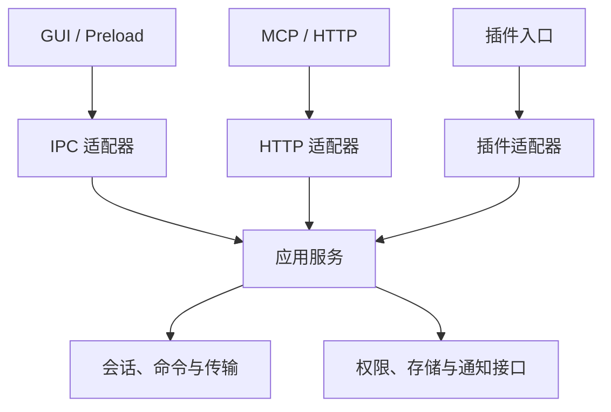

# LyShell 完整修复与架构收敛方案

> 日期：2026-10-30（北京时间）  
> 项目：[liangyou09/lyshell](https://github.com/liangyou09/lyshell)  
> 基线提交：[`a1800aeb77adfb90532007c7b282b9439c5f8d67`][commit]  
> 基线版本：2.0.2；Electron 43.7.11  
> 状态：**可执行的修复方案，尚未实施源码修改。**  
> 范围：覆盖本次架构评审发现的问题、相应兼容处理、回归保护、验证与发布步骤。

## 1. 修复目标与总体决策

**保留现有 Electron、React、TypeScript、Session/Connector、传输 Worker、Local PTY Host 与插件/Harness 架构，通过局部改造解决主线程阻塞、故障收尾、资源预算、循环依赖和验证缺口。**

本方案的目标不是按行数拆文件，而是建立可以验证的运行约束：

1. 外部提供的匹配表达式不能让主进程长时间停顿。
2. 未知进程级故障不能被记录后继续正常处理新操作。
3. 命令、批次、调用者与全局资源都有限额；返回超时不能被当作底层资源已经释放。
4. IPC、HTTP/MCP 和插件入口共享业务实现，并保留各自的身份与权限边界。
5. 高频持久化不阻塞主事件循环，且不会发生旧快照覆盖新快照。
6. 无关会话更新不会无谓刷新大量终端视图。
7. 支持平台的测试、构建与安装验收可重复执行，失败结果不能被隐藏。

这里的“完整”指覆盖本次评审范围，并为每项工作给出具体实施和验收办法；不意味着已经穷尽项目所有潜在缺陷。

### 1.1 工作包总览

| 编号 | 优先级 | 工作包 | 完成标志 |
| --- | --- | --- | --- |
| R0 | P0 | 建立基线、保留回归与验证环境 | 提交、环境、已有失败和证据归档准确 |
| R1 | P0 | 隔离所有外部正则等待路径 | 复杂表达式可被终止，主进程继续响应，控制权校验不退化 |
| R2 | P0 | 收敛全局异常和退出生命周期 | 预期错误局部处理，未知异常非零退出，正常退出有总期限 |
| R3 | P1 | 命令执行与批量输出统一预算 | 执行、排队、保留结果和响应发送均有边界 |
| R4 | P1 | 拆除循环依赖，抽取应用服务 | 指定循环组消失，业务服务不反向依赖入口注册模块 |
| R5 | P2 | 高频 JSON 持久化异步化 | 单写入者、revision 单调、故障不覆盖旧数据 |
| R6 | P2 | 缩小 renderer 订阅范围 | 无关会话变化不触发终端主体更新，IME/ACK/控制权正常 |
| R7 | P1 | 修复跨平台测试并建立持续验证 | 受支持平台具有真实、可重复的验证结果 |
| R8 | P3 | 统一浏览器宿主接口与迁移试点 | 生命周期契约稳定，试点通过验收后再决定是否迁移 |

P0 是稳定性修复的首批交付。R8 是长期维护工作，不应阻塞 R1–R3 的修复发布。以下建议的新文件名、接口和限额都是设计方案，不代表仓库已经实现。

### 1.2 必须保持的现有约束

| 现有约束 | 修复期间的要求 |
| --- | --- |
| renderer 隔离 | 保持 sandbox、contextIsolation 和受控 preload；不向 renderer 引入 Node 权限 |
| 调用者身份 | 保留 WebContents、当前文档、顶层 frame、凭据和资源可见性校验 |
| 终端控制 | 保留 controller、fence、连接 generation 与最终写入前复核 |
| 终端输出 | 保留 subscription/sequence ACK、背压、无订阅者不积压和历史预算 |
| 文件传输 | 保留 task/attempt 身份、Worker 退出后释放名额、提交不确定状态 |
| 凭据 | 保留 safeStorage/vault 引用；不增加明文降级 |
| 恢复 | 保留损坏原件；未知结果不自动重放命令、传输或审批 |
| xterm | 保留实例复用与最终 dispose；不重新引入已因 IME 问题移除的 WebglAddon |
| 既有权限差异 | GUI、外部 MCP、插件、内部任务继续使用各自权限模型 |

依据：[AGENTS.md][src-agents]、[CLAUDE.md][src-claude]、[终端输出分发][src-output-dispatcher]、[Local Host worker][src-local-worker]、[传输提交][src-transfer-commit]。

## 2. R0：基线、已知失败与回归保护

### 2.1 开始实施前的操作

1. 记录当前分支和完整提交 ID；若已经晚于本方案基线，先检查相关路径差异，不把工作区强制回退。
2. 创建独立修复分支，保留用户已有修改；每个工作包单独提交。
3. 记录 Node、npm、Electron、操作系统、CPU 架构、原生模块状态和执行命令。
4. 为每次验证保存 stdout/stderr、退出码、开始结束时间和实际提交 ID。
5. 首先建立 R1 的最小失败复现和现有关键回归集合，再改生产逻辑。

建议归档目录为 `docs/validation/2026-10-30-remediation/`，记录文件为 `baseline.md`、`results.md`、`remaining.md`。实际日期按实施日期更新。日志中不得记录 token、密钥、完整环境变量或用户终端内容。

### 2.2 已有验证基线

本次评审在 Linux、Node v24.22.1、npm 11.9.0 环境中验证：

| 项目 | 实际结果 |
| --- | --- |
| 依赖安装 | `npm ci --ignore-scripts --no-audit --no-fund` 成功；未完成原生模块重建 |
| 类型检查 | `npm run typecheck` 通过，退出码 0 |
| 全量测试 | 中途停止，未完成；不能报告全量通过 |
| 定向测试 | 12 文件中 7 通过、5 失败 |
| 定向用例 | 344 项：308 通过、36 失败，另有 1 个未处理异常 |
| 定向执行 | 退出码 1，耗时 11.58 秒 |
| 正则探针 | `timeoutMs: 500` 未约束同步匹配，约 2 秒后被外部看门狗终止 |

本次没有做完整 GUI、实际安装器、真实远端、物理串口或长时混合负载验收。现有文档里的历史通过数字必须与本轮结果分开。

### 2.3 F01–F08 作为保护性回归

最新架构验收文档已经记录以下问题完成修复；本方案不将它们重新列为现存缺陷。[来源：架构验收文档][doc-final-review]

| 编号 | 需要保留的行为 |
| --- | --- |
| F01 | 独立 SSH 命令在实际派发前重新确认身份和权限 |
| F02 | 批量执行保留真实退出码，不将失败归零 |
| F03 | dryRun 只暴露当前仍有权限查看的目标 |
| F04 | 恢复前保全损坏原件 |
| F05 | 等待接管后重新核对身份和权限 |
| F06 | secretRef 与旧明文并存时按正确优先级处理并清理 |
| F07 | 下载提交验证已打开句柄及目标元数据 |
| F08 | 自定义秘密环境变量在导出中保持加密保护 |

如果后续测试发现退化，应带上当前复现重新打开问题，不能仅依据旧文档段落判断。

## 3. R1：将外部正则匹配移出主线程

### 3.1 已确认的修复入口

| 文件 | 位置或职责 | 修改要求 |
| --- | --- | --- |
| `src/main/mcp/http-server.ts` | `handleWaitForPrompt`、`handleTailUntil` | 不在主线程构造或执行外部正则；统一调用匹配服务 |
| `src/main/terminal/session-manager.ts` | `sendAndWait` / `waitForPattern` | 采用异步匹配，维持锁、cursor、epoch、授权和输入顺序 |
| `src/main/mcp/types.ts` | 请求与返回类型 | 增加可选匹配模式及明确错误信息 |
| `src/shared/api-routes.ts` | MCP/HTTP 共同契约 | 同步参数语义、限额、错误和输出说明 |
| `electron.vite.config.ts` | 主进程构建入口 | 增加独立 matcher Worker 入口 |
| `src/main/index.ts` | 组合与退出 | 管理 Worker 池生命周期 |

建议新增 `src/main/terminal/pattern-matcher.ts`、`pattern-worker.ts`、`pattern-contract.ts`，集中管理匹配协议、预算和 Worker 生命周期。对应入口代码见 [HTTP server][src-http] 和 [SessionManager][src-session-manager]。

### 3.2 API 兼容决策

**既有 `pattern` / `waitForPattern` 未指定模式时，继续表示正则。** 不能直接将它们改为字面量，否则现有脚本中的锚点、字符组和转义会改变含义。

建议增加：

```ts
type MatchMode = 'regex' | 'literal'

// wait_for_prompt / tail_until
type PatternOptions = {
  pattern?: string
  patternMode?: MatchMode // 省略时保持现有 regex 语义
}

// send_and_wait
type WaitPatternOptions = {
  waitForPattern?: string
  waitForPatternMode?: MatchMode // 省略时保持现有 regex 语义
}
```

新界面和新示例在查找普通字符串时显式使用 `literal`。默认提示符仍使用原有的内置提示符表达式。首版不增加任意 flags 参数，避免引入 `g` / `y` 的 `lastIndex` 状态语义。

`wait_for_prompt` 省略 `pattern` 时采用内置提示符规则；此时也应省略 `patternMode`。将“没有 pattern 但显式指定 literal”的组合判为参数错误，避免把内置提示符正则误当普通字符串。

保留以下观察范围：

- `wait_for_prompt` 先检查当前最近历史，再等待新输出。
- `send_and_wait` 仅检查本次调用记录 cursor 之后的输出。
- `tail_until` 继续轮询既有最近输出范围。
- raw 与 ANSI 清洗后的两种基底继续按现有行为参与匹配。
- 输出 epoch 变化或历史缺口继续返回需核对状态的错误。

不得为了降低开销，悄悄只匹配最后一个 chunk，或无标记地截断字符串后报告“没有匹配”。跨 chunk 模式和尾部锚点必须保留回归。

### 3.3 Worker 服务设计

匹配服务只接收有界文本、表达式和请求标识，不接收会话对象、token、文件路径或执行代码。Worker 从构建产物加载，不使用外部字符串拼接生成 Worker 脚本。

建议首版使用固定大小的池，单 Worker 同时处理一个任务。每个任务携带 `jobId` 和 Worker generation；迟到消息必须匹配两个身份后才可接收。

下列数值是**待在目标机器校准的初始值**：

| 限额 | 建议初始值 | 说明 |
| --- | ---: | --- |
| 正则源长度 | 2,048 个 UTF-16 code unit | 入队前检查 |
| 单一输入基底 | 1,048,576 个 code unit | 与现有历史量级对齐；超过则明确失败 |
| 单任务输入总量 | 2,097,152 个 code unit | raw + clean 合计 |
| Worker 数量 | 2 | 包含正在停止的 Worker，不允许无限补建 |
| 待执行任务数 | 16 | 全局有界；单等待器最多一个在途任务 |
| 单调用者等待器 | 4 | 使用现有可信 principal 身份 |
| 全局等待器 | 16 | 与轮询任务数分别限制 |
| 全局保留输入 | 16,777,216 个 code unit | 同时统计排队和在途快照 |
| 单次匹配硬超时 | 100 ms | Worker 就绪后，从派发开始计时，覆盖编译和匹配 |
| Worker 启动期限 | 2,000 ms | 启动失败不回退到主线程执行 |

输入 code unit 预算并非 RSS 上限。Worker 的 `resourceLimits` 只能约束部分 JS 引擎资源，不能代替输入和队列预算，也不能保证整个进程不会 OOM。[参考：Node Worker threads][ref-node-workers]

关键实现规则：

1. 编译校验也在 Worker 中执行；无效表达式必须在发送终端输入之前发现。
2. 请求总期限、排队期限和匹配执行期限分别计算；队列等待消耗总期限。
3. 使用单调时间计算期限，避免系统时间调整影响超时。
4. 超时或取消后调用 `worker.terminate()`，等待退出确认后再归还该 Worker 的容量。
5. Worker 无法及时退出时，将该槽位保持为不可用并报告服务容量不足；不能不断创建替代 Worker。
6. 只有输出 cursor 变化或初次读取时才重新匹配，避免反复测试相同快照。
7. 队列内保存有界快照；在途快照和旧快照释放时正确归还预算。
8. 关闭服务时拒绝新任务、取消排队任务、终止在途任务，并清除监听器和计时器。

`terminate()` 是异步过程，返回的 Promise 在 Worker 退出后完成。因此“发出 terminate”不能作为资源已释放的依据。[参考：Worker terminate][ref-node-workers]

### 3.4 `sendAndWait` 的正确顺序

改为异步匹配后，原来同步编译的位置会出现新的等待。必须按以下顺序实现：

1. 同步完成参数形态与长度校验，固定 Session 对象、Connector 对象和 generation。
2. 原子占有本会话的等待锁，并记录锁的 owner；任何 finally 只能释放自己持有的锁。
3. 在 Worker 中校验表达式。校验失败时没有终端写入，锁必须释放。
4. 校验返回后重新确认会话、连接 generation、控制句柄、fence 和当前权限。
5. 记录输出 cursor/epoch，准备监听器，再通过现有受控写入路径发送输入。
6. 每次等待 Worker 返回后，重新确认观察对象仍是原会话实例，授权仍有效，且没有输出缺口。
7. 超时、撤权、断连、Worker 失败和正常返回统一清理锁、监听器、快照预算与任务句柄。

不要跨越新的 `await` 沿用一次旧的授权结果；底层 `writeToSession` 和 Host 最终写入检查仍应保留。

### 3.5 错误语义

复用 `src/shared/operation.ts` 中已有错误体系，增加必要的细分原因；不要仅将所有异常格式化为 `500 + error.message`。[来源：业务错误契约][src-operation]

| 情况 | 建议语义 |
| --- | --- |
| 表达式无效、模式不支持 | `INVALID_ARGUMENT`；没有输入副作用 |
| 入队或输入预算不足 | `RESOURCE_LIMIT`；明确是否尚未发送输入 |
| 只读等待到期 | 保留正常超时结果，例如 `matched: false` |
| 正则执行硬超时 | `RESOURCE_LIMIT`，附 `MATCH_EXECUTION_TIMEOUT` 原因，不自动重复同一表达式 |
| 会话已更换 | `STALE_GENERATION`；不接受旧匹配结果 |
| 已发出输入，随后观察失败 | `OUTCOME_UNKNOWN` + `reconcile-first`；不能让客户端自动重发输入 |

传输层错误映射必须保留 `code`、`retryDisposition` 和关联 ID，并只返回固定、公开的错误说明。

### 3.6 回归与验收

- 普通字面量、默认提示符、合法复杂正则、无效正则。
- 29 字符的已知高回溯场景在隔离测试子进程中验证；外部看门狗必须保留，不能让测试 runner 自身卡住。
- raw/clean、跨 chunk、历史预检查、新输出 cursor、清屏/裁剪造成的历史缺口。
- 编译等待期间撤权、重连、删除会话、控制权接管。
- Worker 启动失败、执行超时、异常退出、迟到消息、池关闭。
- 多调用者排队、公平性、容量回收、锁无泄漏。
- 开发构建、打包目录和实际安装产物均能加载 Worker。

**完成标准：** 所有外部等待正则入口都使用同一隔离服务；恶劣匹配期间心跳和其他请求继续响应；没有主线程回退；请求、Worker、锁和快照都能收敛到零在途状态。

## 4. R2：异常分层与退出生命周期

### 4.1 修改范围

主要涉及 `src/main/index.ts`、`src/main/quit-cleanup.ts`、`src/main/ipc/application-ipc.ts`、HTTP 入口，以及实际产生可预期错误的 Connector/任务边界。

建议新增 `src/main/lifecycle/app-lifecycle.ts` 和 `fatal-error.ts`。前者负责正常运行与退出状态，后者保持非常小的致命异常处理面。

当前主入口按错误消息关键词忽略异常，并在生产环境记录未知异常后继续运行，应移除这种恢复判据。[来源：主入口][src-main-index]

### 4.2 将错误分为三类

| 类别 | 处理位置 | 结果 |
| --- | --- | --- |
| 预期业务失败：认证失败、连接拒绝、可预期超时、用户取消 | Connector / 会话 / 任务边界 | 完整状态迁移、释放对应资源、返回结构化失败 |
| 请求内部错误，已由入口捕获 | 应用服务与入口错误边界 | 返回固定错误；检查该操作是否需标为未知结果；进程不因普通请求异常退出 |
| 真正未捕获异常或未处理 rejection | 最小致命处理器 | 记录最少诊断、停止继续服务、非零退出 |

不能根据错误 message 含 `SSH`、`timeout`、`EOF` 等字样判断进程安全。也不能把已知业务失败全部上抛，再依赖全局异常处理器维持存活。

### 4.3 致命异常路径

Node 官方建议未捕获异常后只做必要同步清理并退出；不应恢复正常运行，也不应依赖同一不确定进程完成复杂恢复。[参考：Node uncaughtException][ref-node-process]

实施顺序：

1. 使用幂等 guard 防止重复处理和递归日志失败。
2. 将生命周期状态置为 `fatal`，关闭新业务变更的入口。
3. 写入最少、脱敏、固定大小的诊断信息；日志失败也必须进入 finally 退出。
4. 只执行预先定义的最小同步失效操作；不调用普通业务仓库批量保存，不把不可信内存快照覆盖到磁盘。
5. 以非零码结束进程；不能绕回可能依赖已损坏状态的完整 `app.quit()` 流程。
6. 下一次启动按既有身份检查和保守恢复处理未完成任务，显示中断或未知结果，不自动重放。

首版默认由用户重新启动。自动重启只有在后续独立监督进程、重启频率限制和恢复测试完成后再启用。

致命退出不能保证所有外部子进程都已被回收。Local Host 断连后的 fence 失效和下一次启动的身份核对仍是必要保护；不能将异常退出报告成正常的完整清理。

### 4.4 正常退出路径

正常退出与致命退出应分开。正常退出仍可以异步清理，但总期限应从流程开始计算，覆盖 `prepareShutdown()`，不能等它完成后才启动最终等待计时器。

当前已有 `beginShutdown()`、插件准备、传输清理、Local Host 关闭、任务归档和 `waitForQuitCleanup()`，应整合这些能力。[来源：主入口退出流程][src-main-index]、[退出等待器][src-quit-cleanup]

建议生命周期：`running → draining → stopped`，任何阶段遇到未知致命异常均进入 `fatal`。

正常退出具体步骤：

1. 设置 `draining`，拒绝新的用户业务变更，保留必要的内部清理通道。
2. 撤销新终端输入能力、固定待清理资源身份。
3. 给插件 release/deactivate 一个受总期限约束的准备阶段。它使用的 token 与 HTTP 通道必须存活到该阶段结束。
4. 准备阶段结束或超时后撤销相关 token，停止外部入口。
5. 并行等待已登记的传输、终端、插件进程、Harness 和持久化任务收尾。
6. 全部成功或总期限耗尽后退出；记录未确认项目，不伪造“全部停止”。

内部清理权限只能由可信生命周期协调器授予，不能靠外部请求传入 `cleanup: true` 来绕过入口关闭。

建议保留当前约 8 秒量级的正常退出总预算作为起点，但要涵盖所有阶段并适配已有进程树清理的最小等待要求。`stopMcpHttpServer()` 等返回 Promise 的清理必须进入统一等待和错误收集，避免无观察的异步失败。

### 4.5 验收

- 预期 SSH/PTY 故障局部处理，不触发全局未捕获异常。
- 未知 `uncaughtException` 和 `unhandledRejection` 在独立进程测试中非零退出。
- 致命日志路径失败也能退出，不递归调用业务仓库。
- 插件准备永久不返回时，正常退出仍能达到总期限。
- 清理过程中某一项失败不阻断其他项；重复退出不会重复归档或释放。
- 正常退出保持插件释放顺序，异常恢复不重放未知副作用。

**完成标准：** 不再按错误字符串恢复全局服务；正常退出具有覆盖完整流程的期限；致命退出与正常退出的结果在日志和恢复状态中可区分。

## 5. R3：统一命令调度、输出与响应预算

### 5.1 问题和现有能力

`handleRunOnSessions` 最多接受 50 个目标，批次内部最多 10 并发，完成输出保留到整个批次结束。本地 `exec` 还会缓冲较大输出。按单条约 10 MiB 推演，一个批次可能保留约 500 MiB 输出；这不是实测 RSS。[来源：HTTP server][src-http]

仓库已有 `executeLocalCommandStream`、`SSHCommandExecutor.execStream`、`CommandStreamWriter`、`RequestBudget` 和命令输出限制。应复用并改造这些能力，避免再建立一套互不相通的执行器。[来源：本地流执行][src-local-stream]、[SSH 执行器][src-ssh-executor]、[请求预算][src-local-request]

### 5.2 目标组件与修改位置

建议新增：

- `src/main/commands/command-scheduler.ts`：全局实际执行调度。
- `src/main/commands/output-budget.ts`：命令、批次、全局保留量。
- `src/main/commands/command-service.ts`：单条和批量编排。
- `src/main/commands/types.ts`：执行结果、资源关闭回执和取消契约。

改造以下现有路径：

| 路径 | 改造目的 |
| --- | --- |
| `handleExecuteCommand` / 流式执行 / `handleRunOnSessions` | 共用调度与输出预算，避免从另一入口绕过 |
| `src/main/mcp/local-command-stream.ts` | 将通用执行核心移出传输层，保留兼容导出直至调用迁移完成 |
| `src/main/file/ssh-command-executor.ts` | 对接统一收集器，保留派发前 guard |
| `src/main/file/ssh-command-shell.ts` | 同步处理已有 shell 执行方式的预算、取消和退出码 |
| `src/main/file/command-output.ts` | 明确单位和溢出行为；避免双份完整结果缓存 |
| `src/shared/api-routes.ts`、`src/main/mcp/types.ts` | 同步新增字段与失败语义 |

### 5.3 预算模型

预算按四个阶段计算：等待执行、实际执行、结果保留、响应发送。HTTP 请求结束与底层执行结束分开统计。

以下是初始策略，实施时通过负载测试校准并写入集中常量：

| 预算 | 建议初始值 | 到达上限时 |
| --- | ---: | --- |
| 全局活动命令 | 16 | 有界排队；队列满明确拒绝 |
| 单调用者活动命令 | 4 | 公平轮转，防止一个批次占满 |
| 单端点活动命令 | 2 | 以受控连接身份构造端点键 |
| 全局待执行命令 | 128 | 未派发命令返回资源限制 |
| 单调用者待执行命令 | 50 | 保留 50 目标批次的使用能力 |
| 单批次保留输出 | 8 MiB UTF-8 | 触发明确的结果上限策略 |
| 全局保留输出 | 32 MiB UTF-8 | 包括活动收集和等待发送结果 |
| 全局序列化/待发送预算 | 64 MiB | 保守预留；无容量时排队或拒绝，不无界 stringify |
| 整批总期限 | 新增 `totalTimeoutMs`，建议默认 55,000 ms | 未启动项标为未执行；运行中项按真实终止状态返回 |

`timeout` 继续表示每条命令的执行期限；新增整批期限是显式的资源策略调整，必须同步文档和发布说明，不能假装与旧版本行为完全等价。

保留单命令原有上限作为额外限制，聚合预算先消除最危险的多倍累积。后续若统一收紧单命令默认上限，应明确发布这一行为变化。

UTF-8 输出预算是内容量约束，不是 JS 内存或 RSS 承诺。收集器还应保守记录字符串占用、片段数量和待编码内容；JSON 转义可能扩大响应体，不能只按原文长度预留发送预算。

### 5.4 执行与资源关闭分离

现有本地流执行在错误路径中发起进程清理后即可 reject。若调度器在 reject 时立即释放名额，旧进程仍可能活着，新进程又开始执行。

建议目标契约如下；这是接口设计，不是可直接替换现有函数的完整实现：

```ts
interface CommandExecutionHandle {
  result: Promise<CommandResult>
  resourceClosed: Promise<ResourceCloseResult>
  cancel(reason: CancelReason): void
}
```

规则：

1. 命令结果可以先返回失败，执行名额必须等 `resourceClosed` 确认后释放。
2. 本地资源关闭要观察进程退出和所属进程树清理结果，保留现有 PID 身份检查与平台保护。
3. SSH 的 channel 关闭仅说明本地通道释放，不能保证远端进程树或已 detach 命令全部终止。
4. 远端状态不确定时明确返回 `OUTCOME_UNKNOWN`，不自动重发命令。
5. 本地清理不能确认时，保留被占用容量或进入受限状态，不无限补开执行槽位。
6. 取消必须幂等，并处理取消先于 channel-open、spawn 失败和迟到 close 等时序。

### 5.5 输出收集与兼容语义

单条与批量执行共用有界收集器。stdout/stderr 的解码使用现有增量解码思路，避免 UTF-8 多字节字符跨 chunk 损坏。

首版采用明确失败策略：

- 完整完成才返回旧字段 `output` 和真实 `exitCode`。
- 达到预算时设置该项 `error` 与 `code: RESOURCE_LIMIT`；如保留诊断文本，使用可选 `partialOutput`，不要把它放进正常 `output` 冒充完整结果。
- 如果中止执行的结果无法确认，优先使用 `OUTCOME_UNKNOWN` 并附结果上限这一原因。
- 未开始执行的目标明确标记 `not-started`，不能报告“已取消成功”。
- 新增字段只做补充；维持批次顶层与逐项结果的既有结构，单项失败继续不代表其他项失败。
- 不因为输出满了就自动重试或重复执行。

第一阶段不必新增结果落盘服务。需要大结果的调用者使用已有流式路径，但流式路径同样要处理慢客户端、队列上限和背压；“流式”不等于无预算。

HTTP 连接断开默认保持既有的已接受任务语义，不借此宣称命令已停止。结果发送预算可以在连接关闭后释放，执行预算仍持续到资源关闭。显式取消、业务期限和应用退出可以终止任务，但必须遵守以上结果确认规则。

### 5.6 派发顺序和权限

批次建立时固定目标身份；批准后排队；出队后重新核对调用者、会话对象、连接 generation、端点和权限；获得连接后再做最终派发 guard。

授权弹窗和队列等待都可能跨越撤权、重连或插件禁用。保留现有 `commandDispatchGuard`，不能在服务抽取时仅检查 sessionId。

dryRun 不占用执行名额、不触发执行确认，并在异步读取完成后再次确认可见性。批量退出码继续保护 F02。

### 5.7 验收

- 两个以上调用者同时发起多个 50 目标批次，实际活动命令和保留输出都不突破计数预算。
- 无限输出、stderr 密集输出、超大单 chunk、中文跨 chunk、JSON 转义密集输出。
- 客户端很慢、断开、请求超时、显式取消、应用退出。
- 结果已失败但进程仍在停止时，名额不会提前释放。
- SSH 关闭通道不能伪造远端命令已确认终止。
- 队列等待期间撤权、重连、插件禁用，最终不发生错误派发。
- 校验 `false` 等非零退出、无退出码、spawn 失败及清理失败。

**完成标准：** 所有相关入口共享预算；容量在真实资源回收后归还；结果完整性和副作用是否确定可被调用者识别。

## 6. R4：消除循环依赖，按业务用例收敛入口

### 6.1 已确认的循环组

静态 import/re-export 扫描排除显式 type-only 导入后，发现三个需要处理的运行时强连通分量：

| 循环组 | 涉及模块 |
| --- | --- |
| 主进程入口与插件 | `ipc/handlers.ts`、`mcp/http-server.ts`、`mcp/exclusive-routes.ts`、`plugin/host-mgr.ts`、`plugin/view-actions.ts`、`plugin/view-bridge.ts` |
| 存储 | `storage/repository.ts`、`storage/secret-store.ts` |
| renderer 文档动作 | `commands/doc-actions.ts`、`commands/inventory.ts`、`components/DocPanel/readDoc.ts` |

这证明存在维护和初始化顺序风险，不等于已经复现循环导入导致的启动崩溃。

### 6.2 先做四个小范围依赖调整

**A. 通知从 IPC 注册文件移出。**

将会话更新、打开连接对话框、MCP 锁变化和共享工作台详情等通知移到 `src/main/events/application-notifications.ts`。Electron 广播适配器继续校验窗口未销毁且 WebContents 受信任。HTTP 和应用服务依赖通知接口，不再导入 `ipc/handlers.ts`。[来源：现有广播实现][src-ipc-handlers]

服务层应接收类似 `notifySessionsChanged()` 的窄接口，不直接读取所有 BrowserWindow。广播 payload 不增加凭据或内部对象。

**B. MCP 注册配置从 HTTP server 移出。**

将 `buildMcpAddCommand`、`getMcpAddCommandForIpc` 相关职责迁至 `src/main/mcp/client-config.ts`。配置生成核心接收明确输入，例如脚本路径、userData 路径和二进制路径；Electron 路径读取与设置读取放在调用适配处。保留 JSON、TOML、Windows 路径转义及 `ELECTRON_RUN_AS_NODE` 行为。[来源：现有配置生成][src-http]

**C. 端口读取使用已有轻量模块。**

`plugin/host-mgr.ts` 等消费端直接使用 `mcp/http-port.ts`，不为读取一个端口加载整个 HTTP server。[来源：端口模块][src-http-port]

**D. 路径和文档常量下沉。**

- 将 `getConfigDir` 放入 `storage/paths.ts`，由 repository 和 secret store 共同依赖；保持懒读取，不能在模块导入时提前调用 `app.getPath('userData')`，以免破坏开发数据目录隔离。
- 将 `DOC_ACTION_SCHEME` 移到无副作用的 `commands/doc-action-contract.ts`，让 inventory 不再导入完整动作执行模块。
- 更新消费者与测试 mock，不以动态 import 隐藏原来的循环。

依据：[repository][src-repository]、[secret store][src-secret-store]、[文档动作][src-doc-actions]、[文档清单][src-inventory]。

### 6.3 再抽取应用服务

优先抽取这次修复已经需要共用的用例，避免同时重写所有入口：

| 应用服务 | 初始职责 | 不应依赖 |
| --- | --- | --- |
| `CommandService` | 单条、流式、批量执行的调度与结果 | HTTP response、BrowserWindow、IPC 注册文件 |
| `TerminalObservationService` | 只读等待、匹配和观察生命周期 | 具体 MCP 传输协议 |
| `SessionApplicationService` | 创建、连接、关闭及相应通知 | renderer store、HTTP 路由注册 |
| `PluginLifecycleService` | 禁用/卸载时资源失效、清理和结果 | IPC handlers 与 HTTP server 的互相调用 |

`PluginLifecycleService` 应复用当前插件资源管理器与 release 操作，不另建全局“插件真相源”。共享业务服务与现有 `createTaskShelfService(deps)` 的依赖注入方式保持一致。[来源：任务 shelf 服务][src-task-shelf]

建议方向：



入口负责解析与格式映射；应用服务负责用例顺序；协议实现负责最终资源操作与必要的再次校验。组合根注入依赖。只在需要业务共用时提取，不以“每个文件不超过若干行”为目标。

### 6.4 权限与契约保护

复用现有 `CallContext`，但不能仅因为上下文里有 principalId 就视为已授权。服务依赖可信的授权检查或 guard，并在跨越 await 后重新检查当前权限。

变更 IPC 时同步检查四处：handler、validator、preload bridge、消费 store/hook。变更 MCP 时同步 `api-routes.ts`、请求/返回类型、实际 handler、说明与协议测试。不要将 HTTP 的权限实现变成 GUI 的默认授权策略。

### 6.5 依赖边界门禁

增加一个窄范围依赖检查脚本，例如 `scripts/check-architecture-boundaries.cjs`：

- shared 不导入 main/renderer。
- renderer 不导入 main 或 Node 能力。
- 应用服务不导入 `ipc/handlers.ts`、`mcp/http-server.ts` 或 renderer。
- secret store 不依赖综合 repository。
- 指定三个循环组必须消失；新循环不得引入。

检查应解析 TS import/export 与别名，正确识别 type-only 边；动态 import 另外列出，不以改成动态导入作为通过手段。脚本只能给出静态证据，关键生命周期仍要实测。

**完成标准：** 三个已知循环组均解除，关键服务可在无 Electron 窗口环境中验证，所有原有身份/权限与输出契约回归通过。

## 7. R5：高频持久化的串行异步写入

### 7.1 首批范围

优先改造 `src/main/storage/mcp-audit-repository.ts` 的持续保存，复用 `atomic-json.ts` 的写入能力。下载历史等已有异步仓库纳入同一时序检查，但不为了统一形式重写所有低频仓库。

涉及秘密写入、引用变更与配置提交的事务顺序保持原有保证。低频同步接口在没有完成调用链改造前可以保留；不能把返回类型从同步变为异步后，让上层仍提前显示“已保存”。

当前 audit 使用 2 秒 debounce，实际仍进行同步 stringify、原子写入和备份。[来源：审计仓库][src-audit]

### 7.2 串行写入器

建议新增 `src/main/storage/serialized-json-writer.ts`，按目标路径保证一个实际写入者。内部维护：

```ts
interface PersistenceState {
  currentRevision: number
  committedRevision: number
  dirtySince: number | null
  activeWrite: boolean
  lastFailure: PersistenceFailure | null
}
```

具体规则：

1. 变更进入内存时生成单调 revision；实际提交成功后才推进 committedRevision。
2. 同一目标文件的主文件与备份更新保持有序，不启动并行 rename。
3. 可合并的是“完整状态快照”，不能只留下最后一条审计事件。
4. 写入中的快照不可被后续内存变更修改。
5. 合并 revision 时，旧调用的等待者只有在包含其变更的新快照成功提交后才能完成。
6. 写入失败保留 dirty 状态和失败信息，不把 committedRevision 提前推进。
7. 备份失败与主提交失败区分：主文件已经提交时不能做错误的内存回滚。
8. 为 `clear()`、保留上限修改和迁移建立顺序屏障；旧快照不能在 clear 之后重新出现。

### 7.3 debounce、最大等待与 flush

保留约 2 秒 debounce，并增加例如 5 秒的最大等待窗口作为初始值。持续输入不能无限推迟落盘。最大等待只约束开始保存的调度，不意味着慢磁盘必然在 5 秒内完成。

定义 `flush(targetRevision)`，等到至少该 revision 成功提交或明确失败。正常退出协调器在停止新写入后捕获目标 revision，将 flush 纳入 R2 的总期限。

有异步写入在途时，不能另起同步 flush 去写同一路径；否则旧异步任务可能最后覆盖新同步快照。致命异常路径也不能重新序列化全部业务内存。

退出期限耗尽时只能记录未确认状态，不能声称数据已经全部保存。

### 7.4 原子性和性能边界

现有异步 `atomicWriteFile` 与同步版的父目录同步处理并不完全相同。迁移前要核对并对齐所需保证：同目录唯一临时文件、排他创建、权限、完整写入、文件同步、关闭、rename、平台允许时的目录同步，以及失败保留原件。[来源：原子写入实现][src-atomic-json]

不要用 `writeFile(target)` 直写覆盖替代原子替换。Windows 上不能承诺与 POSIX 目录同步完全相同的持久性语义。

异步 fs 不会自动消除 `JSON.stringify` 和快照拷贝的主线程成本。因此：

- 为序列化和写入分别记录耗时。
- 保持审计保留量有界。
- 如果代表性数据的序列化持续超过约 16 ms，单独评估把有界快照的序列化交给 Worker，并测量 structured clone 成本。
- 不能只换成 async 函数就宣布已经消除主线程卡顿。

首批保持磁盘格式兼容，不引入 SQLite 或跨文件事务迁移。以后只有查询、事务和写入负载出现明确需求时，再建立独立数据库迁移计划。

### 7.5 故障与迁移

- 损坏文件继续只读保护，不以空状态覆盖原件。
- 旧目录迁移必须在新目录提交成功后再删除旧文件。
- 失败重试有次数、退避和总预算；永久权限错误不能高频循环。
- 审计查询仍可读取内存状态，但设置页应能区分“尚未提交”和“保存失败”。
- 任何把 `setRetentionLimit` 等接口改为 Promise 的改动，都要同步 IPC、preload 和调用界面，保持“保存成功后再确认”的语义。
- JSON 与 vault 不是整体事务；保留现有引用创建、主记录提交和失败补偿顺序，补偿只能删除本次创建且仍无引用的条目。

### 7.6 验收

- 连续 revision、写入过程中追加、旧快照迟到、多个 flush 同时等待。
- clear 与保存交错，重启后不会恢复已清除记录。
- 主写失败、备份失败、rename 失败、权限不足、磁盘满。
- 损坏原件、旧目录迁移失败、正常退出中达到期限。
- 持续审计输入下最大等待策略有效，主线程延迟较基线改善。

**完成标准：** 高频路径不再同步执行磁盘写入；提交顺序可证明；数据格式和恢复保护保持兼容；序列化剩余成本有实测记录。

## 8. R6：renderer 订阅与终端生命周期

### 8.1 先改明确的大范围订阅

`TerminalView.tsx` 当前不带 selector 订阅 terminal store 和 session store，再查找当前会话。先将 action 和当前会话订阅分开。[来源：TerminalView][src-terminal-view]

建议形态：

```ts
const getTerminal = useTerminalStore(state => state.getTerminal)
const registerTerminal = useTerminalStore(state => state.registerTerminal)
const session = useSessionStore(
  state => state.sessions.find(item => item.id === sessionId)
)
```

以上代码成立的前提是无关会话更新时保留当前 session 对象引用。若现有更新逻辑每次重建所有条目，则先修正这一点，或者进一步订阅组件所需的稳定字段。

不要让 selector 每次返回一个新对象再依赖默认相等比较。确需多个字段时使用当前 Zustand 版本支持的浅比较方法，并明确订阅范围。

### 8.2 保护关键行为

- xterm 实例继续由 terminal store 管理，普通 tab 切换不重新创建。
- SearchAddon、FitAddon 和 output cleanup 随终端实例正确存活和释放。
- 输出 ACK 仍在 xterm write 完成后发送。
- 控制权撤销、MCP 锁和 shelf 的可交互状态及时更新输入门控。
- 回调不能因减少 effect 依赖而捕获过期的授权、尺寸或 sessionId。
- 保留中文输入法、多屏 DPI 和已有 WebglAddon 禁用要求。

### 8.3 验证方法

使用 React Profiler 记录 1、10、30 个已挂载终端场景。改变一个后台会话的活动状态、尺寸或备注，检查无关终端主体是否发生提交。对比优化前后同一操作，不仅比较页面总体 FPS。

增加一个能捕获无关状态更新导致终端重建或重复订阅的行为回归即可，不需要为每个 selector 写镜像测试。

人工检查：活动终端输入、跨 tab 搜索、中文 IME、分屏切换、shelf 收纳/激活、控制权交接、断线重连和关闭清理。

**完成标准：** 无关 store 更新不触发大面积终端主体刷新；终端实例数和监听器数在切换后稳定；输入控制和 ACK 行为无退化。

## 9. R7：跨平台测试、CI 与发布验证

### 9.1 逐项处理已有失败

| 已有问题 | 修复步骤 | 禁止的处理方式 |
| --- | --- | --- |
| `proc.test.ts` 118 项中 32 失败 | 将平台决策显式注入进程操作依赖；分别测试 Windows taskkill/Job 和 POSIX 分支；再跑真实平台集成 | 为了通过把 Linux 断言直接改成空数组，或全局跳过 |
| `atomic-json.test.ts` 23 项中 1 失败 | spy 按路径/标志区分临时文件和目录同步打开；验证行为而非所有 openSync 调用数量 | 删除原子性故障注入验证 |
| `local-host-client.test.ts` 26 项中 2 失败 | 把目录创建失败、PTY 创建后失败、断开事件时序分开；确保假启动器的异步失败被观察 | 假定所有超时都是环境问题、单纯延长等待 |
| `local-host-worker.test.ts` 23 项中 1 失败 | 核对临时目录、userDataDir、pipe ownership 的身份约定；分别验证有效与伪造描述符 | 放宽生产 ownership 校验来迁就夹具 |
| `examples/web-ssh/server.test.ts` 收集失败 | 在独立示例目录安装锁定依赖，并为示例建立独立测试 job | 根测试简单排除后不再验证示例 |

Local Host 的失败尚未全部完成原因归类。实施者需要先复现并确认夹具还是实现问题，不能在方案阶段宣称已经定位或修复。

### 9.2 修改现有配置，避免漏测

仓库已经有 `vitest.config.ts`。应修改它，而不是按过时文档另建重复配置。[来源：Vitest 配置][src-vitest]

建议职责划分：

| 集合 | 覆盖内容 |
| --- | --- |
| 根 Vitest | `src`、`scripts` 下既有测试；`examples` 顶层验证与 `examples/legacy-transfer` |
| Web SSH 示例 | 独立安装 `examples/web-ssh/package-lock.json`；覆盖 `server.test.ts` 和 `web/terminal.test.ts` |
| Node 原生 test runner | 两个 `scripts/shelf-memory-p0/*.node-test.cjs`，独立脚本执行 |
| Electron 集成 | 实际 Electron、原生模块、Worker/Host 启动、关闭与故障 |
| 安装验收 | 安装/升级后的真实应用与安装目录 |

若根 Vitest 排除 `examples/web-ssh/**`，同一个提交必须同时增加对应 job。其余没有独立 package.json 的 examples 测试继续由根环境负责。

`src` 之外的 10 个 Vitest 测试文件不得遗漏：

```text
examples/legacy-transfer/integration.test.ts
examples/legacy-transfer/transfer.test.ts
examples/manifests.validate.test.ts
examples/src-ps7-launcher.test.ts
examples/web-ssh/server.test.ts
examples/web-ssh/web/terminal.test.ts
scripts/default-browser.test.ts
scripts/electron-builder-cache.test.ts
scripts/postinstall.test.ts
scripts/rename-unpacked.test.ts
```

另外两份 Node 测试为 `history-benchmark.node-test.cjs` 与 `history-fixtures.node-test.cjs`，不要因为不匹配 `*.test.ts` 而遗失。

### 9.3 建议的持续验证任务

新增 `.github/workflows/ci.yml`，以仓库实际支持平台为矩阵，并使用与 lockfile 对齐的安装方式。首次实施可使用本次验证过的 Node 24 系列建立基线，同时核对最低支持 Node 22.12；不要顺便升级 Electron 或大批依赖。

| 任务 | 必做内容 |
| --- | --- |
| 静态与逻辑 | typecheck、受影响 lint、依赖边界检查、根 Vitest |
| 示例 | 独立 Web SSH 安装、typecheck、两套测试 |
| 平台进程 | Windows / Linux / macOS 上进程树、Local Host、取消和退出测试 |
| 构建与原生模块 | 正常安装、`npm run rebuild`、`scripts/check-native.cjs`、`npm run build` |
| Electron 冒烟 | 复用并扩展 `scripts/architecture-electron-smoke.cjs`，验证新 Worker 和关键生命周期 |
| 发布候选 | 目标平台打包、实际安装/升级与已安装应用验证 |

不要跨操作系统、架构或 Electron/Node ABI 复用已编译的原生模块缓存。`--ignore-scripts` 只适用于明确不依赖安装后准备的任务，不能替代 Electron 验收。

测试使用独立 userData 与临时目录，动态端口，关闭所有监听器和子进程；不要接入用户正在使用的会话和凭据。

### 9.4 发布前的真实场景

1. Windows 安装、新版本覆盖升级、便携模式及已安装 exe 启动与退出。
2. 支持的 macOS/Linux 产物与原生模块加载。
3. 真实 SSH/SFTP 大文件、断网、取消、重连、目标变更和结果不确定状态。
4. 物理串口连接、断开与退出；没有设备时记录未执行，不能记为通过。
5. 多终端输出、并发批量命令、传输、网页和 Harness 的混合负载。
6. 中文 IME、多屏混合 DPI、网页上传/通话、休眠恢复与窗口关闭。

开发 Electron 加载打包资源只能作为中间验证，不能代替安装验收。最新源码修复后必须重新构建最新 app.asar 和安装器。

### 9.5 通过标准

- 受影响测试必须全部通过，未处理 rejection 为零。
- 完整测试结果要与同一提交对应，不能复用旧通过数字。
- 与运行安全相关的未解释失败阻止正式发布。
- 硬件或第三方环境缺失只能记录为未验证，并限定发布声明；不能自动转成绿色。
- 不通过删除断言、放宽安全校验或扩大无理由 timeout 来修复测试。

## 10. R8：浏览器宿主统一与迁移试点

### 10.1 范围与目标

当前 webview 已经有 partition、preload、导航与 shelf generation 管理。先建立统一接口，再决定哪些场景迁移到 WebContentsView。Electron 官方对 webview 的架构与稳定性风险已有提示；WebContentsView 是可评估的替代方式，但它不能自动改善内存。[参考：webview][ref-electron-webview]、[WebContentsView][ref-electron-webcontentsview]

首批新增 `src/main/browser/browser-host.ts` 与对应 renderer 代理契约，统一以下操作：

- 创建、附着、隐藏、销毁和查询状态。
- navigate、back、forward、reload。
- focus、bounds、visibility。
- screenshot / preview。
- 生命周期事件、崩溃和恢复。

renderer 只持有受校验的宿主标识和状态，不持有可随意构造权限的原生对象。

### 10.2 两阶段实施

**阶段 A：用现有 webview 实现接口。**

先替换直接调用处，保持现有行为。保留 partition 与 preload 白名单、真正的 WebContents 身份校验、navigation/resource generation，以及明确可重载 URL 和只读模式的休眠规则。

**阶段 B：单个只读网页场景试点 WebContentsView。**

试点以内部开关控制宿主类型，记录宿主类型，不迁移用户账号或重新划分登录 partition。对比 focus、IME、DPI、截图、页面导航、关闭和恢复。

原生 view 与 DOM 在覆盖层、裁剪和 z-order 上的行为不同。要验证侧栏遮挡、弹窗、分屏拖动、隐藏页签和菜单，不应只以“页面能打开”为迁移成功。

### 10.3 退出与回退

移除 view 与销毁 WebContents 要分别确认，避免仅从窗口移除却保留后台页面。关闭失败保留可核对状态；迟到导航事件不得作用于已替换的 generation。

回退仅切换宿主实现，保留相同权限、partition 和状态机约束。不得为了试点成功放宽导航、preload 或私有协议权限。

**完成标准：** 所有目标调用经统一宿主接口；单场景试点达到相同交互与生命周期标准；有完整进程内存对比后，再决定是否扩大迁移。

R8 不作为 P0/P1 修复的前置条件。

## 11. 分批实施、依赖与文件归属

### 11.1 推荐提交顺序

| 批次 | 内容 | 前置条件 | 合并时必须拿出的证据 |
| --- | --- | --- | --- |
| A0 | R0 基线与最小回归 | 无 | 固定提交、环境、已有失败清单、R1 隔离复现 |
| A1 | R1 匹配服务和入口接入 | A0 | 隔离、超时、撤权/重连、锁释放与打包加载测试 |
| A2 | R2 预期错误收口、致命异常、正常退出总期限 | A0；与 A1 对齐 shutdown 接口 | 独立进程故障测试、退出期限与插件顺序测试 |
| A3 | R3 调度器、输出预算、生命周期回执 | A0；R1/R2 接口稳定 | 多批次压力、迟到退出、取消、退出码与未知结果验证 |
| B1 | R4 小范围解环和服务迁移 | A1–A3 核心行为已稳定 | 三个循环组消失，原有授权与行为回归通过 |
| B2 | R5 audit 串行异步持久化 | R2 正常退出协调已稳定 | revision、clear、故障、flush 与主线程延迟记录 |
| B3 | R6 selector 和订阅范围 | 可独立开始 | React Profiler 对比、IME/控制权/ACK 回归 |
| C1 | R7 完整 CI 与发布候选验证 | 从 A0 开始建设；最后覆盖全部改动 | 支持平台完整结果、最新构建与安装记录 |
| C2 | R8 浏览器宿主与单场景试点 | P0/P1 已收敛 | 生命周期、交互、内存对比和回退演练 |

R7 的基线修复应与 A1/A2 并行推进，不能等功能改完才发现验证环境不可用。CI 的最终通过条件则必须覆盖最后实际合并的提交。

### 11.2 可以并行的工作

- R1 的匹配 Worker 与 R2 的生命周期模块可以并行，但由一个集成负责人修改 `index.ts` 和 HTTP 入口。
- R4 的 storage paths、renderer 文档常量解环可以独立完成。
- R6 可在独立分支进行，避免与主进程行为修改混在同一提交。
- 文档、日志整理和平台测试执行可并行；代码评审与最终判断由主代理亲自完成。

### 11.3 共用文件的归属

| 共用文件 | 约定 |
| --- | --- |
| `src/main/mcp/http-server.ts` | 由入口集成负责人统一修改；其他工作包先交付服务模块 |
| `src/main/index.ts` | 由生命周期负责人统一接线与退出登记 |
| `src/shared/api-routes.ts`、`src/main/mcp/types.ts` | 由协议契约负责人统一本轮字段和说明 |
| `src/main/terminal/session-manager.ts` | 由终端负责人维护锁、cursor、generation 和控制权 |
| `vitest.config.ts`、CI、package scripts | 由验证负责人维护，避免遗漏测试集合 |

每个 PR 包含明确的问题、改变后的行为、兼容影响和实际验证结果。不要将所有工作合并为一次大重构。

## 12. 协议、数据与回退规则

### 12.1 协议变化清单

| 变化 | 兼容要求 |
| --- | --- |
| `patternMode` / `waitForPatternMode` | 可选；省略保留 regex；新示例显式使用 literal |
| 匹配限制原因 | 保留现有错误码体系，附固定细分原因；不暴露表达式内容 |
| 批量总期限 | 新增明确字段；保留原 `timeout` 的单命令含义；发布说明列出默认策略变化 |
| 结果上限 | 旧客户端继续能看到 `error`；部分结果放 `partialOutput`，不伪装完整输出 |
| 关闭回执 | 内部明确 result 与 resourceClosed；不对外承诺远端进程树已终止 |
| 应用服务提取 | HTTP 路径、IPC channel、权限和既有返回字段优先保持 |
| 异步保存 | 调用方等待真实提交；不能让原来的同步成功提示提前出现 |

新增错误映射必须同时测试 HTTP 和 stdio MCP 投影。已有 `api-routes.ts` 是共同工具定义来源，不要再手写第二套互相漂移的 schema。

### 12.2 数据兼容

首批修复保持配置、vault、审计与任务文件格式兼容。若某个后续改动确实需要 schema 升级，必须单独补齐：版本识别、只读预检查、原件保全、提交点、失败恢复以及旧版本读取限制。

不能用“启动时自动重写所有文件”代替迁移策略。备份或回退时保留最新用户数据，不用旧备份覆盖修复期间新增的记录。

### 12.3 各工作包的回退办法

| 工作包 | 允许的回退方式 | 不允许的退路 |
| --- | --- | --- |
| R1 | 关闭自定义 regex 能力并明确报错，保留安全字面量能力 | Worker 失败后回到主线程执行外部正则 |
| R2 | 回退某个局部业务错误处理改动，保留致命退出策略 | 恢复“未知异常记录后继续服务” |
| R3 | 在已验证范围内调整预算、暂时限制批次规模 | 关闭全局限制、提前释放未关闭资源的名额 |
| R4 | 单独 revert 纯依赖调整提交 | 把已修复的授权或预算一并撤销 |
| R5 | 应用停止后切换实现，保持磁盘格式；重新启动前确认无旧写入者 | 运行中同时启动同步与异步写入同一路径 |
| R6 | 回退 selector 改动，保持原有终端实例生命周期 | 为降低渲染成本移除输入门控或 ACK |
| R8 | 切回已验证的 webview 宿主实现 | 放宽 partition、导航、preload 或身份限制 |

## 13. 可观察性与性能验收

### 13.1 复用现有诊断框架

仓库已有有界诊断事件与请求上下文，应扩展固定指标，不另建无界日志数组。[来源：诊断事件][src-diagnostics]

建议采集以下指标：

| 范围 | 指标 |
| --- | --- |
| 匹配 | 活动/排队数量、输入预算、等待时间、执行时间、超时数、Worker 退出与补建次数 |
| 命令 | 全局/调用者/端点活动数、排队数、保留输出、待发送预算、资源停止时间 |
| 持久化 | current/committed revision 差距、dirty 时长、序列化与写入耗时、失败阶段 |
| 退出 | 各阶段耗时、未确认资源数量、到达总期限的次数 |
| renderer | 终端实例数、订阅数、指定操作的 commit 次数和耗时 |
| 整体 | main 事件循环延迟，各进程 RSS/工作集，CPU，句柄/子进程数量 |

指标不要以原始命令、表达式、sessionName、token 或无限数量的 requestId 作为持久标签。必要诊断保留 requestId 关联，但事件缓存和保留期必须有界。

### 13.2 建议负载场景

| 场景 | 最低验证内容 |
| --- | --- |
| 匹配压力 | 正常与高回溯表达式并发；保持心跳和无关请求；重复超时后池不增长 |
| 命令压力 | 多调用者、多批次、大 stdout/stderr、慢客户端与中途断开 |
| 终端压力 | 多会话持续输出、隐藏/显示、重连、历史裁剪和控制权切换 |
| 存储压力 | 持续审计、较大保留量、慢磁盘模拟、写入失败、退出 flush |
| 混合压力 | 终端、文件传输、网页和 Harness 同时工作；观察至少 60 分钟代表性负载 |
| 回收阶段 | 停止负载后继续观察活动任务、队列、Worker、子进程与监听器是否收敛 |

正式安装验收使用实际目标设备；CI 中使用可重复的较短负载。长时间测试不是每次小改动都重跑，只有相关资源路径变化或仍有泄漏风险时才扩大范围。

### 13.3 性能判断口径

可以先将主进程心跳 p95 小于约 50 ms、恶劣匹配期间其他轻量请求不出现秒级停顿作为目标，再根据目标设备建立固定门槛。**这些是建议目标，不是当前实测性能或任何硬件上的保证。**

内存验收关注：预算计数不突破上限、活动资源不随轮次增长、停止负载后 retained heap/句柄稳定。V8 和操作系统可能保留已分配内存，所以不能仅要求 RSS 立刻回到初始值。

记录主进程、renderer、GPU、PTY/插件/Harness 子进程的完整范围。现有单 Node 合成 benchmark 不足以代表桌面应用整体。[来源：既有 benchmark 范围][doc-benchmark]

## 14. 统一验收矩阵

| 验收 ID | 场景 | 必须观察到的行为 | 关联工作包 |
| --- | --- | --- | --- |
| M01 | 高回溯正则 | Worker 被终止，主进程持续响应 | R1 |
| M02 | 无效正则 + 待发送输入 | 输入未发送，锁释放 | R1 |
| M03 | 编译/匹配期间撤权或重连 | 旧结果不接受，不向新连接发送旧请求 | R1 |
| M04 | 输出跨 chunk、ANSI、历史缺口 | 语义保持，缺口明确失败 | R1 |
| M05 | Worker 迟到、关闭失败 | 不重复完成、不提前归还容量 | R1 |
| E01 | 预期连接错误 | 局部收尾，进程保持正常 | R2 |
| E02 | 未捕获异常 / 未处理 rejection | 非零退出，不写入不可信业务快照 | R2 |
| E03 | 插件准备挂起 | 总退出期限覆盖准备阶段 | R2 |
| E04 | 多次退出与单项清理失败 | 幂等、其他清理继续、未确认结果可见 | R2 |
| C01 | 多个 50 目标批次 | 执行、排队、输出和响应预算都有效 | R3 |
| C02 | 超时但进程仍在退出 | 执行名额保持占用直到资源确认 | R3 |
| C03 | SSH 通道关闭 | 不伪造远端进程终止 | R3 |
| C04 | 慢客户端 / 断开 | 发送队列有界，执行语义明确 | R3 |
| C05 | 非零退出、输出超限、未派发项 | 退出码与完整性/执行状态准确 | R3 |
| A01 | 依赖扫描 | 三个已知循环组消失，无新循环 | R4 |
| A02 | GUI/MCP/plugin 同一用例 | 行为共用，身份和权限仍区分 | R4 |
| S01 | 写入完成乱序风险 | 同一路径串行，revision 单调 | R5 |
| S02 | clear 与保存交错 | 重启不复活旧数据 | R5 |
| S03 | 主写/备份/rename 失败 | 原件保留，提交结果准确 | R5 |
| S04 | 退出时在途写入 | 无同步/异步双写，未确认状态可见 | R5 |
| U01 | 无关会话更新 | 当前终端主体不发生多余提交 | R6 |
| U02 | IME/控制权/ACK/tab 切换 | 原有关键行为保持 | R6 |
| T01 | 支持平台测试 | 失败归因准确，无未处理异常 | R7 |
| T02 | 最新安装器安装/升级 | 已安装应用加载全部产物并正常退出 | R7 |
| B01 | 宿主替换、隐藏和销毁 | 不残留 WebContents，不接受旧 generation 事件 | R8 |
| B02 | 原生 view 遮挡与输入 | 分屏、菜单、覆盖层、IME、DPI 行为满足要求 | R8 |

## 15. 发布与交付清单

### 15.1 首批稳定性修复的发布门槛

- [ ] R1 所有受影响入口接入隔离匹配，关键回归通过。
- [ ] R2 全局异常不再吞掉，正常退出总期限有效。
- [ ] R3 预算与资源关闭回执通过多批次验证。
- [ ] F01–F08 相关保护性回归保持通过。
- [ ] 受影响 lint、typecheck、build 和必要完整测试在同一提交上通过。
- [ ] 已解释并处理与发布功能相关的 Local Host/进程测试失败。
- [ ] 最新 Worker/Host 入口包含在实际安装产物中。
- [ ] 更新 API 说明、变更日志、错误含义与资源限制说明。
- [ ] 安装、升级、真实退出与恢复验证有记录。

R4–R6 可在后续小版本完成，但若与首批代码合并，则它们对应验收同样必须通过。R8 保持独立试点。

### 15.2 每个工作包的交付内容

1. 一个范围清晰的提交或 PR。
2. 改动文件清单及新旧行为说明。
3. 与风险直接相关的复现和回归测试。
4. 实际执行命令、环境、退出码与结果。
5. 兼容影响、已知限制和回退方法。
6. 更新后的文档与未完成项，区分“未执行”“跳过”“失败”。

依据仓库要求，所有代码变更和委派实现都必须由主代理亲自审阅；平台日志整理不能替代代码评审。[来源：仓库工作约束][src-agents]

### 15.3 本方案完成后的架构状态

预期形成的结构是：入口薄、业务编排集中、协议实现保留最终校验、耗时工作有隔离、资源生命周期有回执、持久化有顺序、测试结果有平台边界。

当前没有必要大范围引入 Rust。只有实际 profiling 证实冷历史压缩、索引、搜索或 ANSI 处理是稳定瓶颈时，才为这些窄模块建立独立试点；权限、结果预算和生命周期仍由上述设计负责。[背景：内存与 Rust 计划][doc-rust-plan]

---

## 附录 A：给实施者的简短执行说明

从本方案固定提交与当前工作区差异开始，按 A0、A1、A2、A3、B1–B3、C1 顺序推进。先建立可失败的关键行为验证，再修改生产逻辑。R7 验证环境建设从 A0 同时开始；R8 独立进行。

不要直接全量重写 `http-server.ts`、`handlers.ts` 或 SessionManager。每一阶段先完成独立服务，再由同一集成负责人接入入口。所有新 await 边界都检查会话身份、generation 和权限；所有“取消/超时”都区分请求结果与资源是否真正结束。

不得用删除测试、放宽授权、隐藏失败、自动重放未知副作用、明文秘密降级或主线程正则回退来完成任务。每阶段结束提供改动、验证、限制与回退记录，由主代理检查后进入后续阶段。

本方案中的预算是可实施的起点。调整时必须同时更新集中常量、schema/文档和相关压力测试，不能只改代码里的魔法数字。

## 附录 B：本次定向测试集合

以下集合用于对应基线结果，不代表修复完成后的全部验收范围：

```bash
npm run typecheck

npm run test -- \
  src/main/dsh/proc.test.ts \
  examples/web-ssh/server.test.ts \
  src/main/dsh/exclusive-bridge.test.ts \
  src/main/dsh/bridge.test.ts \
  src/main/terminal/local-host-worker.test.ts \
  src/main/terminal/local-host-client.test.ts \
  src/main/mcp/command-dispatch-authorization.test.ts \
  src/main/mcp/terminal-control-authorization.test.ts \
  src/main/terminal/output-budget.test.ts \
  src/main/terminal/output-dispatcher.test.ts \
  src/main/storage/atomic-json.test.ts \
  src/main/storage/secret-ref-precedence.test.ts \
  --maxWorkers=2 --minWorkers=1 --testTimeout=15000
```

完成 R7 测试分层后，Web SSH 示例改在独立目录执行。其他新测试按对应工作包加入，不能因为本列表没有列出就不验证。

## 附录 C：引用与版本口径

源码链接固定到基线提交；官方文档用于说明 API 和推荐边界。实施使用的 API 仍须在仓库最低支持 Node 与实际打包 Electron 中验证，不因在线文档描述了更新版本能力就直接引入。

- [基线提交][commit]
- [Node.js Worker threads][ref-node-workers]
- [Node.js uncaughtException][ref-node-process]
- [Electron Performance][ref-electron-performance]
- [Electron webview][ref-electron-webview]
- [Electron WebContentsView][ref-electron-webcontentsview]
- [仓库架构验收文档][doc-final-review]
- [仓库架构 benchmark][doc-benchmark]

[commit]: https://github.com/liangyou09/lyshell/commit/a1800aeb77adfb90532007c7b282b9439c5f8d67
[doc-benchmark]: https://github.com/liangyou09/lyshell/blob/a1800aeb77adfb90532007c7b282b9439c5f8d67/docs/architecture-benchmark.md
[doc-final-review]: https://github.com/liangyou09/lyshell/blob/a1800aeb77adfb90532007c7b282b9439c5f8d67/docs/architecture-final-review.md
[doc-rust-plan]: https://github.com/liangyou09/lyshell/blob/a1800aeb77adfb90532007c7b282b9439c5f8d67/docs/memory-optimization-rust-plan.md
[ref-electron-performance]: https://www.electronjs.org/docs/latest/tutorial/performance
[ref-electron-webcontentsview]: https://www.electronjs.org/docs/latest/api/web-contents-view
[ref-electron-webview]: https://www.electronjs.org/docs/latest/api/webview-tag/
[ref-node-process]: https://nodejs.org/api/process.html#event-uncaughtexception
[ref-node-workers]: https://nodejs.org/api/worker_threads.html
[src-agents]: https://github.com/liangyou09/lyshell/blob/a1800aeb77adfb90532007c7b282b9439c5f8d67/AGENTS.md
[src-atomic-json]: https://github.com/liangyou09/lyshell/blob/a1800aeb77adfb90532007c7b282b9439c5f8d67/src/main/storage/atomic-json.ts
[src-audit]: https://github.com/liangyou09/lyshell/blob/a1800aeb77adfb90532007c7b282b9439c5f8d67/src/main/storage/mcp-audit-repository.ts
[src-claude]: https://github.com/liangyou09/lyshell/blob/a1800aeb77adfb90532007c7b282b9439c5f8d67/CLAUDE.md
[src-diagnostics]: https://github.com/liangyou09/lyshell/blob/a1800aeb77adfb90532007c7b282b9439c5f8d67/src/main/diagnostics/events.ts
[src-doc-actions]: https://github.com/liangyou09/lyshell/blob/a1800aeb77adfb90532007c7b282b9439c5f8d67/src/renderer/commands/doc-actions.ts
[src-http]: https://github.com/liangyou09/lyshell/blob/a1800aeb77adfb90532007c7b282b9439c5f8d67/src/main/mcp/http-server.ts
[src-http-port]: https://github.com/liangyou09/lyshell/blob/a1800aeb77adfb90532007c7b282b9439c5f8d67/src/main/mcp/http-port.ts
[src-inventory]: https://github.com/liangyou09/lyshell/blob/a1800aeb77adfb90532007c7b282b9439c5f8d67/src/renderer/commands/inventory.ts
[src-ipc-handlers]: https://github.com/liangyou09/lyshell/blob/a1800aeb77adfb90532007c7b282b9439c5f8d67/src/main/ipc/handlers.ts
[src-local-request]: https://github.com/liangyou09/lyshell/blob/a1800aeb77adfb90532007c7b282b9439c5f8d67/src/main/mcp/local-request.ts
[src-local-stream]: https://github.com/liangyou09/lyshell/blob/a1800aeb77adfb90532007c7b282b9439c5f8d67/src/main/mcp/local-command-stream.ts
[src-local-worker]: https://github.com/liangyou09/lyshell/blob/a1800aeb77adfb90532007c7b282b9439c5f8d67/src/main/terminal/local-host-worker.ts
[src-main-index]: https://github.com/liangyou09/lyshell/blob/a1800aeb77adfb90532007c7b282b9439c5f8d67/src/main/index.ts
[src-operation]: https://github.com/liangyou09/lyshell/blob/a1800aeb77adfb90532007c7b282b9439c5f8d67/src/shared/operation.ts
[src-output-dispatcher]: https://github.com/liangyou09/lyshell/blob/a1800aeb77adfb90532007c7b282b9439c5f8d67/src/main/terminal/output-dispatcher.ts
[src-quit-cleanup]: https://github.com/liangyou09/lyshell/blob/a1800aeb77adfb90532007c7b282b9439c5f8d67/src/main/quit-cleanup.ts
[src-repository]: https://github.com/liangyou09/lyshell/blob/a1800aeb77adfb90532007c7b282b9439c5f8d67/src/main/storage/repository.ts
[src-secret-store]: https://github.com/liangyou09/lyshell/blob/a1800aeb77adfb90532007c7b282b9439c5f8d67/src/main/storage/secret-store.ts
[src-session-manager]: https://github.com/liangyou09/lyshell/blob/a1800aeb77adfb90532007c7b282b9439c5f8d67/src/main/terminal/session-manager.ts
[src-ssh-executor]: https://github.com/liangyou09/lyshell/blob/a1800aeb77adfb90532007c7b282b9439c5f8d67/src/main/file/ssh-command-executor.ts
[src-task-shelf]: https://github.com/liangyou09/lyshell/blob/a1800aeb77adfb90532007c7b282b9439c5f8d67/src/main/harness/task-shelf.ts
[src-terminal-view]: https://github.com/liangyou09/lyshell/blob/a1800aeb77adfb90532007c7b282b9439c5f8d67/src/renderer/components/Terminal/TerminalView.tsx
[src-transfer-commit]: https://github.com/liangyou09/lyshell/blob/a1800aeb77adfb90532007c7b282b9439c5f8d67/src/main/file/transfer-commit.ts
[src-vitest]: https://github.com/liangyou09/lyshell/blob/a1800aeb77adfb90532007c7b282b9439c5f8d67/vitest.config.ts
