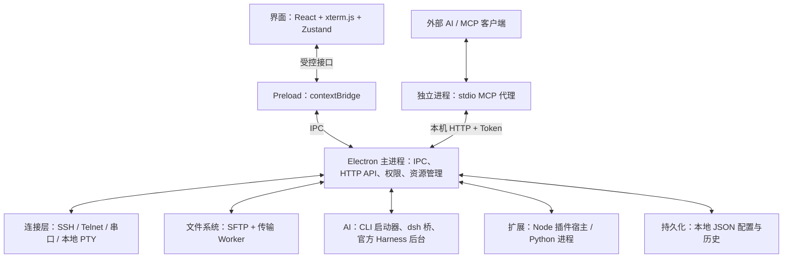

# LyShell 系统架构

整理日期：2026-10-28。本文依据当前工作区源码，说明系统分层、进程关系和主要数据流；技术版本以 `package.json` 为准。

## 1. 总体设计

LyShell 采用 Electron 多进程架构，以主进程为控制中心，把终端、文件传输、AI 和插件整合成一个桌面工作台。

系统有两条主要入口：用户通过图形界面操作，AI 或外部工具通过 MCP / HTTP API 操作。两条路径最终复用主进程中的业务服务。



图中连接层、文件系统等是逻辑模块。实际执行既包括主进程内服务，也包括子进程与 Worker 线程。

当前技术栈包括 Electron 43、React 18、TypeScript 5、xterm.js、Zustand、TailwindCSS 和 electron-vite。

## 2. 源码分层

```text
src/
├── main/        # 主进程：连接、文件、IPC、MCP、AI、插件和存储
├── preload/     # 界面与主进程之间的受控桥接
├── renderer/    # React 界面、终端显示、布局和界面状态
└── shared/      # 跨进程类型、常量和接口契约
```

| 层 | 主要职责 |
|---|---|
| 界面层 `src/renderer` | 展示终端、分屏、文件管理、网页、AI 工作台和任务暂存架；Zustand 管理界面状态。 |
| 桥接层 `src/preload` | 通过 `contextBridge` 暴露受控接口，把界面请求转换为 IPC 调用，并转发主进程事件。 |
| 主进程 `src/main` | 管理窗口、连接、文件、子进程、权限、插件和配置，协调资源生命周期。 |
| 共享层 `src/shared` | 定义会话、布局、插件、Harness 任务等跨进程类型与接口契约。 |

界面状态由渲染层管理，真实连接与资源生命周期由主进程管理，Harness 任务执行状态则以官方 dsh 后台事件为依据。

## 3. 终端与连接系统

`SessionManager` 统一管理会话，根据连接类型创建 Connector。连接器继承 `BaseConnector`，提供连接、断开、写入、调整尺寸等统一接口。

| 连接器 | 底层能力 |
|---|---|
| `SSHConnector` | 使用 `ssh2` 建立 SSH 连接与终端通道。 |
| `TelnetConnector` | 建立 Telnet 连接并处理协议交互。 |
| `SerialConnector` | 使用 `serialport` 访问串口设备。 |
| `LocalConnector` | 使用 `node-pty` 启动本地 Shell；当前工作区也实现了独立 PTY 宿主路径。 |

终端输入路径：

```text
xterm.js
  → Preload
  → IPC 参数校验与处理
  → SessionManager
  → Connector
  → 本地 Shell / 远端设备
```

输出反向返回界面，同时进入 `OutputBuffer`，供 MCP 读取。图形输出经过分包、确认与背压控制，限制慢消费者造成的积压。

独立本地 PTY 宿主通过命名管道或 Unix socket 与主进程通信，支持终端界面与后台进程分离、重新附着。收纳任务的保活范围不跨应用正常退出。

## 4. 文件管理与传输

文件管理模块位于 `src/main/file`，内置远端文件操作与传输使用 SFTP。

上传和下载由 Worker 线程承载，主进程负责调度、任务生命周期、取消和进度转发，渲染层显示文件列表与传输队列。

普通 SSH 命令使用独立的命令执行通道，与 SFTP 传输路径分开。

## 5. AI 子系统

### 5.1 CLI 启动方式

LyShell 配置工作目录、环境变量和模型参数，在本地终端启动 Codex、Claude、dsh 等工具。相关模块主要位于 `src/main/harness`。

### 5.2 原生 Harness 工作通道

原生任务的调用路径如下：

```text
外部调用方
  → lyshell_harness_work / HTTP work API
  → 主进程鉴权、参数校验与归属管理
  → LyShell dsh 桥
  → 官方 Harness 后台
  → 模型调用与工具执行
```

两侧职责如下：

| 部分 | 职责 |
|---|---|
| LyShell 管理层 | 启动配置、后台进程与租约、调用凭据隔离、会话归属、任务跟踪和审批转发。 |
| 官方 dsh 执行层 | 模型调用、工具实际执行、执行权限策略，以及真实回合的开始和结束事件。 |

同一调用凭据可以拥有多个并行会话，每个会话最多一个活动任务。任务通过后台实例身份、`sessionId` 和 `taskId` 精确跟踪；接收任务的回执与任务完成状态分别处理。

原生工作通道与 PetLink 可以共用官方后台，但使用独立的会话归属、任务控制和审批绑定。

详细契约见 [原生 Harness 工作接口](native-harness-work.md)。

## 6. MCP 与外部自动化

MCP 接入分为两层：

1. `src/main/mcp-server`：独立的 stdio MCP 代理进程，负责 MCP 协议与工具调用转发。
2. `src/main/mcp/http-server.ts`：主进程内的本机 HTTP 服务，在 `127.0.0.1` 的随机端口监听，负责鉴权、授权与业务调用。

外部 AI 可以通过这些接口管理会话、发送输入、读取输出、操作文件和提交 Harness 任务。接口复用主进程中的连接与文件服务。

授权依据调用凭据和能力权限，例如读取、交互输入、远端执行、本地执行、文件写入和会话控制。

终端文本读取使用 PTY 输出及 ANSI 处理后的缓冲内容；全屏 TUI 的真实显示交互由图形终端承担。

## 7. 插件与 Python 扩展

插件扩展由宿主、视图和权限管理组成：

- Node 插件运行在独立于 Electron 主进程的插件宿主子进程中；宿主可承载多个插件，也有一次性任务入口。
- Python 脚本和插件由 Python 进程执行。
- 插件页面使用带专用 Preload 的隔离 webview。
- 插件通过获授能力的专用 Token 调用主进程服务，主进程负责资源登记及禁用、卸载时的清理。

进程隔离与页面沙箱承担不同职责：插件宿主的进程分离不等同于为插件代码提供操作系统级沙箱。

## 8. 持久化与安全边界

持久化主要采用 `userData` 下的 JSON 文件，保存连接配置、用户偏好、Agent 定义、环境变量组、工作区和历史等数据。SSH 敏感字段使用 Electron `safeStorage` 加密保存。

主要安全边界包括：

- 主界面启用 `sandbox`、`contextIsolation`，关闭 `nodeIntegration`，通过 Preload 访问主进程能力。
- IPC 和 HTTP 请求在主进程侧进行输入校验。
- HTTP API 使用 Token 鉴权，并按调用凭据和操作能力授权。
- 插件页面的身份、导航和可用能力由宿主侧校验。
- 连接、Worker、插件宿主及 dsh 后台均由对应管理模块负责生命周期与退出清理。

## 9. 源码阅读入口

| 主题 | 入口 |
|---|---|
| 依赖与版本 | [package.json](../package.json) |
| 构建与进程入口 | [electron.vite.config.ts](../electron.vite.config.ts) |
| 应用启动与窗口 | [src/main/index.ts](../src/main/index.ts) |
| 界面与主进程桥接 | [src/preload/index.ts](../src/preload/index.ts) |
| IPC 处理与校验 | [handlers.ts](../src/main/ipc/handlers.ts)、[validation.ts](../src/main/ipc/validation.ts) |
| 会话与连接 | [session-manager.ts](../src/main/terminal/session-manager.ts)、[base.ts](../src/main/connectors/base.ts) |
| 终端输出与背压 | [output-dispatcher.ts](../src/main/terminal/output-dispatcher.ts) |
| 本地 PTY 宿主 | [local-host-client.ts](../src/main/terminal/local-host-client.ts)、[local-host-worker.ts](../src/main/terminal/local-host-worker.ts) |
| SFTP Worker 调度 | [download-worker-manager.ts](../src/main/file/download-worker-manager.ts)、[upload-worker-manager.ts](../src/main/file/upload-worker-manager.ts) |
| MCP 代理与 HTTP 服务 | [mcp-server/index.ts](../src/main/mcp-server/index.ts)、[http-server.ts](../src/main/mcp/http-server.ts) |
| Harness 启动配置 | [harness/config.ts](../src/main/harness/config.ts) |
| dsh 后台与工作通道 | [dsh/web.ts](../src/main/dsh/web.ts)、[dsh/bridge.ts](../src/main/dsh/bridge.ts)、[dsh/work.ts](../src/main/dsh/work.ts) |
| 官方后台侧桥包 | [resources/dsh-bridge/index.mjs](../resources/dsh-bridge/index.mjs) |
| 插件宿主管理 | [plugin/host-mgr.ts](../src/main/plugin/host-mgr.ts) |
| 本地配置与凭据存储 | [storage/repository.ts](../src/main/storage/repository.ts) |
